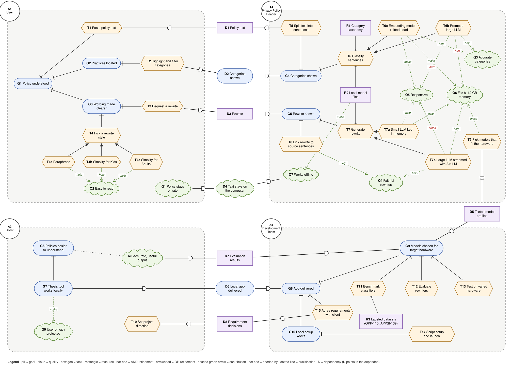
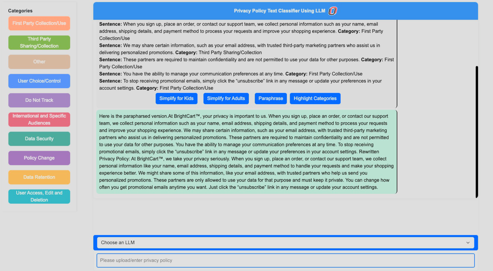
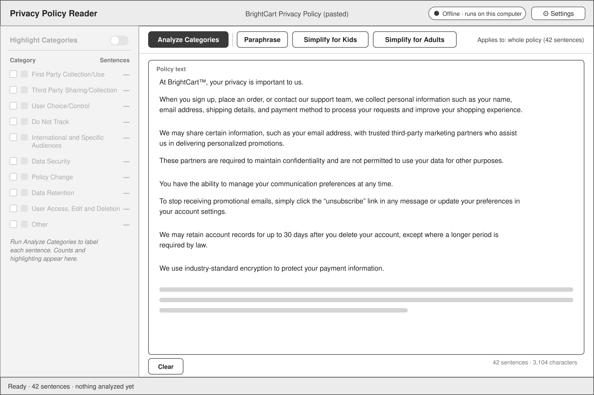
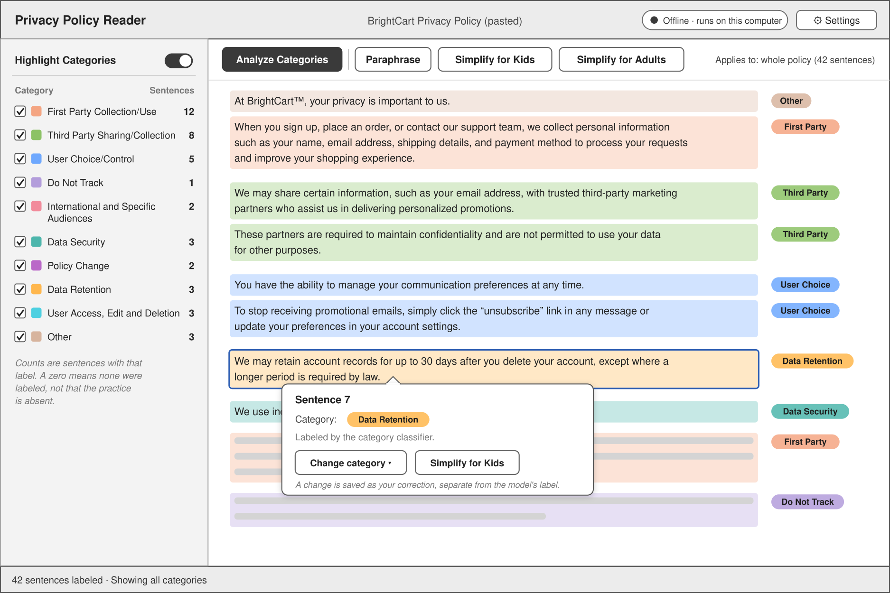
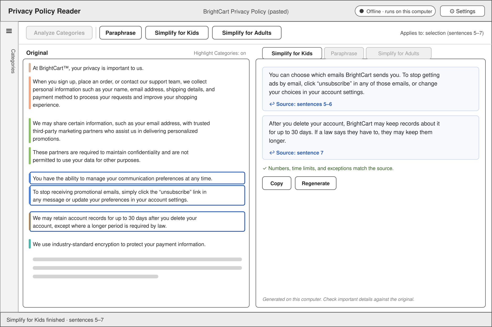
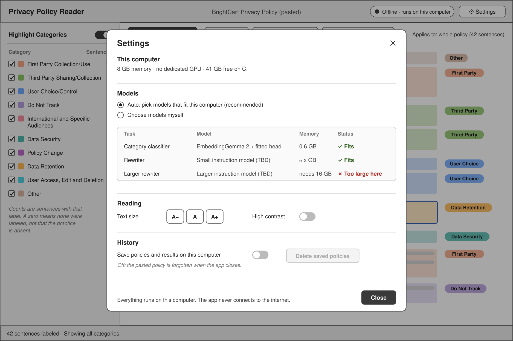
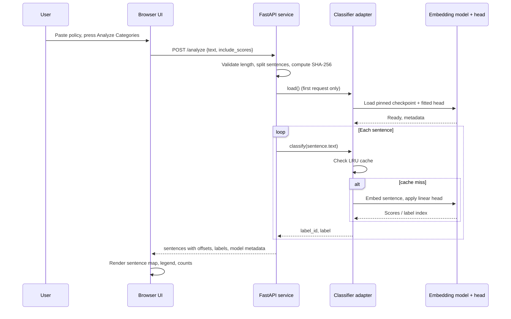
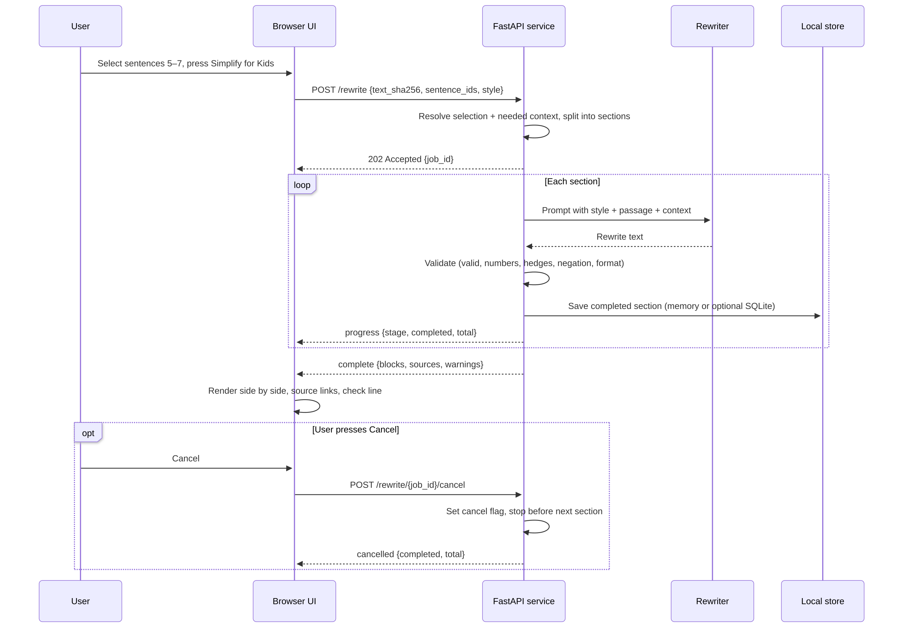

# UNO Privacy Capstone

**Privacy Policy Reader**

*One-liner description:* Privacy Policy Reader is a local-first web app that labels every sentence of a privacy policy with one of ten privacy-practice categories and rewrites hard passages into plain language without sending the policy off the user's computer.

**Team members:**

- Dade Larsen
- Tim Pippin
- Ethan McGee
- Nathan Johnson

**Sponsor:**

Professor Alfredo Perez

Instructor for Capstone course

**Document status.** This file is draft content for Chapters 1–5 of the final report, current through November 13, 2026. Chapter 6 (Summary), Chapter 7 (Local and Global Impacts), and the Appendices are intentionally blank. Section 3.9 (Screenshots) and Section 4.1 (Directory Structure) are intentionally skipped for now. Statements marked **Implemented**, **Prototype**, or **Planned** describe the state of the repository at that date.


---

## Table of Contents

1. Introduction
   1. Motivation
   2. Similar Applications
   3. Theoretical Foundations of the Project
   4. Software Engineering Challenges
   5. System Context
2. Requirements
   1. Goals
   2. Functional Requirements
   3. Wireframes
   4. Object Model
   5. Nonfunctional Requirements
   6. Analysis Requirements
   7. External System Interfaces
   8. Requirements Not Implemented
3. Architecture and Design
   1. Overview
   2. Logical Decomposition View
   3. Technology Stack
   4. Deployment View
   5. Development View
   6. Data View
   7. Concurrency View
   8. Execution Flow View
   9. Screenshots
   10. Summary of Design Changes
   11. Design Modularity and Extensibility
4. Implementation
   1. Directory Structure
   2. Technical Issues Encountered
   3. User-Reported Bugs
5. Testing
   1. Test Plan
   2. Obtaining Realistic Test Data
   3. Tests Conducted
   4. Test Results
   5. Automated Test Outputs
   6. Tests Not Conducted
6. Summary
7. Local and Global Impacts
8. Appendix
9. References

---

# 1. Introduction

## 1.1 Motivation

Privacy policies are the main channel through which companies explain what they do with personal data, yet they are long, legalistic, and rarely read. McDonald and Cranor (2008) estimated that reading every privacy policy a typical Internet user encounters in a year would take hundreds of hours. The practical result is that people consent to practices they do not understand: which data is collected, who receives it, how long it is kept, and what choices they have.

Several kinds of tools try to close that gap. Research systems such as Polisis classify policy text and present privacy icons or answer questions (Harkous et al., 2018); browser extensions such as PrivacyCheck summarize a policy into risk levels (Zaeem et al., 2018); and crowdsourced projects such as ToS;DR rate terms and policies by hand (ToS;DR, n.d.). Most of them depend on a server, a network connection, or human curation. General-purpose chat assistants can produce a fluent summary, but the user must upload the policy to a cloud service and has no reliable way to check the summary against the source.

This project starts from a different constraint: **the policy should never leave the user's computer**. Privacy policies can reveal what apps a person uses, what health or financial services they rely on, their location, and their household situation. Uploading that text to a third party creates exactly the kind of trust and confidentiality problem the document is supposed to address. A local tool also works on a plane, in a library, or on a locked-down machine, and it does not require an account, a subscription, or a network connection after setup.

The project is a capstone for Professor Alfredo Perez and rebuilds the classify-and-rewrite tool from the parent thesis so that it runs on an ordinary laptop. The app must do two things well:

1. **Classify** every sentence of a pasted policy into one of ten privacy-practice categories, then let the reader highlight and filter those categories.
2. **Rewrite** a selected passage, or the whole policy, in one of three styles—**Paraphrase**, **Simplify for Kids**, and **Simplify for Adults**—without dropping conditions, numbers, or hedges such as *may*, *only*, *except*, and *knowingly*.

The engineering motivation is therefore as important as the privacy motivation. A useful version must fit in 8–12 GB of total memory on a computer with no dedicated GPU, start quickly, stay responsive, and produce output faithful enough that a reader is not misled. Choosing and evaluating models under those constraints is the core of the work; packaging the app as an installer was explicitly deprioritized with the client so that the team could spend its time on model quality.

## 1.2 Similar Applications

The table compares the closest existing tools. The last column is the gap this project targets.

| Tool | What it does | How this project differs |
| --- | --- | --- |
| **Polisis / PriBot** (Harkous et al., 2018) | A deep-learning framework that annotates policy segments with high-level and fine-grained privacy classes, draws privacy icons, and answers free-form questions. Research prototype with web and browser-extension front ends. | Polisis runs models server-side and does not rewrite text into plain language. This project runs on the user's machine, classifies each sentence into the thesis's ten categories, and links every rewrite back to its source sentences. |
| **PrivacyCheck** (Zaeem et al., 2018) | A browser extension that uses data-mining models to answer ten privacy questions and show red/yellow/green risk icons; later versions add GDPR questions and competitor comparison. | PrivacyCheck sends processed policy text to a server, summarizes at the policy level, and does not offer sentence-level highlighting or rewriting. This project is offline, sentence-level, and rewrite-oriented. |
| **ToS;DR** (ToS;DR, n.d.) | A crowdsourced project that breaks terms of service and privacy policies into small points, attaches evidence, and assigns a class from A (best) to E (worst). | ToS;DR depends on human curators and grades policies rather than explaining their sentences. This project automates the reading aid and keeps the original text visible beside every result. |
| **The parent thesis tool** | The direct precursor: a classify-and-rewrite interface with the same ten categories and the four actions that inspired this app's three rewrite styles. | The thesis tool assumed larger models and did not target a low-memory, offline laptop. This project rebuilds the pipeline around small local models and evaluates the trade-offs explicitly. |
| **General LLM assistants** (ChatGPT, Copilot, Gemini, etc.) | Produce fluent summaries or explanations of pasted text. | They require uploading the policy, give no guaranteed source-sentence traceability, can change meaning without warning, and do not work offline. |
| **Commercial privacy-compliance platforms** (e.g., OneTrust, TrustArc, Transcend) | Organizational tools for policy management, consent, data mapping, and compliance reporting. | They are built for companies and compliance teams, are cloud-based, and do not give an individual reader a local, sentence-level explanation with plain-language rewrites. |

The closest competitor is the parent thesis itself. The contribution here is not a new taxonomy; it is a **local implementation and an evidence-based model choice** for hardware that ordinary users actually own, plus an interface that keeps the source text and the generated rewrite side by side so the reader can verify the result.

## 1.3 Theoretical Foundations of the Project

**Privacy-policy annotation and taxonomy.** The ten categories come from the OPP-115 corpus and its annotation scheme (Wilson et al., 2016). OPP-115 labels sentences from website privacy policies with practices such as first-party collection and use, third-party sharing, user choice, data security, and retention. The project maps OPP-115's twelve labels onto ten categories, including an **Other** category for introductions, scope statements, contact information, and practices outside the nine substantive categories. The APPSI-139 corpus provides a second, independent source of app-policy sentences annotated by legal experts (Zhu et al., 2026). Using two corpora matters because a model tuned on website policies can behave differently on app policies; the project treats APPSI-139 as the main test of transfer.

**Sentence classification with frozen embeddings.** The leading classifier is a linear head on top of sentence embeddings from EmbeddingGemma 2 (Google DeepMind, n.d.). Sentence embeddings turn a sentence into a fixed-length vector; a logistic-regression head learned on labeled sentences then predicts a category. This is a form of transfer learning: the large embedding model is frozen, and only a small, cheap classifier is trained. It follows the sentence-transformers approach (Reimers & Gurevych, 2019) and the broader Transformer stack (Wolf et al., 2020). Class weighting and **prior shift** adjust the head for the category mix of the target corpus, since a classifier trained on a balanced sample otherwise over-predicts rare categories on real policies. McNemar's test (McNemar, 1947) is used to decide whether small accuracy differences between two classifiers are beyond chance.

**Quantized local inference.** Generative rewriters are too large to run at full precision on an 8–12 GB laptop. The project uses 4-bit NF4 quantization (Dettmers et al., 2023) through bitsandbytes and Accelerate, and parameter-efficient adapters through PEFT where relevant (Mangrulkar et al., 2022). Quantization trades a small amount of accuracy and some memory overhead for a large reduction in model size, which is what makes a 4-billion-parameter rewriter plausible on the target hardware.

**Faithfulness and readability.** A rewrite is not a summary. The project treats it as a meaning-preserving transformation: facts, conditions, exceptions, numbers, named parties, negations, and hedges must survive. Readability is measured with Flesch–Kincaid grade level (Kincaid et al., 1975), and copying is measured with the copied-run length used by Grusky et al. (2018). Because automatic word checks cannot tell whether a promise survived, the evaluation also uses a blind AI judge and per-passage key-point checklists; the judge must quote the rewrite for every problem it reports. This combines automatic checks, which are cheap enough to run in the app, with a slower semantic review.

**Requirements and evaluation foundations.** The goal model follows i* strategic rationale modeling (Yu, 1995) and is drawn with piStar (Pimentel & Castro, n.d.). Nonfunctional requirements use Goal–Question–Metric analysis (Basili et al., 1994), and priorities use MoSCoW (Clegg & Barker, 1994). Privacy by design (Cavoukian, 2009) motivates local processing, data minimization, and the absence of telemetry. Accessibility targets WCAG 2.2 AA (W3C, 2023), including keyboard operation and never relying on color alone.

The project therefore sits at the intersection of privacy usability, applied natural language processing, and resource-constrained software engineering: a taxonomy and annotation literature supplies the labels, embedding and quantization techniques supply the models, and empirical evaluation supplies the evidence that the result is accurate, faithful, and fast enough to use.

## 1.4 Software Engineering Challenges

**Model quality under a hard memory ceiling.** The target is an 8–12 GB laptop with no dedicated GPU. The app's peak memory should stay under 6 GiB so the operating system and other applications still fit. A prompted 14-billion-parameter classifier is accurate, but it needs 10–16 GiB and is 10–30× slower per sentence. A small embedding model with a fitted head is fast and small, but its accuracy depends on the training mix and may not transfer from website policies to app policies. The team must choose models on evidence rather than intuition.

**Faithfulness is hard to measure and easy to get wrong.** There is no reference rewrite for a policy passage. A rewrite that reads well can still turn *“we do not knowingly collect data from children under 13”* into *“we do not collect data from children under 13”*—a meaningful change. The project needs automatic checks for numbers, hedges, negations, and copied text, plus a slower semantic review using key-point checklists and a blind judge. The checklist itself needs human review, and the judge can be biased by the same model family that wrote the instructions.

**Reproducibility.** Model behavior changes with library versions. Moving JEV-9B from transformers 5.16.1 to 5.19.0 made it 1.6–2.3× faster and shifted its logits; two near-ties flipped. Every run must therefore record the git commit and dirty diff, the interpreter and platform, the full package list, the resolved model revision, and the hashes of frozen data. Fitted heads are pinned by SHA-256 and checked before loading. Without this discipline, a result cannot be reproduced or defended.

**Offline setup and distribution.** The app may not download anything at runtime. Model weights must be fetched once during setup, stored in the local Hugging Face cache, and loaded from local paths with offline mode enabled. Missing files must produce a clear error that points to setup, never a silent download. Model licenses also matter: the setup downloads from the original source rather than redistributing weights, and each license must permit the intended use.

**Hardware heterogeneity.** The service runs on an NVIDIA GPU in bf16 when the GPU supports native bf16, and on the CPU in fp32 otherwise. A head fitted on bf16 embeddings must still produce acceptable labels in fp32. Older NVIDIA cards emulate bf16, which is not the same as native support, so detection must exclude emulation. AMD, Intel, and Apple GPUs currently fall back to the CPU. Performance on an actual low-memory laptop is still unmeasured.

**Integration and alignment.** The browser must highlight the original text, not a re-split copy. That requires the Python service to return exact character offsets for every sentence, and the UI to render spans against the unchanged policy. The current frontend uses its own regular-expression splitter and hard-coded categories, so wiring it to the service is a real integration task, not just a `fetch` call. The two processes also need a localhost-only contract, CORS rules, error handling, progress reporting, and cancellation.

**Evaluation data and annotation cost.** Category boundaries are sometimes ambiguous; a sentence about sharing an email address with a marketing partner can be both first-party use and third-party sharing. The datasets disagree on what **Other** means. Building a trustworthy test set requires accepted labels, reviewer notes, and policy-level separation between tuning and test data. Rewrite evaluation requires passages with conditions, numbers, and exceptions, plus checklists that a person has reviewed.

**Scope and project constraints.** The team has four members and one semester. The client asked the team to prioritize model choice over packaging, so there is no installer, no accounts, no cloud sync, and no PDF import. The remaining work is concentrated in three risky places: wiring the UI to the service, choosing and integrating a rewriter, and validating performance on the target hardware.

## 1.5 System Context

The system is a **single-user, single-machine, offline web app**. A browser window presents the interface; a local Python process runs the models; model files and frozen research data live on disk. Nothing is sent over the network at runtime, and there is no server-side account or database.

```text
+--------------------------- User's computer -----------------------------+
|                                                                         |
|  Browser (React + Vite)          Python model service (FastAPI)         |
|  http://localhost:5173  <----->  http://127.0.0.1:8000                  |
|        |                                   |                            |
|        | reads/writes UI state             | loads pinned models        |
|        v                                   v                            |
|  In-memory policy, labels,        Hugging Face cache + fitted head      |
|  rewrites, settings               + taxonomy + prompt files             |
|                                                                         |
|  Optional future: local SQLite history (off by default)                 |
+-------------------------------------------------------------------------+

No outbound network after setup. No accounts. No telemetry. No cloud API.
```

### Subject Facet

The subject is the **consumer privacy policy and the data practices it describes**. The app represents a policy as an ordered set of sentences with stable IDs and character offsets. Each sentence may carry a category label, a user correction, and one or more rewrites. Categories are the ten thesis categories, each with a definition and a display color. Rewrites are tied to the sentences they came from and to the style and model that produced them. A model profile records which model and hardware produced a result. An organization may be associated with a policy, but only as a name for now.

The subject facet deliberately stops short of legal compliance analysis. The app does not decide whether a policy is lawful, does not extract every data practice into a structured record, and does not replace the policy. It helps a reader locate and understand what the policy says. That boundary keeps the taxonomy tractable and avoids implying legal advice.

### Usage Facet

The primary user is someone trying to understand a policy, with no assumed legal or technical background. A secondary user is the client, who reviews whether the output is accurate and useful. The development team maintains the app and the model benchmark.

A typical session is short and task-oriented:

1. Paste a policy, open a `.txt` file (Could), or load the built-in example (Could).
2. Press **Analyze Categories**; the app splits the text into sentences and labels each one.
3. Turn on **Highlight Categories**, read the legend and counts, and filter to the categories of interest.
4. Click a sentence to inspect or correct its label (Planned).
5. Select sentences, or leave the selection empty to rewrite the whole policy, then choose **Paraphrase**, **Simplify for Kids**, or **Simplify for Adults**.
6. Watch progress, cancel if needed, and read the rewrite beside the original with source links.
7. Copy or regenerate a rewrite; optionally save the session to local history (Planned).

The context of use is a laptop or desktop, often offline, usually one person at a time, in a browser. Accessibility matters: the interface must work from the keyboard, keep contrast at WCAG 2.2 AA, and never rely on color alone to convey a category.

### IT Facet

| Tier | Components | Notes |
| --- | --- | --- |
| Client | React 19 + TypeScript single-page app, built with Vite; served on `localhost:5173` in development or `localhost:4173` for preview | Uses the browser's `fetch`; no Electron or native shell. |
| Application | FastAPI + Uvicorn on `127.0.0.1:8000`; routes `/health`, `/categories`, `/analyze`, `/analyze/upload` | Sync route handlers run in a thread pool; one model instance, guarded by a lock. |
| Model | PyTorch 2.8, transformers 5.19, sentence-transformers 6.1, bitsandbytes, Accelerate, PEFT, scikit-learn | Classifier: EmbeddingGemma 2 plus a fitted linear head. Rewriter: Qwen3.5-4B NF4 is the leading candidate, not yet integrated. |
| Data | In-memory LRU cache (4,096 sentences), frozen taxonomy JSON, condition TOML, fitted weights, model snapshots | No database today. Optional SQLite history is planned. |
| Network | Loopback only; CORS allowlist for the Vite dev and preview origins | The service refuses a non-loopback bind address. |

The model service reuses the `privacy_bench` package from `privacy-research/` rather than loading models itself. A **condition** file pins the checkpoint, the fitted head, the instruction prefix, the label order, and the device. This reuse is an architectural decision: it keeps the app and the benchmark on exactly the same inference path, so a model that wins a benchmark is the model that runs in the app.

### Development Facet

The project is developed by four students in a capstone course, with the sponsor as client. Work is organized in a GitHub repository (`dadeLarsen/UNO-Privacy-Capstone`) with feature branches and pull requests; the repository history includes merged PRs for the model service and the rewrite task. The repository contains three Python/TypeScript subprojects:

- `privacy-research/`: the `privacy_bench` benchmark, frozen datasets, conditions, fits, prompts, run records, comparisons, and tests.
- `modelService/`: the local FastAPI service, its tests, and its own `uv` environment. It depends on `privacy-research` by path.
- `frontend/`: the React/TypeScript interface, currently a visual scaffold.

Development conventions favor reproducibility: every Python dependency is pinned, conditions and fits are files rather than code, frozen data is hashed, and generated results are separated from tracked results. Tests run offline: the service tests use a fake classifier, and the benchmark tests build tiny models on the CPU. There is no CI pipeline yet; checks are run locally.

The development risks are concentrated in the integration phase, because the three subprojects were built somewhat independently. The frontend has its own category list, sentence splitter, and example labels; the service has the authoritative taxonomy and offsets. The first integration task is to remove that duplication and make `/categories` and `/analyze` the only sources of truth.

### Legal/Ethical Facet

**Privacy and data minimization.** The policy text is processed locally and is not logged. The service logs error types and timings, not policy text or prompts. There are no accounts, no telemetry, no update checks, and no cloud calls. Saved history is off by default and deletable. The service binds to loopback only so other machines cannot reach it.

**Accuracy and the risk of misleading a reader.** A wrong category or an unfaithful rewrite can cause real harm: a reader might believe data is deleted when it is only retained for a limited time, or that a promise is absolute when it is qualified by *may* or *knowingly*. The design mitigates this by keeping the original text visible, linking every rewrite to its source sentences, flagging changed numbers and hedges, and labeling output as an aid rather than legal advice. The app should show uncertainty rather than hide it.

**Intellectual property and licenses.** Models are downloaded from their original sources under their own licenses (for example, the Gemma Terms of Use for EmbeddingGemma 2; Google, n.d.). Datasets such as OPP-115 and APPSI-139 have their own terms and attribution requirements. The team does not redistribute model weights or datasets beyond what their licenses allow, and it records the source and revision of every artifact.

**Accessibility and equity.** The app targets readers who may not have a powerful computer or a reliable connection. Running offline on 8–12 GB hardware is an equity decision, not only a technical one. WCAG 2.2 AA, keyboard operation, high contrast, and adjustable text size are requirements rather than polish.

**Research ethics.** The planned reader study (AR-04) would involve outside participants and may need IRB approval. Rewrite evaluation uses an AI judge, which can share blind spots with the model that drafted the checklists; the limitations are documented, and a human review of the checklists is required before the results are treated as final. No real user policies are collected without consent, and any example policy is either public or synthetic.

---

# 2. Requirements

## 2.1 Goals

### 2.1.1 Goal Model

Figure 1 is the strategic rationale (SR) model for four actors: the user, the client, the app, and the development team. Dependums D1–D8 carry the dependencies between actors. The model is drawn with piStar from `docs/requirements-figures/goal-model-pistar.txt`; the exported SVG is `goal-model.svg`, and the PNG used in this report is `goal-model.png`.



*Figure 1. SR goal model for the Privacy Policy Reader.*

The main trade-offs sit inside the app. For classification, a small embedding model with a fitted head (T6a) is fast and small, while a prompted large language model (T6b) is at most a few points more accurate at many times the time and memory. For rewriting, AirLLM layer streaming (T7b) fits in little memory but is far too slow to use interactively, so a small model kept in memory (T7a) is the working assumption. The client asked the team to prioritize choosing models that work (G9) over packaging, so the app runs from the repository as a local web app after a one-time setup (G10, NFR-08).

### 2.1.2 Goal Descriptions

IDs: **A** actor, **G** goal, **Q** quality, **T** task, **R** resource, **D** dependum.

**Actors**

| ID | Actor | Description |
| --- | --- | --- |
| A1 | User | Someone trying to understand a privacy policy. No legal or technical background is assumed. |
| A2 | Client | Dr. Alfredo J. Perez. Directs the functional requirements and judges whether the output is accurate and useful. |
| A3 | Development team | Ethan McGee, Dade Larsen, Tim Pippin, and Nathan Johnson. |
| A4 | Privacy Policy Reader | The app: a local web app that runs entirely on the user's computer. |

**A1 User**

| ID | Element | Description |
| --- | --- | --- |
| G1 | Policy understood | The user knows what the policy says about their data: what is collected, who gets it, how long it is kept, and what choices they have. |
| G2 | Practices located | The user can find the sentences about a practice without reading the whole policy. |
| G3 | Wording made clearer | The user gets hard passages in plainer language. |
| Q1 | Policy stays private | Nothing the user pastes leaves their computer. |
| Q2 | Easy to read | Rewrites are easier to read than the source. |
| T1 | Paste policy text | Paste the policy into the app. |
| T2 | Highlight and filter categories | Turn on category highlighting and narrow it to the categories of interest. |
| T3 | Request a rewrite | Ask the app to rewrite a passage or the whole policy. |
| T4 | Pick a rewrite style | Choose Paraphrase, Simplify for Kids, or Simplify for Adults. |
| T4a | Paraphrase | Restate the passage in clearer, neutral wording with about the same detail. |
| T4b | Simplify for Kids | Restate the passage so a younger reader can follow it. |
| T4c | Simplify for Adults | Restate the passage in plain language for a reader without a legal background. |

**A4 Privacy Policy Reader**

| ID | Element | Description |
| --- | --- | --- |
| G4 | Categories shown | Every sentence has a category, and the app can highlight it. |
| G5 | Rewrite shown | A rewrite appears next to the passage it came from. |
| Q3 | Accurate categories | Labels match what a careful reviewer would accept. |
| Q4 | Faithful rewrites | Rewrites keep the source's facts, conditions, numbers, and hedges and add nothing. |
| Q5 | Responsive | Results arrive quickly and the interface never freezes. |
| Q6 | Fits 8–12 GB memory | Runs on an ordinary laptop or desktop alongside other apps. |
| Q7 | Works offline | After a one-time setup, no internet connection is needed to start the app or use any feature. |
| T5 | Split text into sentences | Keep the original text unchanged and give each sentence a stable ID and position. |
| T6 | Classify sentences | Give each sentence one of the ten categories (R1). |
| T6a | Embedding model + fitted head | A small sentence-embedding model with a linear head trained on labeled sentences. Current lead: EmbeddingGemma 2, about 0.04 s per sentence and 0.6 GiB. |
| T6b | Prompt a large LLM | Ask a chat model such as Qwen3-14B for the category. Similar accuracy, but 10–30× slower and 10–16 GiB. |
| T7 | Generate rewrite | Produce the requested rewrite with a local generative model. |
| T7a | Small LLM kept in memory | A model small enough to stay loaded between requests. Not chosen yet (AR-02). |
| T7b | Large LLM streamed with AirLLM | Load a larger model layer by layer from disk. Fits in little memory but measured far too slow (Section 2.8). |
| T8 | Link rewrite to source sentences | Each rewritten block records the sentences it came from, so the reader can check it. |
| T9 | Pick models that fit the hardware | Detect memory and GPU, then choose model profiles tested for that hardware. |
| R1 | Category taxonomy | The ten thesis categories, each with a one-sentence definition (FR-04). |
| R2 | Local model files | Model weights and tokenizers, pinned by commit and downloaded once during setup. |
| R3 | Labeled datasets | OPP-115 and APPSI-139 sentences with category labels. |

**A2 Client**

| ID | Element | Description |
| --- | --- | --- |
| G6 | Policies easier to understand | The research goal behind the original thesis. |
| G7 | Thesis tool works locally | The thesis's classify-and-rewrite tool, rebuilt to run on the user's own computer. |
| Q8 | Accurate, useful output | Categories and rewrites are correct and actually help readers. |
| Q9 | User privacy protected | Running locally keeps policies, and what they reveal about the user, private. |
| T10 | Set project direction | Answer scope questions and review results in client meetings. |

**A3 Development Team**

| ID | Element | Description |
| --- | --- | --- |
| G8 | App delivered | The app is built, tested, and handed to the client. |
| G9 | Models chosen for target hardware | Classifier and rewriter chosen on evidence for each hardware tier. |
| G10 | Local setup works | The app runs from the repository on the user's computer after one setup. |
| T11 | Benchmark classifiers | Compare candidate classifiers on accuracy, speed, and memory (AR-01). |
| T12 | Evaluate rewriters | Review candidate rewriters for faithfulness and readability (AR-02). |
| T13 | Test on varied hardware | Measure speed and memory on each hardware tier (NFR-03, NFR-04). |
| T14 | Script setup and launch | One setup step installs dependencies and downloads pinned models; one command starts the app. |
| T15 | Agree requirements with client | Settle open scope questions with the client. |

**Dependencies**

| ID | Dependum | Depender → dependee | Description |
| --- | --- | --- | --- |
| D1 | Policy text | App → User | The app needs the text to analyze. |
| D2 | Categories shown | User → App | The user relies on the app to label and highlight sentences. |
| D3 | Rewrite | User → App | The user relies on the app for rewrites. |
| D4 | Text stays on the computer | User → App | The user relies on the app not to send the policy anywhere. |
| D5 | Tested model profiles | App → Team | The app needs models tested for its hardware tier. |
| D6 | Local app delivered | Client → Team | The client relies on the team to deliver the app. |
| D7 | Evaluation results | Client → Team | The client relies on the team for evidence that the output is accurate and useful. |
| D8 | Requirement decisions | Team → Client | The team needs the client's decisions on open scope questions (FR-07, FR-11, FR-26). |

## 2.2 Functional Requirements

Each requirement is written as **ID [MoSCoW] user story**, followed by the detail needed to test it. Priorities follow MoSCoW: Must, Should, Could, Won't.

### 2.2.1 Entering a Policy

| ID | Priority | Requirement |
| --- | --- | --- |
| FR-01 | Must | As a user, so that I can understand a privacy policy, I want to paste its text into the app. *(G1, T1, T5)* |
| FR-02 | Could | As a user, so that I don't have to copy and paste, I want to open a `.txt` file. *(G1, T1)* |
| FR-03 | Could | As a user, so that I can try the app before I have a policy at hand, I want to load an example policy that comes with the app. *(G1)* |

**FR-01 detail.** The app keeps the pasted text exactly as entered, paragraph breaks included, and splits it into sentences. Every label and rewrite points back to that text by character offset. Editing the text clears the results that depended on the changed sentences. The service rejects text over 200,000 characters and text with no sentences.

**FR-02 detail.** Upload accepts UTF-8 `.txt` only. A non-`.txt` file returns HTTP 415; invalid UTF-8 returns 400. PDF, DOCX, and OCR are explicitly out of scope because extraction can lose headings, columns, and footnotes, changing meaning.

### 2.2.2 Categories

| ID | Priority | Requirement |
| --- | --- | --- |
| FR-04 | Must | As a user, so that I can find what the policy says about each practice, I want each sentence labeled with one of ten categories. *(G2, G4, T6, R1)* |
| FR-05 | Must | As a user, so that I can see at a glance which parts of the policy cover which practice, I want a **Highlight Categories** toggle that shades each sentence in its category's color, with a legend. *(G2, T2)* |
| FR-06 | Should | As a user, so that I can focus on one practice, I want to filter highlights by category and see how many sentences each category has. *(G2, T2)* |
| FR-07 | Could | As a user, so that an ambiguous sentence isn't forced into one category, I want it to show every category that clearly applies. *(G2, Q3, D8)* |
| FR-08 | Could | As a user, so that I can fix a label I think is wrong, I want to change a sentence's category. *(G2, Q3)* |

**FR-04 categories.** First Party Collection/Use; Third Party Sharing/Collection; User Choice/Control; Do Not Track; International and Specific Audiences; Data Security; Policy Change; Data Retention; User Access, Edit and Deletion; Other. Each has a one-sentence definition in `modelService/src/model_service/taxonomy.json`. The taxonomy is versioned (`opp115-10-other`, version 1) so results can be cached and compared across versions.

**FR-05 scenario.**

```gherkin
Scenario: Highlighting after analysis
  Given the BrightCart policy has been analyzed
  When I turn on Highlight Categories
  Then each sentence is shaded in its category's color with the category name beside it
  And no model runs again

Scenario: Highlighting before analysis
  Given the policy has not been analyzed
  Then the Highlight Categories toggle is disabled
```

**FR-06 detail.** With several categories checked, a sentence stays highlighted if it matches any of them. A count of zero means no sentence got that label, not that the policy says nothing about it. The legend continues to show every category's count even when a filter hides some sentences.

**FR-07 detail.** The first version shows one category per sentence, but the classifier should be able to return several later. Waiting on the client's decision. **FR-08 detail.** The change is stored as the user's correction, separate from the model's label, and retrains nothing.

### 2.2.3 Rewrites

| ID | Priority | Requirement |
| --- | --- | --- |
| FR-09 | Must | As a user, so that a passage is easier to follow, I want to **Paraphrase** it in clearer wording with the same detail. *(G3, T4a)* |
| FR-10 | Must | As a user, so that a younger reader can understand a passage, I want to **Simplify for Kids**. *(G3, T4b, Q2)* |
| FR-11 | Must | As a user, so that I can understand a passage without a legal background, I want to **Simplify for Adults**. *(G3, T4c, Q2, D8)* |
| FR-12 | Must | As a user, so that I can check a rewrite against what the policy actually says, I want it shown beside the original, with each part linked to the sentences it came from. *(G3, T8, Q4)* |
| FR-13 | Should | As a user, so that I can rewrite just the part I'm stuck on, I want rewrites to apply to my selection, or to the whole policy when nothing is selected, with the scope shown next to the buttons. *(G3, T3)* |
| FR-14 | Should | As a user, so that I can reuse or retry a rewrite, I want to copy it and regenerate it. *(G3)* |
| FR-15 | Could | As a user, so that I notice when a rewrite may have changed the meaning, I want it flagged when numbers, dates, named parties, or negations differ from the source. *(Q4)* |
| FR-16 | Could | As a user, so that I get the gist quickly, I want a short summary under each category, linked to the source sentences. *(G2, G3, Q4)* |

The three styles differ in audience and in what they must preserve:

| Action | Writes | Must keep |
| --- | --- | --- |
| Paraphrase | Clearer, neutral wording with about the same detail. Not a summary. | Defined terms, who does what, permissions, exceptions, numbers. |
| Simplify for Kids | Short sentences and everyday words, with brief explanations of needed terms. | Who collects what, why, who receives it, and what the reader can do. Important conditions stay even if the rewrite gets longer. |
| Simplify for Adults | Plain language, short paragraphs, and direct explanations of choices. | Deadlines, settings, contact routes, limits, and conditional promises. |

No rewrite may drop a condition or hedge to read more simply. From wireframe W4, sentence 7, *“We may retain account records for up to 30 days after you delete your account, except where a longer period is required by law,”* becomes *“After you delete your account, BrightCart may keep records about it for up to 30 days. If a law says they have to, they may keep them longer.”* The rewrite *“Your data is deleted within 30 days”* fails: it drops *may*, widens *account records*, and loses the exception. The thesis does not define an age range or reading level for Kids or Adults, and it describes Adults as aimed at older readers; reading targets will be set with the client and checked in AR-02.

**FR-12 scenario.**

```gherkin
Scenario: Simplify a selection
  Given the BrightCart policy is open
  And I have selected sentences 5–7
  When I press Simplify for Kids
  Then the rewrite appears beside the original text
  And each rewritten block links to its sources, "sentences 5–6" and "sentence 7"
  And the original text is unchanged

Scenario: Follow a source link
  Given a rewrite is shown
  When I click "Source: sentence 7"
  Then the original pane scrolls to sentence 7 and outlines it
```

**FR-13 detail.** A whole-policy rewrite goes section by section against the source; it never summarizes earlier summaries. If a selection refers to something outside it (*“these partners”*), the needed context is sent along with it. Rewrites do not wait for classification. **FR-15 detail.** These checks find rewrites worth a second look; passing them does not prove a rewrite is faithful.

### 2.2.4 Progress and Cancelling

| ID | Priority | Requirement |
| --- | --- | --- |
| FR-17 | Must | As a user, so that I know a rewrite is still working, I want to see its progress. *(Q5)* |
| FR-18 | Should | As a user, so that I'm not stuck waiting on a rewrite I no longer need, I want to cancel it. *(Q5)* |

| Condition | Response |
| --- | --- |
| Rewrite requested | Show the current stage, such as "Loading rewriter" or "Rewriting section 2 of 5", until it finishes. |
| Cancel pressed | Stop starting new sections, keep finished ones, and say what was cancelled. |
| Model runs out of memory or fails | Keep finished results, say what failed, and suggest a shorter selection or a smaller model. |
| Model files missing or damaged | Name the files and point to the setup step. Never fall back to a download (NFR-01). |

Labeling is fast enough not to need progress or cancel (NFR-04).

### 2.2.5 Models and Settings

| ID | Priority | Requirement |
| --- | --- | --- |
| FR-19 | Should | As a user, so that the app runs well on my computer without my knowing about models, I want it to pick models that fit my hardware. *(T9, Q6, D5)* |
| FR-20 | Could | As a user, so that I can trade speed for quality, I want to choose among the supported models. *(Q3, Q4, Q5)* |
| FR-21 | Could | As a user, so that the text is comfortable to read, I want to change the text size and turn on high contrast. *(Q2)* |
| FR-22 | Could | As a user, so that I can come back to a policy later, I want to save it with its results on my computer, and delete what I've saved. *(Q1)* |

At launch the app checks memory, GPU, and free disk without running a test generation, then picks from the model profiles tested for that tier (NFR-03). Settings shows what it found and why a model is unavailable (W5). The thesis interface had a **Choose an LLM** menu; only models with a tested profile are offered (NFR-09, FR-26). History is off by default (NFR-02).

### 2.2.6 Not in This Version

| ID | Priority | Requirement |
| --- | --- | --- |
| FR-23 | Won't | Chat or follow-up questions about a policy. The proposal described a chat window; a reading workspace replaced it. |
| FR-24 | Won't | PDF or DOCX import, or OCR. Extraction can lose headings, columns, and footnotes, which changes meaning. |
| FR-25 | Won't | Policies in languages other than English. |
| FR-26 | Won't | Models the user downloads and adds. Every model needs testing for input and output format, memory, and accuracy first. Waiting on the client's decision (D8). |
| FR-27 | Won't | Accounts, cloud features, update checks, or telemetry (NFR-01). |

## 2.3 Wireframes

Every screen uses the BrightCart policy from the thesis mockup, extended with a retention sentence and a security sentence. Sentences 1–8 are shown; the rest of the 42-sentence policy is greeked. Labels and counts match across screens, and colors follow the thesis legend.

**W1. Thesis interface (starting point).** The parent thesis's UI: a category legend, the sentence and category list, the four actions, a paraphrase result, an LLM menu, and the policy input. The screens below keep the categories and the four actions but show the policy in place instead of as a list of "Sentence: … Category: …" lines.



*Figure 2. W1, the parent thesis interface.*

**W2. Policy entered** *(FR-01, FR-04, FR-13)*. The pasted policy before analysis. Highlighting and counts stay disabled until Analyze Categories runs. The rewrite buttons work right away and apply to the whole policy.



*Figure 3. W2, policy entered.*

**W3. Categories highlighted** *(FR-05, FR-06, FR-08)*. After analysis. Each sentence is shaded and named, and the legend shows counts and filters. Clicking sentence 7 opens the sentence inspector.



*Figure 4. W3, categories highlighted.*

**W4. Rewrite beside the original** *(FR-10, FR-12, FR-14, FR-15)*. Simplify for Kids on sentences 5–7, with the category rail collapsed. Each block links to its source, and the check line is FR-15.



*Figure 5. W4, rewrite beside the original.*

**W5. Settings** *(FR-19 to FR-22)*. Detected hardware, automatic model choice, reading settings, and history, which is off by default. Model names other than the classifier are placeholders.



*Figure 6. W5, settings.*

The wireframes are deliberately rough. They fix information architecture and state transitions, not final styling. The current React scaffold follows W2–W4 visually but still uses hard-coded example labels; it is a prototype of the layout, not of the behavior.

## 2.4 Object Model



*Figure 7. Object model.*

**Required entities.**

- **PrivacyPolicy**: the pasted text, kept unchanged.
- **Sentence**: a span of the policy with a stable ID and position.
- **Category**: one of the ten categories.
- **CategoryLabel**: a category a model gave a sentence. One per sentence for now; several if FR-07 is adopted. Zero until the policy is analyzed.
- **Rewrite**: the output of one rewrite action, tied to its source sentences.
- **RewriteStyle**: Paraphrase, Simplify for Kids, or Simplify for Adults.
- **ModelProfile**: a supported model and the hardware it was tested on. Records which model produced each label and rewrite.

**Optional entities.**

- **Section**: headings and paragraphs, for section-by-section rewrites of long policies (FR-13).
- **LabelCorrection**: the user's own category for a sentence (FR-08).
- **Organization**: who publishes the policy. Only a name for now.

The practices themselves (data collected, recipients, retention periods, user choices) appear only as categories on sentences. The app does not extract them as separate records. This keeps the model and the storage requirements small and avoids pretending to a structured legal analysis the app does not perform.

## 2.5 Nonfunctional Requirements

Measurable product qualities use GQM; the rest are narrative. Each requirement names the goals it serves.

**NFR-01 [Must] Works with no internet connection after setup.** *(Q7, D4, G7)*

Setup (NFR-08) needs the internet once, to install dependencies and download the pinned model files. After that, starting the app and every feature work with no network. The app never downloads and has no accounts, update checks, or telemetry. Model libraries run in offline mode and load only from local folders, so a missing file is an error, never a download. Planned verification: block networking after setup, then start the app, run Analyze Categories, run all three rewrites, and restart.

**NFR-02 [Must] Policy text stays on the computer.** *(Q1, Q9, D4)*

Policies and results are processed on the user's computer. Nothing is saved unless the user turns on history (FR-22). Logs record timings and error codes, never policy text or prompts. The web interface and the Python process that runs the models listen on localhost only.

**NFR-03 [Must] Fits in an ordinary computer's memory.** *(Q6, T9)*

- **Goal:** Analyze the app's memory use to decide which computers it supports, with respect to peak memory, from the user's point of view, on desktops and laptops with 8–12 GB of total memory.
- **Questions:** How much memory does labeling take? How much does rewriting take? How much is left for the OS and other apps? Does the app hold GPU memory while idle?
- **Metrics:** peak RAM, and VRAM where a GPU is used, while labeling the 42-sentence sample and a long policy; the same while rewriting the longest allowed selection; available system memory during each run; GPU memory held while idle.
- **Targets (provisional):** 8–12 GB with no dedicated GPU supports every Must and Should feature, with the app's peak under 6 GiB; 2–4 GB supports labeling and highlighting (Could); 16 GB or more supports a larger rewriter (Could). Between requests the app releases GPU memory it does not need. In testing, holding 16 GiB on the display GPU lagged the Windows desktop; 8 and 12 GiB did not.

**NFR-04 [Should] Responsive.** *(Q5)*

- **Goal:** Analyze the app's response times to judge whether it is usable, with respect to waiting time, from the user's point of view, on 8–12 GB computers.
- **Questions:** How long does labeling a whole policy take? How long does a rewrite take? Does the interface stay usable while a rewrite runs? How quickly does Cancel take effect?
- **Metrics:** time from Analyze Categories to labels shown, with the classifier cold and loaded, for the 42-sentence sample and a long policy; seconds per sentence; time to the first rewrite text and to the finished rewrite, by selection length; input delay during a rewrite; time from Cancel to idle.
- **Targets (provisional, no dedicated GPU):** highlighting and filters update in under 0.1 s with no model call; the 42-sentence sample is labeled within 5 s once the classifier is loaded; Cancel takes effect within 2 s. Rewrite targets are set after AR-02.

**NFR-05 [Must] Accurate categories.** *(Q3, Q8)*

- **Goal:** Analyze the classifier to accept or reject it, with respect to label accuracy, from the client's and user's point of view, on policies it was not tuned on.
- **Questions:** How often does its label match one a reviewer accepts? How does it do on each category, including rare ones? Is it at least as good as the best small baseline?
- **Metrics:** accuracy against accepted labels on the APPSI-139 test half (natural category mix) and the 460-sentence balanced sample; macro accuracy, weighting each category equally; per-category accuracy; share of valid outputs.
- **Target:** no significant accuracy difference from `skythrone/privacy-model` on either sample (exact McNemar test, p > 0.05), with every output valid. The prior-shifted EmbeddingGemma 2 head meets this: 0.857 against privacy-model's 0.858 on the test half (p = 0.75), and 0.815 against 0.824 on the balanced sample (p = 0.74) when run on the CPU in fp32 (AR-01).

**NFR-06 [Must] Faithful, readable rewrites.** *(Q4, Q2, Q8)*

- **Goal:** Analyze rewrites to accept a rewriter and its prompts, with respect to faithfulness and readability, from the reader's and client's point of view, on policy passages with numbers, exceptions, negations, and permissions.
- **Questions:** Does the rewrite keep every fact and condition? Does it add anything the source does not say? Is it easier to read than the source for its audience?
- **Metrics:** per-rewrite reviewer counts of omitted facts or conditions, changed numbers, dates, or parties, lost negations or hedges, and unsupported additions; readability scores (such as Flesch–Kincaid grade) of the rewrite against the source; reviewer clarity ratings per audience.
- **Target:** no changed numbers, parties, or negations on the review set. The acceptable omission and addition rate, and the reading levels for Kids and Adults, are set with the client after the first review.

**NFR-07 [Should] Usable and accessible.** *(Q2)*

Category colors always appear with the category name, so nothing depends on color alone. Text and highlights meet WCAG 2.2 AA contrast, and every action works from the keyboard. Reading settings (FR-21) apply to every rewrite style; the Kids and Adults labels do not change font size.

**NFR-08 [Must] Sets up and runs from the repository.** *(G10, T14, Q7)*

The app is a local web app: a JavaScript/TypeScript interface opened in the browser and a Python process that runs the models. A documented setup step installs the dependencies and downloads the pinned model files, and one command then starts the app. No installer or executable is built (Section 2.8). Windows 10/11 (x64) is required; macOS (Apple Silicon) and Linux are Could.

**NFR-09 [Should] Models can be swapped.** *(G9, T9)*

Each supported model has a profile file: model and tokenizer revision, runtime versions, memory needed, and tested tiers. The taxonomy and rewrite prompts are versioned files. Swapping a model changes these files, not the UI. Results are cached by text, model, prompt, and taxonomy version, so switching views never reruns a model.

## 2.6 Analysis Requirements

These are the evaluations the team runs to choose models and settings. Each uses frozen samples and pinned model revisions so results stay comparable.

**AR-01 [Must] Choose the classifier.** *(G9, T11, Q3, Q5, Q6)*

- **Goal:** Analyze candidate sentence classifiers to choose the app's classifier, with respect to accuracy, speed, and memory, from the team's and client's point of view, on policies they were not tuned on.
- **Questions:** Which candidates are most accurate on a balanced sample and on a natural mix? Do results carry over from OPP-115 to APPSI-139? What does each cost per sentence in time and memory? Which categories does each confuse?
- **Metrics:** accuracy and macro accuracy against accepted labels; macro-F1; exact McNemar tests between pairs; seconds per sentence; peak GPU memory; share of valid outputs; per-category confusion.
- **Status:** In progress. On the balanced APPSI-139 sample, a linear head on EmbeddingGemma 2 ties Qwen3-14B and JEV-9B (0.867 against 0.883–0.891, not significant) at 0.04 s per sentence and about 0.6 GiB. Shifted toward APPSI-139's category mix, it ties privacy-model on the test half (0.858 each) but loses its balanced lead. No head leads on both mixes yet, and nothing has been timed on a computer without a GPU. On the CPU in fp32 it still meets NFR-05: 0.857 against 0.858 on the test half.

**AR-02 [Must] Choose the rewriter.** *(G9, T12, Q4, Q2)*

- **Goal:** Analyze candidate local generative models and prompts to choose the rewriter, with respect to faithfulness, readability, speed, and memory, from the reader's and client's point of view, on 8–12 GB computers.
- **Questions:** Which candidates keep the meaning (NFR-06)? Is the output readable for each audience? Does it run in the 8–12 GB tier at an acceptable speed? Can JEV-9B's base model, with its adapter off, rewrite well enough to serve both tasks?
- **Metrics:** the NFR-06 metrics on a fixed review set of passages; time to first token and total time; peak memory.
- **Status:** In progress. Nine models were judged on 40 real policy sections. Qwen3.5-4B at NF4 is the leading candidate for the main tier: about 3.6 GB, 82% of key facts kept, and 2 of 40 rewrites judged potentially misleading. Gemma 4 12B scored better (92% kept, 0 of 36 misleading) but needs about 8.6 GB and does not fit the main tier. No candidate has been timed on an actual 8–12 GB laptop, and no rewriter is integrated into the app yet.

**AR-04 [Could] Check that readers understand more.** *(G1, G6)*

- **Goal:** Analyze the app's effect on understanding, with respect to task success and time, from the user's point of view, with readers who are not privacy experts.
- **Questions:** Do readers find a policy's sharing practices faster with highlighting? Can they explain the retention exception after reading a rewrite? Can they get from a rewrite back to its source?
- **Metrics:** task success rate and time, with and without the app's features; reader ratings.
- **Status:** Not started. A study with outside participants may need IRB approval.

**AR-03** (compare runtimes and memory strategies) was dropped. It is recorded in Section 2.8 with its findings.

## 2.7 External System Interfaces

The app calls no web services and needs no API keys. Its external interfaces are local Python libraries, model files, and data files.

### 2.7.1 Model Libraries

| Library | Used for | Calls | In → out |
| --- | --- | --- | --- |
| sentence-transformers | Sentence embeddings for the classifier | `SentenceTransformer(path, local_files_only=True)`, `encode` | Sentences, with the fitted head's prefix → embedding vectors |
| Transformers (PyTorch) | Sequence classifiers, chat models, tokenizers | `AutoTokenizer` / `AutoModelFor…` `.from_pretrained(path, local_files_only=True, trust_remote_code=False)`, `generate` | Token IDs → logits or generated tokens |
| bitsandbytes, Accelerate | INT8 and NF4 quantization, device placement | `quantization_config`, `device_map` | — |
| PEFT | JEV-9B's LoRA adapter | `PeftModel.from_pretrained` | — |
| PyTorch, psutil | Hardware detection (FR-19) | `torch.cuda.mem_get_info()`, `psutil.virtual_memory()` | → free and total VRAM, available RAM |

Setup sets `HF_HUB_OFFLINE=1` and `HF_HUB_DISABLE_TELEMETRY=1` before importing these libraries. Every version is pinned (currently transformers 5.19.0 and torch 2.8.0). A transformers upgrade made JEV-9B 1.6–2.3× faster and shifted its logits, so library versions belong in each model profile.

### 2.7.2 Model Files

Models use the Hugging Face snapshot layout (`config.json`, tokenizer files, `*.safetensors` weights) and are pinned by commit.

| Model | Role | Commit |
| --- | --- | --- |
| `google/embeddinggemma-2` | Classifier backbone (current lead) | `914f7f8` |
| Fitted head | Linear head: `weights.safetensors`, plus `fit.json` with the SHA-256 a run checks before loading | — |
| `skythrone/privacy-model` | Baseline classifier | `7b478b5` |
| `Qwen/Qwen3-14B` | Prompted classifier (comparison) | `40c0698` |
| `autotrust/JEV-9B` | Qwen3.5-9B base with a LoRA judge adapter (one-model option) | `4ab5dfb` |
| Rewriter | Qwen3.5-4B NF4 is the leading candidate (AR-02) | — |

Setup downloads each model from Hugging Face rather than the team redistributing it, but each license must still allow this use; EmbeddingGemma 2, for example, is under the Gemma Terms of Use (Google, n.d.).

### 2.7.3 Local HTTP API

The model service exposes a small JSON API on loopback.

| Route | Input | Output |
| --- | --- | --- |
| `GET /health` | — | Whether the model is loaded, plus its pinned identity and device |
| `GET /categories` | — | The ten categories, definitions, display names, and colors |
| `POST /analyze` | JSON `{"text": "...", "include_scores": false}` | One label per sentence, with exact character offsets |
| `POST /analyze/upload` | multipart `.txt` file, optional `include_scores` query | Same response as `/analyze` |

Each sentence in the response has `id`, `text`, `start`, `end`, `label_id`, and `label`. `start` and `end` are offsets into the policy exactly as submitted, so the UI can highlight the original text without re-splitting it. `label_id` follows `taxonomy.json`.

### 2.7.4 Data Formats

- **Policy input:** UTF-8 plain text, pasted or from a `.txt` file (FR-02).
- **Category taxonomy:** JSON with the ten categories and their definitions.
- **Classifier output:** one JSON object per sentence, `{"label_id": 0–9}`. A generative model must write exactly this; anything else is rejected and counts as wrong.
- **Rewrite output:** plain text blocks, each with its source sentence IDs. Copied as plain text.
- **Saved history (FR-22):** a local SQLite file (planned).
- **Development datasets (not used by the app):** OPP-115 as a CSV of 10,717 sentences with twelve annotation columns, mapped to the ten categories; APPSI-139 as 13,291 app-policy sentences mapped to the ten categories, with a CSV of accepted labels (the originals plus a relabeling).

### 2.7.5 Setup and Configuration

`modelService` depends on `privacy-research` by path, so both folders stay side by side. Setup uses `uv` and Python 3.12. With an NVIDIA GPU, `uv sync` installs the CUDA 12.8 build of torch and `uv run pbench download <condition>` caches the pinned model. Without an NVIDIA GPU, `uv sync --no-group cu128 --group cpu` installs the CPU build, and `UV_NO_SYNC=1` keeps later `uv run` commands from reinstalling CUDA torch. The service starts with `uv run model-service` and listens on `http://127.0.0.1:8000`. Configuration is through `MODEL_SERVICE_*` environment variables and command-line flags; a condition and a device cannot be combined, and the host must be a loopback address.

## 2.8 Requirements Not Implemented

**AirLLM as the inference runtime** *(T7b)*. The September design ran every model through AirLLM's layer streaming on every supported platform, with an extension that kept some layers in VRAM or RAM to cut reload time. Not implemented: stock AirLLM took about 394 s to generate 32 tokens with Qwen3-14B on an RTX 4090, against about 1.7 s fully on the GPU in 4-bit, and the residency extension was never built. The leading classifier needs about 0.6 GiB, so labeling does not need streaming. AirLLM stays a tentative option for running a larger rewriter on low-memory computers if AR-02 finds small models are not faithful enough.

**One offline installer per platform** *(G10, T14, NFR-08)*. The first design shipped the UI, Python runtime, and model files as one installer or portable bundle per platform, so installing the app needed no network and no separate Python install. Not implemented: the client asked the team to put its effort into choosing models (AR-01, AR-02) rather than packaging, and does not need an executable. The app runs from the repository after a one-time setup instead (NFR-08), so setup needs the internet once (NFR-01).

**AR-03: Compare runtimes and memory strategies** *(T13)*. This analysis compared inference runtimes (Transformers with quantization, llama.cpp, and AirLLM layer streaming) for speed, memory, and accuracy on each hardware tier. Dropped so that the analyses focus on choosing the models (AR-01, AR-02). Models run with Transformers and bitsandbytes (Section 2.7), and speed and memory on each tier are measured against NFR-03 and NFR-04. Its findings before it was dropped: AirLLM was far too slow (above), and on the pilot, INT8 and NF4 stayed within 1.5 points of BF16 (Qwen3-14B 0.900, 0.890, 0.885; JEV-9B 0.860, 0.860, 0.855), with NF4 roughly halving memory. Every measurement came from one PC with an RTX 4090 and 64 GB of RAM.

**Features specified but not yet built.** The repository is mid-implementation. The following are specified above but not present in the running app as of this draft:

| Requirement | Current state | Reason / next step |
| --- | --- | --- |
| FR-02, FR-03 | Backend upload route exists; no frontend file picker or example-policy button | UI wiring |
| FR-07 | One label per sentence | Awaiting client decision (D8) |
| FR-08 | No user corrections | Not started; follows integration |
| FR-09 to FR-16 | No rewriter integrated; no `/rewrite` route | AR-02 in progress; leading candidate Qwen3.5-4B NF4 |
| FR-17, FR-18 | No progress or cancel | Needs the rewrite job design (Section 3.7) |
| FR-19 | GPU/CPU choice at startup only; no memory-tier model profiles | Partially implemented |
| FR-20, FR-21, FR-22 | No model menu, reading settings, or history | Could-priority work |
| NFR-07 | No accessibility audit yet | Planned manual and automated checks (Section 5.1) |
| NFR-09 | Conditions and profiles exist; UI does not consume them | Integration |

The UI is a visual scaffold: `frontend/src/App.tsx` renders the BrightCart example with a hard-coded `categoryForSentence` array and a client-side "Analyze" state toggle. It does not yet call the model service. This is the largest remaining implementation gap.

---

# 3. Architecture and Design

## 3.1 Overview

The app is a **local web application** split into two processes on the user's computer. A React single-page app in the browser owns everything the user sees and the policy text itself. A Python FastAPI process owns model inference, sentence splitting, taxonomy, and the pinned model artifacts. The two talk over HTTP on loopback. There is no cloud service, no account, no remote database, and no runtime download.

The design is driven by six principles:

1. **Local-first and offline.** The policy stays in the browser or in local process memory. The model service binds to `127.0.0.1` and fails rather than downloading a missing model.
2. **One inference path.** The app reuses `privacy_bench` and its condition files, so the model that wins a benchmark is exactly the model that runs in the app.
3. **Verifiable output.** The original text is never replaced. Labels and rewrites carry sentence IDs and character offsets, and the UI shows source links beside results.
4. **Small, replaceable models.** Model choice is data, not code: a condition file pins the checkpoint, head, device, and taxonomy. A new model is a new file.
5. **Graceful degradation.** The app runs on a CPU with fp32 when no supported GPU is present. It reports which device and model are in use.
6. **Fail visibly, not silently.** Missing files, out-of-memory errors, and invalid model output produce explicit errors and preserve completed work. No silent fallback to a network call.

```text
+----------------------------- Browser -------------------------------+
|  React 19 + TypeScript + Vite                                       |
|  Policy input -> sentence map -> category rail -> rewrite pane      |
|  No model code. State is in memory.                                 |
+------------------------------+--------------------------------------+
                               |  HTTP/JSON on 127.0.0.1:8000
                               |  GET /health, GET /categories
                               |  POST /analyze, POST /analyze/upload
                               v
+------------------------- Model service -----------------------------+
|  FastAPI + Uvicorn                                                  |
|  app.py       routes, validation, response shape                    |
|  sentences.py offset-preserving splitter                            |
|  classifier.py adapter over privacy_bench strategies + LRU cache    |
|  settings.py  env/CLI config, loopback check, GPU or CPU choice     |
|  taxonomy.json ten categories, definitions, colors                  |
+------------------------------+--------------------------------------+
                               |  in-process Python calls
                               v
+------------------------ privacy_bench ------------------------------+
|  core/     conditions, fits, runs, provenance, harness              |
|  models/   sentence embedder, chat model, sequence classifier, JEV  |
|  tasks/    classification and rewrite tasks + strategies            |
+------------------------------+--------------------------------------+
                               |  local files only (offline)
                               v
+------------------------ Model artifacts ----------------------------+
|  Hugging Face cache snapshots, fitted head weights (SHA-256),       |
|  condition TOML, prompts, taxonomy, frozen evaluation data          |
+---------------------------------------------------------------------+
```

*Figure 8. High-level architecture and trust boundary.*

The classifier path is implemented end to end at the service level. The rewrite path is designed but not implemented: there is no `/rewrite` route, and the frontend has no model calls at all. The architecture below therefore distinguishes **current** from **target** behavior.

| Capability | State | Notes |
| --- | --- | --- |
| Sentence splitting with offsets | Implemented | `sentences.py`, tested |
| Classifier inference | Implemented | EmbeddingGemma 2 + linear head, GPU bf16 or CPU fp32 |
| `/analyze` and upload | Implemented | Validated input, typed response, no logging of text |
| Taxonomy endpoint | Implemented | JSON, versioned |
| Category highlighting and filtering | Prototype | Client-side, hard-coded labels |
| Rewrite generation | Planned | Leading candidate chosen, route not built |
| Progress and cancel | Planned | Needs job/streaming design |
| History | Planned | Optional SQLite, off by default |
| Memory-tier model selection | Partial | GPU/CPU split works; RAM tiers do not |

**Key design decisions.**

| Decision | Rationale | Consequence |
| --- | --- | --- |
| Browser UI + local Python service instead of a desktop shell | No Electron/Tauri packaging; the client prioritized model work; the browser is already installed | Two processes to launch, CORS and port handling, no single installer |
| Reuse `privacy_bench` instead of a second inference implementation | Eliminates drift between benchmark and app; conditions and head hashes are already checked | `modelService` depends on `privacy-research` by path; both folders must stay together |
| Frozen embeddings + linear head for classification | Near large-model accuracy at ~0.04 s/sentence and ~0.6 GiB | Requires a fitted head per corpus/prior; label order must be mapped carefully |
| NF4 quantized small rewriter in memory | Only way to fit a useful 4B model in the 8–12 GB tier | Some quality loss; copying can increase; GPU/CPU kernel support varies |
| No runtime downloads | Privacy and offline requirement | Setup must prefetch; missing files are hard errors |
| Source offsets and sentence IDs in every result | The reader must be able to verify a label or rewrite | UI must render spans, not reconstructed text; the splitter must be stable |
| One model instance, one worker | Avoids duplicating several GB of weights | Requests serialize on the model lock; throughput is not a goal for a single user |

## 3.2 Logical Decomposition View

The system is decomposed into five layers, with dependencies pointing downward. The `privacy_bench` package enforces a strict rule: `core`, `models`, and `report` never import a task, and no task imports another. A test (`tests/test_architecture.py`) enforces the rule.

```text
Presentation        React components, styles, client-side state
     |
Client API          typed fetch wrapper, DTOs, error mapping (planned)
     |
Application         FastAPI routes, validation, response assembly
     |
Domain              sentence splitter, classification strategy, taxonomy,
                    rewrite strategy, faithfulness checks, model profiles
     |
Infrastructure      privacy_bench adapters, PyTorch, transformers,
                    sentence-transformers, bitsandbytes, Hugging Face cache
     |
Data                frozen datasets, fitted weights, prompts, conditions,
                    optional SQLite history
```

| Layer | Modules (current or planned) | Responsibility |
| --- | --- | --- |
| Presentation | `frontend/src/App.tsx`; planned `PolicyInput`, `CategoryRail`, `SentenceMap`, `RewritePane`, `Settings`, `History` | Render text spans, controls, legends, side-by-side rewrites, progress, errors |
| Client API | planned `api.ts`, `types.ts`, `useAnalysis.ts`, `useRewrite.ts` | Call the service, validate responses, cancel requests, cache results |
| Application | `modelService/src/model_service/app.py` | Routes, input limits, upload validation, HTTP status codes, response shape |
| Domain | `sentences.py`, `classifier.py`, `taxonomy.py`, `settings.py`, planned `rewrite.py`, `checks.py`, `profiles.py` | Split text, label sentences, choose device/condition, generate rewrites, validate output |
| Infrastructure | `privacy_bench` `core/`, `models/`, `tasks/`; PyTorch stack | Load pinned checkpoints, run inference, hash and provenance checks |
| Data | `privacy-research/data/`, `results/fits/`, `conditions/`, `prompts/`, local Hugging Face cache | Frozen inputs, weights, model files, evaluation records |

**Module responsibilities.**

- **`sentences.py`** splits on sentence terminators, keeps closing quotes/brackets, treats a blank line as a hard boundary, and avoids splitting common abbreviations, single initials, and decimals. It returns `Sentence(index, text, start, end)` with offsets into the original string. It never normalizes the text.
- **`classifier.py`** loads a condition through `privacy_bench`, builds its strategy, checks that the service taxonomy matches `privacy_bench`'s label order, remaps the checkpoint's internal label indices to the service's `label_id` using the fit's `label_mapping`, caches results in an LRU keyed by sentence text, and serializes access with an `RLock`.
- **`settings.py`** parses environment and CLI configuration, refuses non-loopback hosts, validates port and size limits, and selects the GPU or CPU default condition. It detects native bf16 rather than emulated bf16.
- **`app.py`** defines Pydantic request models, the app factory, CORS, and the four routes. It rejects oversized text (413), non-`.txt` uploads (415), invalid UTF-8 (400), empty policies (422), unavailable models (503), and classification failures (500). It returns `text_sha256`, character count, sentences, and safe model metadata.
- **`privacy_bench`** owns everything task-agnostic: conditions, fits, run records, provenance, the run harness, model backends, and the classification/rewrite tasks. The app does not reimplement inference.

The most important boundary is between **text** and **model output**. The browser owns the text; the service returns offsets and labels. The browser never asks the service to re-split or return a modified policy. This is what makes highlighting trustworthy and what allows the UI to clear only the results affected by an edit.

## 3.3 Technology Stack

| Layer | Technology | Version | Why | Alternatives considered |
| --- | --- | --- | --- | --- |
| UI framework | React + TypeScript | React 19.3.1, TypeScript ~6.0.3 | Component model fits the policy/sentence/rewrite panes; TypeScript catches DTO mistakes; the scaffold already exists | Svelte, Vue, plain HTML/JS |
| Build/dev server | Vite | 8.3.x (lock resolved 8.3.5) | Fast dev server, simple static build, first-class React support | Webpack, Parcel, Next.js |
| Lint | Oxlint | 1.88.0 | Fast, minimal configuration; catches React/TypeScript issues | ESLint |
| UI tests (planned) | Vitest + React Testing Library | — | Same Vite pipeline; component-level behavior tests | Jest + Enzyme |
| End-to-end (planned) | Playwright | — | Cross-browser, can drive the real service and assert on rendered text | Cypress, Selenium |
| Service framework | FastAPI + Uvicorn | FastAPI 0.162.5, Uvicorn 0.54.0 | Typed request/response models, automatic OpenAPI, easy local HTTP, `TestClient` for API tests | Flask, Django, gRPC |
| Validation | Pydantic | bundled with FastAPI | Declarative limits and error messages | Manual parsing |
| Runtime | Python + uv | 3.12, uv | Lockfile reproducibility; per-project environments; CUDA/CPU dependency groups | pip + venv, Conda, Poetry |
| Tensors | PyTorch | 2.8.0 | Required by transformers and bitsandbytes; CUDA 12.8 and CPU builds | TensorFlow, ONNX Runtime |
| Model APIs | Transformers, sentence-transformers | 5.19.0, 6.1.0 | Pinned checkpoints, tokenizers, generation, embeddings | llama.cpp, vLLM |
| Quantization | bitsandbytes, Accelerate | 0.50.2, 1.15.0 | NF4/INT8 weights and device placement on consumer hardware | GPTQ, AWQ, GGUF |
| Adapters | PEFT | 0.21.0 | JEV-9B's LoRA adapter | Full fine-tuning |
| Metrics | scikit-learn, NumPy, SciPy | 1.9.1, 2.5.3, 1.18.1 | Accuracy, macro-F1, McNemar tests, arrays | Custom code |
| Tests | pytest + httpx | 9.1.1, 0.28.1 | Offline unit/API tests; GPU tests marked separately | unittest |
| Data formats | JSON, TOML, CSV, `safetensors`, JSONL | — | Human-readable config/taxonomy; frozen CSVs; safe weight files; per-sentence run records | SQLite for app state (planned), Parquet |

**Model choices.**

| Role | Choice | Evidence |
| --- | --- | --- |
| Classifier backbone | `google/embeddinggemma-2`, commit `914f7f8` | 0.910 pilot accuracy; 0.867 balanced APPSI-139; ties large models at a fraction of time/memory |
| Classifier head | Linear head, balanced class weights, prior-shifted for APPSI-139 (`linear-balanced-tuned`) | Meets NFR-05 on both APPSI-139 samples; CPU and GPU agree |
| Baseline classifier | `skythrone/privacy-model` | Strong natural-mix baseline (0.860 on all APPSI-139) |
| Comparison classifiers | Qwen3-14B (prompted), JEV-9B (choice head) | Upper-bound accuracy at much higher memory/time |
| Rewriter (leading candidate) | Qwen3.5-4B, NF4 | 82% key facts kept, 2/40 potentially misleading, ~3.6 GB |
| Rewriter (large tier) | Gemma 4 12B, NF4 | 92% kept, 0/36 misleading, ~8.6 GB; does not fit main tier |
| Runtime fallback | AirLLM layer streaming | Rejected as primary: ~394 s for 32 tokens; kept only as a fallback idea |

The stack is intentionally conservative. It rests on PyTorch for tensor work (Paszke et al., 2019), FastAPI for the local HTTP surface (Ramírez, n.d.), and uv for reproducible environments (Astral Software Inc., n.d.). Every library is pinned, every model is loaded from a local snapshot, and the number of moving parts between the browser and the weights is small. The biggest technical bet is that a frozen embedding model plus a tiny head is sufficient for classification; the benchmark supports that bet for the target corpora. The second bet, that a 4-billion-parameter quantized rewriter is faithful enough, is still under evaluation.

## 3.4 Deployment View

The deployment is a **single machine with two local processes** and a set of model files on disk. There is no container, no cloud region, no reverse proxy, and no TLS because traffic never leaves loopback.

```text
Windows 10/11 (x64), 8–12 GB RAM, optional NVIDIA GPU
+--------------------------------------------------------------------+
| Browser process                                                    |
|   http://localhost:5173  (dev)  or  http://localhost:4173 (preview)|
+------------------------------+-------------------------------------+
                               | 127.0.0.1:8000
+------------------------------v-------------------------------------+
| Uvicorn process: model-service                                     |
|   one worker, one classifier instance, preload at startup          |
|   GPU condition (bf16) if native bf16; else CPU condition (fp32)   |
+------------------------------+-------------------------------------+
                               | local file reads
+------------------------------v-------------------------------------+
| %USERPROFILE%\.cache\huggingface\hub\...  (pinned snapshots)       |
| <repo>\privacy-research\results\fits\...  (head weights)           |
| <repo>\privacy-research\conditions\...    (condition TOML)         |
| <repo>\modelService\src\model_service\taxonomy.json (categories)   |
+--------------------------------------------------------------------+
```

*Figure 9. Deployment view.*

**Development deployment.** Run `uv sync` in `modelService/` (with the appropriate CUDA or CPU group), prefetch the pinned condition with `uv run pbench download <condition>`, then `uv run model-service`. In a second terminal, run `npm install` and `npm run dev` in `frontend/`. The browser opens the Vite dev server, and the service allows the Vite origins through CORS.

**Local production deployment.** Run `npm run build` in `frontend/`, serve the static `dist/` folder with `npm run preview` (or any static file server), and run the model service as above. A single launch script that starts both processes is planned but not implemented. There is no installer; setup is a documented sequence.

**Model deployment.** Model weights are not stored in the repository. Setup downloads each pinned snapshot from Hugging Face once, while online, into the standard cache. After that, the service runs with `HF_HUB_OFFLINE=1` and `local_files_only=True`. A missing or damaged file produces an error that names the file and points to setup. The fitted head weights are small and are stored under `privacy-research/results/fits/` with their SHA-256 recorded in `fit.json`; a run refuses to load weights whose hash does not match.

**Hardware profiles.**

| Tier | Intended support | Classifier | Rewriter |
| --- | --- | --- | --- |
| 2–4 GB | Labeling and highlighting (Could) | CPU fp32, EmbeddingGemma 2 head | None (not reliable; small models mislead in 25–52% of rewrites) |
| 8–12 GB, no dedicated GPU | Every Must and Should feature; app peak under 6 GiB | CPU fp32 | Qwen3.5-4B NF4 (~3.6 GB model; app overhead still to be measured) |
| 16 GB | Larger rewriter (Could) | CPU or GPU | Qwen3.5-4B; Gemma 4 12B is just over the half-memory limit |
| 24 GB or more | Best quality (Could) | GPU bf16 | Gemma 4 12B NF4 or Qwen3-14B NF4 |

**Security and privacy controls.** The service binds only to loopback (`127.0.0.1`, `::1`, or `localhost`). CORS allows only the known dev and preview origins. Uploads are limited to `.txt` and a maximum character count. The service does not log policy text. History is off by default and stored locally if enabled. There is no authentication because there is no multi-user or remote access; the loopback binding is the security boundary.

**Deployment gaps.** There is no unified launcher, no installer, no auto-update (by design), no service health check in the UI yet, and no measurement of the full app's memory on an 8–12 GB machine. The app has been exercised on a development machine with an RTX 4090 and 64 GB RAM; the CPU path has been exercised with the GPU hidden, not on a machine without an NVIDIA driver.

## 3.5 Development View

The repository is organized by subproject, with a shared documentation and data layer.

```text
UNO-Privacy-Capstone/
  README.md                  what the app is, targets, status
  INDEX.md                   map of every folder and file
  docs/                      requirements, figures, this report
    Requirements-Document.md
    requirements-figures/    goal model, W1–W5
  frontend/                  React + TypeScript + Vite UI
    src/App.tsx              current visual scaffold
    package.json
  modelService/              local FastAPI service
    src/model_service/       app, classifier, sentences, settings, taxonomy
    tests/                   API, splitter, classifier, settings, taxonomy
    pyproject.toml
  privacy-research/          model benchmark and frozen evidence
    src/privacy_bench/       core, models, tasks, report
    conditions/              one TOML per run condition
    fits/                    head-fitting specifications
    prompts/                 editable rewrite and judge prompts
    data/                    frozen datasets, samples, passages, key points
    results/                 runs, fits, judgments, comparisons
    tests/                   offline tests, tiny CPU models
    tools/                   one-time scripts that froze data
```

**Dependency rules.**

- `privacy_bench` is layered: `core`, `models`, and `report` do not import a task; tasks do not import each other. A test enforces this.
- `modelService` depends on `privacy-research` by path and imports `privacy_bench`; it does not vendor model code.
- `frontend` is independent of Python. It talks only over HTTP and should eventually be generated from the API contract or share a checked-in type definition.
- Frozen data and results are never edited in place. A change means a new frozen file with a new hash and a note explaining how it was made.

**Build and test commands.**

| Subproject | Command | What it does |
| --- | --- | --- |
| `modelService/` | `uv sync` | Install the service, the benchmark, and the CUDA torch group |
| `modelService/` | `uv sync --no-group cu128 --group cpu` | Install the CPU torch build |
| `modelService/` | `uv run model-service` | Start the service on `127.0.0.1:8000` |
| `modelService/` | `uv run pytest` | Offline API, splitter, classifier, settings, taxonomy tests |
| `privacy-research/` | `uv run pytest` | Offline benchmark tests; GPU tests excluded by default |
| `privacy-research/` | `uv run pbench run <condition>` | Run one pinned condition |
| `privacy-research/` | `uv run pbench compare <comparison>` | Rescore and plot saved runs |
| `privacy-research/` | `uv run pbench judge prepare/record` | Prepare or freeze a blind rewrite judgment |
| `frontend/` | `npm run dev` | Vite dev server |
| `frontend/` | `npm run lint` | Oxlint |
| `frontend/` | `npm run build` | TypeScript project build + Vite production build |

**Conventions.** Python dependencies are pinned in `pyproject.toml` and `uv.lock`, including transitive packages for the benchmark. Each run records the git commit and dirty diff, interpreter, platform, installed packages, and resolved model revision. Conditions name one task, strategy, sample, model, prompt, and options. Fits name the examples and heads to learn. Comparisons list saved runs and scoring settings. Every generated result has a provenance trail; `results/` is separated into frozen run records and regenerable evaluation outputs.

There is no CI configuration in the repository yet. All checks are run locally. A reasonable next step is a GitHub Actions workflow that runs the offline Python tests, `npm run lint`, and `npm run build` on every pull request; model benchmarks and GPU tests stay manual because they need cached weights and a GPU. Until then, the pull-request history and the reproducibility commands are the main safeguards.

## 3.6 Data View

The app has two very different data worlds: **runtime user data**, which is small, ephemeral, and private, and **development artifacts**, which are frozen, versioned, and reproducible.

### 3.6.1 Runtime Data

At runtime the browser holds a `PrivacyPolicy` (the original text plus a SHA-256), an ordered list of `Sentence` objects with offsets, a list of `CategoryLabel` objects, and any `Rewrite` objects. The service holds the loaded model, the taxonomy, and an in-memory LRU cache of sentence → classification results.

The `/analyze` response is the contract between the two processes:

```json
{
  "text_sha256": "…",
  "characters": 72,
  "sentences": [
    {
      "id": 0,
      "text": "We collect your email address.",
      "start": 0,
      "end": 31,
      "label_id": 8,
      "label": "First Party Collection/Use"
    }
  ],
  "model": {
    "id": "google/embeddinggemma-2",
    "revision": "914f7f8…",
    "precision": "bf16",
    "device": "cuda:0",
    "strategy": "embedding-head",
    "head": "linear-balanced-tuned",
    "taxonomy_id": "opp115-10-other",
    "taxonomy_version": 1
  }
}
```

The invariant is that `text[start:end] == sentence.text` and that `start`/`end` index the exact text the user submitted. No normalization, trimming, or sentence reconstruction is allowed to change that. The model metadata is intentionally safe to show: it names the model, revision, precision, device, strategy, head, and taxonomy version, but not the weights or any user text.

**Caching.** The service caches classifications by sentence text in a bounded LRU (4,096 entries by default), so repeated sentences and repeated requests do not rerun the model. The planned UI cache is broader: results keyed by `(text_sha256, model_id, model_revision, prompt_version, taxonomy_version)`. That lets the user switch views, collapse panels, or toggle highlighting without a model call, and it prevents a stale rewrite from being shown after the model or prompt changes.

**Persistence.** There is no database today. History (FR-22) is off by default. If enabled, the proposed SQLite schema is:

| Table | Columns (proposed) | Purpose |
| --- | --- | --- |
| `policies` | `id`, `sha256`, `text`, `created_at`, `title` | The original policy, stored only with consent |
| `analyses` | `id`, `policy_id`, `model_id`, `model_revision`, `taxonomy_version`, `created_at` | One analysis run |
| `sentences` | `id`, `analysis_id`, `ordinal`, `start`, `end`, `text` | Sentence spans |
| `labels` | `sentence_id`, `label_id`, `source`, `confidence` | Model labels and user corrections |
| `rewrites` | `id`, `analysis_id`, `style`, `model_id`, `prompt_version`, `text`, `created_at` | Rewrite output |
| `rewrite_sources` | `rewrite_id`, `sentence_id` | Many-to-many source links |
| `settings` | `key`, `value` | Reading settings, last model, history preference |

Deleting a policy cascades to its analyses, labels, rewrites, and source links. A “delete everything” action removes the file. Nothing is written unless the user turns history on, and the UI must say where the file is.

### 3.6.2 Development Artifacts

| Artifact | Format | Role | Status |
| --- | --- | --- | --- |
| OPP-115 sentences | CSV, 10,717 rows, 12 label columns | Website-policy training/examples and pilot test | Frozen |
| APPSI-139 sentences | CSV, 13,291 rows | App-policy evaluation; tuning/test halves | Frozen |
| Classification samples | CSV/JSON manifests | Exactly which sentences a run covers | Frozen |
| Gold labels | CSV + JSONL review notes | Accepted labels for scoring | Frozen |
| Fitted head | `weights.safetensors` + `fit.json` | Linear classifier weights and hash | Frozen |
| Conditions | TOML | Task, strategy, sample, model, prompt, device, options | Current |
| Rewrite prompts | TOML | System/user templates for each style | Current |
| Rewrite passages | JSON, 20 + 20 holdout | 86–340-word sections from different policies | Frozen |
| Key points | JSON | Facts, critical marks, ambiguity notes per passage | Frozen, human review pending |
| Run records | `run.json`, `input.json`, `responses.jsonl`, `evaluation/` | Provenance and outputs of one run | Frozen/generated |
| Comparisons | `summary.csv`, plots, `side-by-side.md` | Rescored comparison of saved runs | Generated |

Frozen files are protected by SHA-256. Opening a frozen CSV in Excel and saving it can change the bytes and break the hash; the convention is to freeze a new file instead. `.gitattributes` disables line-ending conversion under `data/` and `results/` for the same reason.

### 3.6.3 Data Lifecycle and Privacy

1. **Entry.** The user pastes text or uploads a `.txt`. The browser keeps it; the service receives it in a POST body.
2. **Analysis.** The service computes a SHA-256, splits sentences, classifies each, and returns labels and offsets. It does not write the text to disk.
3. **Interaction.** Highlighting and filtering are client-side. A rewrite request would send the selection and its context to the local service; no network call.
4. **Exit.** Closing the tab discards the session unless history is enabled. History is local, optional, and deletable.
5. **Logs.** The service logs error types, request outcomes, timings, and model metadata—not policy text, not prompts, not rewrite text.

The privacy boundary is therefore both technical (loopback, offline libraries, no telemetry) and procedural (no logging of text, no collection of user policies for training without consent). If the team later wants to use real user policies for evaluation, it must obtain explicit consent and redact identifiers first.

## 3.7 Concurrency View

The app is a single-user system, but several kinds of concurrency still matter: browser rendering, HTTP request handling, model inference, background rewrites, and memory management.

| Process / thread | Responsibility | Concurrency notes |
| --- | --- | --- |
| Browser main thread | Render React UI, handle input, update highlights | Must not block on model work; network calls are async |
| Browser HTTP client | `fetch` requests, abort controllers | One analysis or rewrite request at a time per policy; cancel via `AbortController` |
| Uvicorn event loop | Accept HTTP, run async middleware | Sync route handlers are dispatched to a thread pool |
| FastAPI worker thread | Validate input, split sentences, call classifier | Multiple requests can enter; classifier calls serialize on an `RLock` |
| PyTorch / model runtime | Embedding and generation kernels | One model instance; GPU kernels are not safe to interleave arbitrarily |
| Planned rewrite job | Generate sections, emit progress, honor cancel | Needs a queue and a cancel token; do not start a second rewrite for the same policy |

**Current classifier concurrency.** `PrivacyBenchClassifier` guards `load()` and `classify()` with an `RLock`. The first request loads the model; subsequent requests reuse it. The LRU cache is also under the lock. This is simple and safe, but it means concurrent `/analyze` requests queue behind each other. For a single local user that is acceptable. Running Uvicorn with multiple workers would load a separate copy of the model in each process and multiply memory use, so the deployment uses one worker.

**Current request shape.** `/analyze` loops over sentences and classifies them one at a time. It does not batch. For a 42-sentence sample this is fast because the head is cheap; for a 200,000-character policy it could take long enough to need progress or a background job. Batching embeddings is an obvious optimization, but it changes memory behavior and must be measured against NFR-03/04.

**Planned rewrite concurrency.** A rewrite should run as a **job**, not as one long HTTP request. The service would create a job with an ID, return immediately, and stream progress events (Server-Sent Events or a polling endpoint). The job would:

1. Resolve the selection (or split a whole policy into sections).
2. Load the rewriter once, if not already loaded.
3. Generate one section at a time, saving each completed section.
4. Emit `{stage, completed, total}` after each section.
5. Check a cancel flag between sections; on cancel, stop starting new sections and keep finished ones.
6. Release the model or GPU memory when idle, subject to the memory budget.

Only one rewrite job should run at a time on a given model, because two concurrent generations would exceed memory and provide no benefit to a single user. Classification and rewriting may need different models loaded at once; if memory is tight, the service should evict one before loading the other, or refuse the second with a clear message. This policy is not implemented yet.

**Failure and race conditions.**

- Two simultaneous first requests could both try to load the model; the lock and the `_metadata` check prevent a double load.
- A model load failure must not leave the service in a half-ready state; the next request retries and reports the error.
- An edit to the policy while a rewrite is running must invalidate the rewrite when it completes; the UI should key results by `text_sha256` and discard mismatches.
- Cancelling an HTTP request does not stop a GPU kernel already in flight; cancellation is cooperative between sections.
- Out-of-memory should be caught, reported, and followed by releasing the model so the next attempt can succeed.

## 3.8 Execution Flow View

### 3.8.1 Startup

1. `uv run model-service` reads environment variables and CLI flags into `Settings`.
2. `Settings` validates the host (loopback only), port, character limit, cache size, and CORS origins.
3. `detect_device()` checks for CUDA and native bf16 support. If both are present, it selects the GPU condition; otherwise the CPU condition.
4. The app factory creates the classifier adapter with the selected condition.
5. If preload is on, the lifespan handler loads the model and logs the condition name (not the policy).
6. `GET /health` reports `{"status": "ok", "ready": true, "model": {...}}` once loading finishes.

### 3.8.2 Analyze



*Figure 10. Analyze sequence.*

The browser must use the returned offsets rather than its own splitter. The current scaffold uses a regular expression (`/[^.!?]+[.!?]+/g`) that differs from the service splitter on abbreviations, decimals, ellipses, and headings without punctuation. During integration, that regex should be removed; the sentence list should come from `/analyze`.

### 3.8.3 Highlight and Filter

This flow involves no model call:

1. The user turns on **Highlight Categories**. The toggle is disabled until an analysis exists.
2. The UI iterates the sentence list and applies the category tint from `/categories` (or a checked-in copy of the same taxonomy).
3. The user unchecks categories. A sentence remains highlighted if its label is in the active set.
4. The legend always shows all category counts; filtering changes only which sentences are shaded.
5. If the policy text changes, the UI clears the analysis and disables highlighting until the user analyzes again.

The performance target is under 0.1 s for these interactions because they are pure client-side rendering (NFR-04).

### 3.8.4 Rewrite (Planned)



*Figure 11. Planned rewrite sequence.*

The rewrite response should contain blocks, not one blob, so each block can carry its own source sentence IDs and its own validation warnings. A whole-policy rewrite should reuse the section boundaries and never summarize a previous summary. The source context for a selection should include a small amount of surrounding text when the selection contains a referring expression (*“these partners”*, *“the Service”*).

### 3.8.5 Error Flows

| Condition | HTTP / UI behavior | Recovery |
| --- | --- | --- |
| Empty policy or no sentences | 422 with a message | User pastes more text |
| Over 200,000 characters | 413 before tokenizing | User shortens the policy or selects a section |
| Non-`.txt` upload | 415 | User converts to UTF-8 `.txt` |
| Invalid UTF-8 | 400 | User re-saves the file |
| Model files missing | 503 naming the file and setup step | User runs the download command once, online |
| Out of memory | 507/500 with a clear message; finished results kept | User shortens selection, closes apps, or chooses a smaller model |
| Invalid model output | 422 or a failed block with a reason | User retries or changes model; output is never silently accepted |
| Cancel | 200 with partial results and a cancelled flag | User keeps finished sections or retries |
| Text edited during a rewrite | Result discarded as stale | User reruns on the new text |

The guiding rule is that a failure must never look like a successful empty result. The UI should distinguish “no sentences found” from “the model failed” from “the request was cancelled.”

## 3.9 Screenshots

*Intentionally left blank for now.* Screenshots will be added after the frontend is wired to the model service and the rewrite pane renders real output. The wireframes W1–W5 in Section 2.3 are the current visual reference.

## 3.10 Summary of Design Changes

| Earlier design | Current design | Why it changed |
| --- | --- | --- |
| A chat window for follow-up questions | A reading workspace with sentence highlighting and side-by-side rewrites | Reading and verification proved more useful than open-ended chat; chat is out of scope (FR-23) |
| One offline installer per platform | Run from the repository after a one-time setup | The client prioritized model choice over packaging; no installer is needed |
| AirLLM layer streaming for every model | Transformers with quantization; small model kept in memory; AirLLM only a fallback | AirLLM took ~394 s for 32 tokens, far too slow for interactive use |
| Prompted large LLM for classification | Frozen EmbeddingGemma 2 embeddings + fitted linear head | Near large-model accuracy at ~0.04 s/sentence and ~0.6 GiB |
| One large model with task adapters for both tasks | Classifier + separate rewriter as the working design; JEV base-model reuse still open | The classifier head is much cheaper; rewriting quality is the open question |
| A single model for all hardware tiers | GPU/CPU choice at startup; tier-specific rewriter candidates under evaluation | Hardware varies widely; one model cannot fit both 2–4 GB and 24 GB machines |
| A list of "Sentence: … Category: …" lines | The policy text in place, with offsets, tints, legend, filters, and source links | Preserves context and lets the reader verify results |
| Benchmark code embedded in the app | Shared `privacy_bench` package with conditions, tasks, and strategies | One inference path; reproducible comparisons; models become configuration |
| 16 GiB GPU allocations considered acceptable | App peak target under 6 GiB; release idle GPU memory | Holding 16 GiB on the display GPU lagged the Windows desktop |
| Memory strategy analysis (AR-03) | Dropped; measure time/memory directly against NFR-03/04 | Focus effort on model choice, which the client prioritized |

## 3.11 Design Modularity and Extensibility

The design deliberately concentrates variation in a few extension points.

| Extension | How to do it | What stays unchanged | Constraints |
| --- | --- | --- | --- |
| Add or swap a classifier | Add a condition TOML pinning the checkpoint, head, prompt, and taxonomy; run it through `privacy_bench` | Service routes, UI, storage | Must produce the `{"label_id": N}` contract; head hash must match |
| Add a rewriter | Add a condition and prompt, implement a `/rewrite` strategy, return blocks with source IDs | UI contract, validation checks | Must fit the memory tier and pass NFR-06 |
| Add a rewrite style | Add a prompt file and a `RewriteStyle` value | Rewrite pipeline, UI | Must preserve facts, conditions, numbers, hedges |
| Add a category | Version the taxonomy, update `taxonomy.json` and the benchmark mapping, refit or relabel | Service, UI if it reads `/categories` | Old cached results invalidate; benchmark comparisons must use the same taxonomy version |
| Add a task (e.g., summary) | Add `tasks/<name>/` with a task object and strategies; register it | Core harness, models, reports | Must not import another task; follow the layering test |
| Add a model backend | Implement the loader/generate contract in `models/`; reuse it from a strategy | Tasks, service | Must load offline from a local path and verify the exact checkpoint |
| Add a hardware profile | Add a profile file with memory, device, model, and tested tier; read it in settings | UI model menu | Must be measured, not guessed |
| Add history/export | Implement the SQLite schema and UI; keep it off by default | Analysis/rewrite pipelines | Must delete cleanly and never log text |
| Add PDF/DOCX import | Add an extraction layer that preserves headings and reading order | OCR is separate; meaning must not change | Out of scope for now (FR-24) |
| Add another language | Add a taxonomy, prompts, and evaluation data for that language | Core pipeline | Out of scope for now (FR-25) |

**What is modular today.** The benchmark's task/strategy/backend split is the strongest part of the design. A new model is a condition file; a new prompt is a prompt file; a new task is a package registered in one place. The architecture test prevents accidental coupling. The service reuses that machinery instead of forking it.

**What is not modular yet.** The frontend is a single `App.tsx` with hard-coded categories, colors, example labels, and a rewrite string. It needs to be split into components and driven by `/categories` and `/analyze`. The service has one classifier condition and no rewrite route; adding a second model currently means adding a condition, not a user-facing profile menu. There is no formal job abstraction, so progress and cancellation have no home. These are integration tasks, not architectural rewrites: the boundaries are in the right places, but the UI has not been connected to them.

**Extensibility risks.** Model profiles can drift from measured reality if a profile is edited without rerunning the benchmark. Prompt changes can silently invalidate comparisons unless prompts are versioned and copied into run records. A taxonomy change invalidates every cached label. The design mitigates these with frozen files, hashes, and run provenance, but the discipline depends on the team following it.

---

# 4. Implementation

## 4.1 Directory Structure

*Intentionally skipped for now*, per the instructions for this draft. The development view in Section 3.5 gives the current repository layout.

## 4.2 Technical Issues Encountered

The issues below are the ones that changed the implementation or the design. Each entry names the evidence, what was done, and what is still open.

| # | Issue | Evidence / symptom | Resolution / status | Requirement affected |
| --- | --- | --- | --- | --- |
| 1 | **AirLLM layer streaming was unusably slow** | Stock AirLLM generated 32 tokens with Qwen3-14B in about 394 s on an RTX 4090; the same model fully on the GPU in 4-bit took about 1.7 s. The planned residency extension was never built. | Removed as the primary runtime. Transformers + bitsandbytes is the runtime. AirLLM remains only a fallback idea for a larger rewriter on low-memory machines. | T7b, NFR-04 |
| 2 | **Model memory exceeded the target tier** | At full precision, no medium or large candidate fit under the 4–6 GB budget. A 14B model needs 10–16 GiB. | Adopted NF4 quantization. A 4B rewriter drops to about 3.6 GB; large models drop roughly a third from INT8. Accuracy changes were small on the pilot, but Qwen3.5-4B copied more at NF4. | NFR-03, AR-02 |
| 3 | **GPU memory on the display GPU lagged Windows** | Holding 16 GiB on the display GPU caused severe desktop lag; 8 and 12 GiB did not. | Set the main-tier app peak target under 6 GiB and planned idle GPU release. Idle release is not implemented. | NFR-03 |
| 4 | **A GPU head fitted on bf16 embeddings had to run on the CPU in fp32** | The head was fitted on bf16 embeddings. CPU inference uses fp32. A naive load refused the mixed precision. | Allowed fp32 inference on the bf16-fitted head and measured the effect. On the APPSI-139 test half the CPU run scored 0.8566 against the GPU's 0.8575 and privacy-model's 0.8584; the CPU and GPU disagreed on 29 of 6,058 sentences (McNemar p = 0.26). | NFR-05, FR-19 |
| 5 | **bf16 detection counted emulation as support** | `torch.cuda.is_bf16_supported()` returns true for older NVIDIA cards that emulate bf16, but the GPU condition was untested on them. | Detection now calls `is_bf16_supported(including_emulation=False)`; older cards take the CPU condition. | FR-19, NFR-03 |
| 6 | **Checkpoint label order differed from the benchmark taxonomy** | A classifier checkpoint has its own label order; its logits follow that order. Returning the model's index directly gave `privacy-model` sentences the wrong benchmark labels. | The adapter reads the condition's `label_mapping`, builds a service-order index, and remaps both the label and the score vector. A test covers a checkpoint with its own order. | FR-04, NFR-05 |
| 7 | **The UI splitter did not preserve offsets** | `App.tsx` uses `/[^.!?]+[.!?]+/g`, which differs from the service splitter on abbreviations, decimals, ellipses, and headings without punctuation. Highlighting a re-split copy would misalign with the original. | The service splitter returns exact `start`/`end` offsets and is tested. The frontend still uses the regex; integration must replace it with the service's sentence list. | FR-01, FR-05 |
| 8 | **Two sources of truth for categories and colors** | `taxonomy.json` has one category order and color set; `App.tsx` has a different order and its own palette. The category arrays are indexed differently, so a label could be tinted as the wrong category after integration. | `/categories` exists. The frontend must load it and stop hard-coding categories. This is an open integration bug risk, not a user-visible bug yet because the UI uses example data. | FR-04, FR-05 |
| 9 | **PyTorch CUDA and CPU installs conflict** | `uv run` re-syncs the default dependency group, which can reinstall the CUDA torch build on a CPU-only machine. | Documented `UV_NO_SYNC=1` for CPU-only setups and used `--no-group cu128 --group cpu`. The service README spells out both setups. | NFR-08 |
| 10 | **Transformers upgrade changed JEV-9B behavior** | Moving from transformers 5.16.1 to 5.19.0 made JEV 1.6–2.3× faster and shifted its logits; two INT8 near-ties flipped. Qwen3-14B and privacy-model were unaffected. | Pinned transformers and recorded it in each run's provenance. Comparisons across versions are treated as historical, not directly comparable. | NFR-09, AR-01 |
| 11 | **A GPU memory leak inflated reported peak memory** | Runs over all 13,291 APPSI-139 sentences reported up to 1.33 GiB, while the longest single sentence used 0.57 GiB. Each sentence's outputs stayed on the GPU until the run ended. | Fixed the retention; predictions were unchanged. The leak is documented so old peak-memory numbers are not compared naively. | NFR-03, AR-01 |
| 12 | **Offline model loading is easy to get wrong** | Hugging Face libraries default to network access and can silently download a missing file, violating NFR-01/NFR-02. | Set `HF_HUB_OFFLINE=1` and `HF_HUB_DISABLE_TELEMETRY=1` before imports; load with `local_files_only=True`; check condition files and head hashes before inference. A missing file is a startup/request error with a setup pointer. | NFR-01, NFR-02 |
| 13 | **No reference rewrites exist, and word checks can rank models backwards** | Automatic checks count words, not meaning. Qwen3-14B kept fewer qualifying words than Granite 4.2 3B (72% vs 82%) but the judge found it far more faithful (78% vs 65% of facts kept; 2 vs 8 potentially misleading rewrites). | Added blind key-point judging with per-passage checklists, shuffled model letters, and strict quote validation. The checklists still need human review. | NFR-06, AR-02 |
| 14 | **Long-policy behavior is untested** | The service loops sentence by sentence and accepts up to 200,000 characters. Only the 42-sentence sample and benchmark samples have been exercised. | Known gap. Batching and a background job are design options; they must be measured against NFR-03/04 before adoption. | NFR-04, FR-13 |
| 15 | **The frontend is not wired to the service** | `App.tsx` uses a hard-coded `categoryForSentence` array and a state toggle for “Analyze”; it never calls `fetch`. | Open. This is the largest remaining implementation task. | FR-01, FR-04, FR-05, FR-12 |

The pattern across these issues is that **the model layer is easier to make reproducible than the product layer**. Hashes, pinned revisions, and run records solved most of the model-side uncertainty. The unresolved problems are integration problems: offsets, category order, progress, cancellation, and the missing rewrite path.

## 4.3 User-Reported Bugs

No bugs have been reported by the client or by external users as of this draft. The app has not been handed to the client in a runnable, wired state, so there has been no realistic user session to report from. The known internal gaps are tracked in Section 4.2 and Section 5.6. When client testing begins, this section should record: date, reporter, steps to reproduce, expected vs actual behavior, severity, and the fix or workaround. Until then, it should not be filled with speculative entries.

---

# 5. Testing

## 5.1 Test Plan

The test plan follows the requirements rather than the code structure. Each level answers a different question, and no single level is allowed to stand in for another.

### 5.1.1 Objectives

| Objective | Requirements | Question the test answers |
| --- | --- | --- |
| Correct text handling | FR-01, FR-05, FR-12 | Are sentences split and highlighted at the exact original offsets, including abbreviations, decimals, quotes, and headings? |
| Correct API contract | FR-01, FR-02, FR-04 | Do the routes return the documented JSON, status codes, and limits? |
| Accurate categories | NFR-05, AR-01 | Does the classifier match accepted labels on unseen policies, including rare categories? |
| Faithful, readable rewrites | NFR-06, AR-02 | Does a rewrite keep facts, conditions, numbers, and hedges, and is it easier to read? |
| Responsive and small | NFR-03, NFR-04 | Does the app meet its time and memory targets on the target hardware? |
| Offline and private | NFR-01, NFR-02 | Does everything work with the network blocked, and does any policy text leave the machine or the logs? |
| Usable and accessible | NFR-07 | Can a keyboard-only user operate it, and does it meet contrast and color-independence requirements? |
| Installable | NFR-08 | Can a new machine set up and run the app from the README? |
| Extensible | NFR-09 | Can a model be swapped by changing configuration without touching the UI? |

### 5.1.2 Levels and Automation

| Level | Tool | What is automated | What is manual | When |
| --- | --- | --- | --- | --- |
| Static analysis | `tsc -b`, Oxlint | Type errors, lint findings | — | Every frontend change |
| Unit tests (Python) | pytest | Splitter, settings/device rules, taxonomy order, classifier adapter, API validation | — | Every Python change |
| API/integration tests | pytest + FastAPI `TestClient` / httpx | Routes, status codes, upload validation, response shape, fake classifier | — | Every service change |
| Benchmark evaluation | `pbench run`, `pbench compare`, `pbench judge` | Metrics, comparisons, plots, judge reply validation | Reviewing mistakes and writing key points | On model/prompt changes |
| Component tests (planned) | Vitest + React Testing Library | Highlight toggle, filters, counts, sentence rendering, error states | Visual appearance | Every UI change |
| End-to-end (planned) | Playwright | Paste → analyze → highlight → rewrite → source link, against the real service | Exploratory sessions | Pre-release / nightly |
| Accessibility (planned) | axe-core + manual | Automated WCAG checks | Keyboard-only walkthrough, screen reader, contrast, zoom | Pre-release |
| Performance/memory | pytest timings, `psutil`, OS resource monitor, browser performance panel | Repeated timing and memory capture where practical | Task Manager / Resource Monitor on Windows, long-policy runs, idle GPU check | Each hardware tier |
| Offline/privacy | Network disabled, log inspection | Start, analyze, rewrite, restart with no network | Confirm no outbound connections, inspect logs and cache | Pre-release |
| Acceptance | Manual script | — | Client walks through W2–W5 with a real policy | Milestones |

**Why pytest.** The service and benchmark are already Python, the tests run offline, and `TestClient` gives a real HTTP contract without a browser. The service's API tests inject a **fake classifier**, so they exercise routing, validation, offsets, and response shape without loading a model or needing a GPU. The benchmark tests build tiny models on the CPU, so they run on any machine. GPU tests are marked `gpu` and excluded by default.

**Why a planned browser test layer.** pytest cannot prove that a sentence is shaded, that a filter hides the right rows, or that a source link scrolls to the right sentence. Those are DOM behaviors. Vitest + React Testing Library covers component logic cheaply; Playwright covers the full browser-to-service path. Neither is installed yet, so the current automated suite stops at the API boundary. This gap should be closed before the final demo.

**What stays manual.** Visual design, readability for a real audience, the feel of progress and cancel, accessibility with a screen reader, installation on a clean Windows machine, memory on an 8–12 GB laptop, and whether a rewrite is actually helpful. These are judgments, not assertions. A manual script with explicit pass/fail criteria keeps them from becoming vague.

### 5.1.3 Environments

| Environment | Purpose | Status |
| --- | --- | --- |
| Linux development machine, CPU, fake classifier | Fast unit/API tests | Used for the results in Section 5.3 |
| Windows PC, RTX 4090 24 GiB, 64 GB RAM | Model benchmarks and development inference | Used for all model measurements in the research |
| CPU-only path with GPU hidden (`CUDA_VISIBLE_DEVICES=-1`) | Verify the CPU condition | Exercised; not a machine without an NVIDIA driver |
| Windows 10/11, 8–12 GB, no dedicated GPU | Main target | Not yet tested |
| Windows 10/11, 2–4 GB | Labeling-only tier | Not yet tested |
| Chrome, Edge, Firefox on Windows | Browser compatibility | Not yet tested |
| Clean machine with no Python/Node | Setup instructions | Not yet tested |

### 5.1.4 Entry and Exit Criteria

**Entry:** the code builds, the offline unit/API suites pass, and the model files for the chosen condition are cached locally.

**Exit for the final demo:** all automated unit/API/component tests pass; `npm run lint` and `npm run build` pass; the classifier meets NFR-05 on the APPSI-139 test half; the chosen rewriter meets the agreed NFR-06 thresholds; the end-to-end flow works with the network blocked; the app stays under 6 GiB on the main tier; there are no open severity-1 or severity-2 defects; and the client has completed an acceptance walkthrough.

### 5.1.5 Defect Severity

| Severity | Definition | Example |
| --- | --- | --- |
| S1 | Data loss, privacy breach, or a completely unusable app | Policy text sent to a remote host; app crashes on start |
| S2 | A core feature gives a wrong or misleading result | Wrong category shown for a sentence; rewrite drops a negation |
| S3 | A feature is broken but a workaround exists | Upload fails for a valid `.txt`; source link scrolls to the wrong sentence |
| S4 | Cosmetic or minor usability issue | Misaligned legend; inconsistent spacing |

S1 and S2 block release. S3 must be fixed or explicitly accepted by the client. S4 can be deferred.

### 5.1.6 Regression Strategy

- **Code changes:** rerun the offline Python suites and the frontend build/lint. A failing test blocks the change.
- **Model or prompt changes:** rerun the affected `pbench` condition, then the comparison. Never compare runs scored on different samples or reference labels; `pbench compare` refuses that.
- **Taxonomy changes:** bump the taxonomy version, invalidate caches, rerun the classifier evaluation, and update the UI's category source.
- **Frozen data:** never edit in place; freeze a new file and record how it was made.
- **UI changes:** rerun component tests and the Playwright flow once they exist; recheck the manual visual and keyboard scripts.

## 5.2 Obtaining Realistic Test Data

“Realistic” means **real consumer policies, at full length, with the features that make policies hard**: headings, defined terms, cross-references, passive voice, numbers, dates, exceptions, negations, and hedges. A handful of hand-written sentences is not enough, because the failure modes are precisely the long, conditional, legalistic passages that a demo policy omits.

### 5.2.1 Existing Corpora

| Dataset | Size and content | Use in testing | How it was obtained |
| --- | --- | --- | --- |
| OPP-115 | 10,717 website-policy sentences with 12 annotation columns, mapped to the ten categories | Training examples for fitted heads; 200-sentence pilot (20 per category) for model comparison | Public research corpus (Wilson et al., 2016); stored as a frozen CSV with a SHA-256 |
| APPSI-139 | 13,291 app-policy sentences already in the ten categories | Main evaluation: all sentences, 1,000 random, 460 balanced (up to 50 per category), and a 6,058-sentence test half | Public corpus (Zhu et al., 2026); frozen subset in the repository |
| APPSI-139 tuning half | 7,233 sentences, policy-disjoint from the test half | Sets the prior-shift target mix and strength; never used for reporting | Drawn from APPSI-139 by the team's split tool |
| OPP-115 examples | 10,417 sentences outside the pilot | Fits the linear heads; no test sentence appears here | Frozen example file |
| Rewrite passages | 20 tuning + 20 held-out sections, 86–340 words, one per policy, three length bands | Rewriter evaluation and prompt tuning | Drawn from APPSI-139 policy sections by a one-time tool |
| Key-point checklists | 231 facts, 125 marked critical, across the 40 passages | Blind judging of rewrite faithfulness | Drafted by an AI from the passages; human review pending |
| BrightCart sample | A 42-sentence synthetic policy extended from the thesis mockup | UI smoke tests, wireframes, manual demos | Authored by the team; no real user data |

The two corpora play different roles. OPP-115 is the source of the taxonomy and the training examples. APPSI-139 is the **transfer test**: app policies from a different source, annotated by legal experts, with a natural category mix. Reporting only on OPP-115 would overstate accuracy because the pilot is balanced and drawn from the same corpus family.

### 5.2.2 Data Not Yet Collected

The existing 40 rewrite passages are sections, not complete policies. The following are still needed for realistic end-to-end testing:

1. **Full policies.** Collect 10–15 complete public policies from different sectors (e-commerce, social media, a children's app, a health app, a financial app, a news site, a library or e-book service, and a service with EU/California-specific notices). Copy the text into `.txt` files, record the URL and retrieval date, and keep the text unchanged. Do not use policies behind a login or containing personal data.
2. **Long policies.** At least two policies near the 200,000-character limit, to test the splitter, the sentence-by-sentence loop, progress, and memory.
3. **Edge-case suite.** Hand-authored inputs for abbreviations (`Dr.`, `U.S.`, `e.g.`), decimals (`3.5%`), ellipses, quoted speech, headings without punctuation, bullet lists pasted as text, Unicode curly quotes, blank lines, a single sentence, empty/whitespace text, invalid UTF-8, and a non-`.txt` upload.
4. **Ambiguous and multi-label sentences.** A small set where two categories plausibly apply, to test FR-07 and to measure how often the single-label UI hides a real practice.
5. **Rewrite stress set.** Passages containing retention exceptions, *knowingly*/*may*/*only*/*unless*, named third parties, cross-references (“see Section 5”), defined terms, and numbers with units. The 40 existing passages already cover many of these; the set should be extended with the three rewrite styles, which have not been evaluated separately.
6. **Usability tasks.** If AR-04 proceeds, recruit 5–8 readers who are not privacy experts, with tasks such as “find who the policy shares data with” and “explain what happens to your data after you delete your account.” This requires consent and likely IRB review.

### 5.2.3 How to Obtain and Protect the Data

- **Prefer public corpora and public policies.** Download once, record the source URL, license/terms, retrieval date, and SHA-256, and store a frozen copy. Do not scrape at runtime; the app itself never fetches a policy.
- **Separate tuning from testing.** Split by policy, not by sentence, so sentences from the same policy do not appear on both sides. APPSI-139 already has a tuning half and a test half; the rewrite passages have a tuning set and a held-out set from different policies.
- **Label with a rubric and a second reviewer.** Use the accepted labels (original plus reviewed alternatives) for classification. For new labels, write a short rubric, have two people label a sample, compute agreement, and adjudicate disagreements. Do not use a model's own output as gold for that model's test.
- **Review rewrite key points by hand.** The checklists were drafted by an AI. A team member must confirm each fact, its critical mark, and any ambiguity note before the judge's scores are treated as final. If a checklist changes, re-judge the affected passages; the tools refuse to reuse a judgment whose checklist changed.
- **Judge blind and validate quotes.** Shuffle model order per passage, hide model names, require a quote for every reported problem, and reject a reply that quotes words the rewrite does not contain. Use a judge from a different model family where possible.
- **Protect privacy.** No real user policies without explicit consent. Redact names, emails, account numbers, and addresses before storing examples. Keep test data out of logs and out of the model context unless it is the passage being rewritten.
- **Version everything.** A dataset change means a new frozen file and a new hash. A prompt change means a new prompt version. A model change means a new condition. This is what makes a test result reproducible months later.

### 5.2.4 How Much Data Is Enough

The current plan is sufficient to make a defensible claim, not to prove universal accuracy:

- **Classification:** 200 pilot sentences for quick iteration; 460 balanced sentences for per-category comparison; 6,058 test-half sentences for the natural-mix claim; 13,291 for a corpus-wide sanity check. Report confidence intervals or McNemar tests rather than a single accuracy number.
- **Rewriting:** 40 passages (20 tuning, 20 held-out) from 40 different policies, 231 key facts, 125 critical. Add at least 10 passages per rewrite style before claiming style-specific quality. A human review of a 10% sample is the minimum for calibrating the AI judge.
- **Usability:** 5–8 participants is enough for a formative check, not a statistically powered study. Report it as formative and do not overgeneralize.

The guiding rule is: **test on policies the model was not tuned on, with the category mix and the linguistic features real policies actually have, and keep the test set frozen.**

## 5.3 Tests Conducted

The following checks were run on November 13, 2026, against the current repository. They are the automated suites that can run without a GPU or a model download. The service tests use a fake classifier; the benchmark tests use tiny models built on the CPU.

| Check | Command | Scope | Result |
| --- | --- | --- | --- |
| Model service tests | `cd modelService && uv run pytest` | 10 API tests, 9 splitter tests, 6 settings tests, 3 classifier tests, 2 taxonomy tests, plus parametrized cases | **33 passed**, 1 deprecation warning, 9.79 s |
| Benchmark tests | `cd privacy-research && uv run pytest` | Unit/integration tests for core, models, classification, rewrite, judging, reporting, and architecture; GPU tests excluded by the default `-m "not gpu"` | **643 passed**, 22.78 s |
| Frontend lint | `cd frontend && npm run lint` | Oxlint over the React/TypeScript source | **No findings** |
| Frontend build | `cd frontend && npm run build` | `tsc -b` project build, then Vite production build | **Success**; 17 modules transformed; 225.34 kB JS (70.69 kB gzip), 6.56 kB CSS (2.11 kB gzip); 262 ms |

These runs cover the API contract, the offset-preserving splitter, hardware/device selection rules, taxonomy order, classifier label mapping, the benchmark harness, classification scoring, rewrite checks, judgment validation, comparison reporting, and the architecture rule. They do **not** cover real model inference, the browser UI, end-to-end behavior, or target hardware. Those gaps are listed in Section 5.6.

## 5.4 Test Results

### 5.4.1 Automated Suite Results

| Area | Result | Notes |
| --- | --- | --- |
| Sentence splitting and offsets | Pass | Terminators, closing quotes, abbreviations, initials, decimals, blank lines, ellipses, empty text |
| API contract | Pass | Health, categories, analyze, upload, optional scores, empty/oversized policy, non-text upload, invalid UTF-8, lazy loading |
| Settings and device choice | Pass | GPU/CPU default selection, condition vs device rule, missing condition, loopback-only host |
| Taxonomy | Pass | Category IDs in order; names match the benchmark |
| Classifier adapter | Pass | Default conditions build without loading; both use the same head; checkpoint label order is remapped |
| Benchmark core/tasks/report | Pass | 643 tests, including architecture layering and judge quote validation |
| Frontend types/lint | Pass | `tsc -b` and Oxlint clean |
| Frontend production build | Pass | 17 modules, 225.34 kB JS |
| Browser component behavior | Not run | No Vitest/RTL suite installed |
| End-to-end browser flow | Not run | UI not wired to the service |
| Real classifier on target hardware | Not run | Benchmarks used a desktop GPU; CPU path tested separately |
| Rewriter integration | Not run | No `/rewrite` route |

### 5.4.2 Model Evaluation Results (Benchmark, Not App E2E)

These numbers come from the `privacy-research` comparisons and are the evidence behind AR-01 and AR-02. They are not results of the app's UI.

**Classification.**

| Model / strategy | Sample | Accuracy | Time per sentence | Peak memory |
| --- | --- | ---: | ---: | ---: |
| EmbeddingGemma 2 + linear head (balanced) | OPP-115 pilot, 200 | 0.910 | 0.041 s | 0.54 GiB |
| Qwen3-14B, definitions, INT8 | OPP-115 pilot, 200 | 0.890 | 1.22 s | 15.7 GiB |
| JEV-9B, choice head, BF16 | OPP-115 pilot, 200 | 0.860 | 0.11 s | 16.9 GiB |
| privacy-model, raw sentence, FP32 | OPP-115 pilot, 200 | 0.770 | 0.003 s | 0.26 GiB |
| EmbeddingGemma 2 + linear head (balanced) | APPSI-139 balanced, 460 | 0.867 | 0.04 s | ~0.6 GiB |
| Qwen3-14B, definitions, NF4 | APPSI-139 balanced, 460 | 0.883 | — | — |
| JEV-9B, choice head, INT8 | APPSI-139 balanced, 460 | 0.891 | — | — |
| privacy-model, FP32 | APPSI-139 balanced, 460 | 0.824 | — | — |
| EmbeddingGemma 2 + linear head (prior-shifted) | APPSI-139 test half, 6,058 | 0.857 | 0.04 s (GPU), 0.058 s (CPU) | ~0.6 GiB |
| privacy-model, FP32 | APPSI-139 test half, 6,058 | 0.858 | — | — |

The prior-shifted head ties privacy-model on the natural test mix (0.857 vs 0.858, exact McNemar p = 0.75 on the CPU run) and ties the large models on the balanced sample within chance. It is much faster and smaller than the prompted 14B model. The open weakness is the **Other** category: privacy-model scored 0.943 there on the test half against 0.814 for the head, because APPSI-139's *Other* contains contact information while OPP-115's also contains introductions and out-of-taxonomy practices.

**Rewriting (nine models, 40 passages, `summary-v3` prompt, judged blind).**

| Model | Memory needed | Facts kept | Rewrites that could mislead | Reading grade |
| --- | ---: | ---: | ---: | ---: |
| Qwen3.5-0.8B | 1.6 GB | 57% | 10 of 40 (25%) | 12 |
| Gemma 3 1B | 2.1 GB | 26% | 21 of 40 (52%) | 9 |
| LFM2.5-1.2B | 2.5 GB | 19% | 19 of 40 (48%) | 8 |
| Granite 4.2 3B | 3.1 GB | 65% | 8 of 40 (20%) | 12 |
| **Qwen3.5-4B** | **3.6 GB** | **82%** | **2 of 40 (5%)** | **13** |
| Gemma 4 E4B | 9.7 GB | 87% | 4 of 40 (10%) | 11 |
| Gemma 4 12B | 8.6 GB | 92% | 0 of 36 (0%) | 13 |
| Ministral 3 14B | 10.1 GB | 68% | 8 of 40 (20%) | 8 |
| Qwen3-14B | 11.0 GB | 78% | 2 of 40 (5%) | 10 |

Qwen3.5-4B is the leading candidate for the 8–12 GB tier because it fits at about 3.6 GB and keeps most facts, but it also copies more than the other medium models (copied-run length 9.1) and reads at grade 13, the hardest of the medium group. Gemma 4 12B is the quality leader but needs about 8.6 GB, which is over the half-memory budget for a 16 GB machine and far over the main tier. The smallest models are not usable for rewriting: they could mislead in 25–52% of rewrites.

**Qualification.** All model measurements came from one Windows PC with an RTX 4090 and 64 GB RAM. No model has been timed on an 8–12 GB laptop. The rewrite key-point checklists have not been reviewed by a person. One AI judge graded each passage once; the comparison between models is more trustworthy than the exact percentages. These limitations belong in the results, not in a footnote.

## 5.5 Automated Test Outputs

The commands and their key output lines are reproduced below. Full output is reproducible from the repository.

**Model service (offline API, splitter, settings, taxonomy, classifier adapter):**

```text
$ cd modelService && uv run pytest -q
.................................                                        [100%]
=============================== warnings summary ===============================
.venv/lib/python3.12/site-packages/fastapi/testclient.py:1
  ... StarletteDeprecationWarning: Using `httpx` with `starlette.testclient` is deprecated;
  install `httpx2` instead.
-- Docs: https://docs.pytest.org/en/stable/how-to/capture-warnings.html
33 passed, 1 warning in 9.79s
```

**Benchmark (offline; GPU tests excluded by the default marker):**

```text
$ cd privacy-research && uv run pytest -q
........................................................................ [ 11%]
........................................................................ [ 22%]
........................................................................ [ 33%]
........................................................................ [ 44%]
........................................................................ [ 55%]
........................................................................ [ 66%]
........................................................................ [ 78%]
........................................................................ [ 89%]
...................................................................      [100%]
643 passed in 22.78s
```

**Frontend lint and production build:**

```text
$ cd frontend && npm run lint
> frontend@0.0.0 lint
> oxlint
(no findings)

$ cd frontend && npm run build
> frontend@0.0.0 build
> tsc -b && vite build
vite v8.3.5 building client environment for production...
transforming...
✓ 17 modules transformed.
dist/index.html                   0.45 kB │ gzip:  0.29 kB
dist/assets/index-_yOyBdww.css    6.56 kB │ gzip:  2.11 kB
dist/assets/index-UOXC04to.js   225.34 kB │ gzip: 70.69 kB
✓ built in 262ms
```

**Interpretation.** A green suite here means the **plumbing** works: validation, offsets, taxonomy, label mapping, configuration, and the benchmark's evaluation logic. It does not mean the product works for a user. The browser has not been connected to the service, no real model has been exercised through the HTTP API in this run, and no target laptop has been tested. Those are the next milestones, and they are exactly the tests listed as not conducted below.

## 5.6 Tests Not Conducted

The following are known gaps as of this draft. They are listed with the reason and the planned check so that the final report can show what changed.

| Not conducted | Why | Planned check |
| --- | --- | --- |
| Real classifier through the HTTP API | Service tests use a fake classifier; the model path was exercised separately in the benchmark | Start the service with the cached condition and run the README `curl` examples for `/health`, `/analyze`, `/analyze/upload`; verify labels, offsets, and device metadata |
| End-to-end browser flow | Frontend is a scaffold with hard-coded data and no `fetch` calls | Playwright: paste → analyze → highlight → filter → select → rewrite → source link |
| UI component behavior | No Vitest/RTL suite installed | Component tests for toggle state, counts, filters, error messages, keyboard operation |
| Real rewriter in the app | AR-02 is in progress; no `/rewrite` route | Integrate the leading candidate, then run the end-to-end rewrite flow |
| Rewrite quality across all three styles | Judged runs used a summary prompt; Kids/Adults prompts are not evaluated | Run each style on the 40 passages, judge blind, review key points by hand |
| Target hardware (8–12 GB, no GPU) | No such machine available during development | Measure peak RAM/VRAM, startup time, seconds per sentence, seconds per rewrite, idle GPU memory; repeat on Windows 10/11 |
| 2–4 GB tier | Same | Verify labeling-only behavior and a clear “rewriting unavailable” message |
| Windows clean-machine setup | Development used an existing environment | Follow the README on a fresh Windows account with no Python/Node; record every step and failure |
| Offline after setup | Not yet tested with the network physically blocked | Disable the adapter, start, analyze, rewrite, restart; inspect logs and connections |
| Long-policy behavior | Only sample-sized policies exercised | Test near 200,000 characters; measure time, memory, and UI responsiveness |
| Progress and cancel | Not implemented | Manual timing plus automated job-state tests; cancel within 2 s |
| Accessibility audit | No audit yet | axe-core scan, keyboard-only walkthrough, screen reader, contrast, 200% zoom, color-blind simulation |
| Cross-browser compatibility | Only Chromium-based development use | Chrome, Edge, Firefox on Windows |
| History persistence and deletion | Not implemented | SQLite CRUD tests; verify deletion and default-off behavior |
| Security review of the local service | Loopback binding and CORS are implemented, but no adversarial review | Check bind address, CORS, upload limits, path handling, and log content |
| Client acceptance testing | No wired build delivered yet | Scripted walkthrough of W2–W5 with the client; record bugs in Section 4.3 |
| AR-04 reader study | Not started; may need IRB approval | Formative study with 5–8 participants; task success and time |
| Human review of rewrite key points | AI-drafted checklists | Two team members review facts and critical marks; re-judge changed passages |
| Judge reliability | One judge, one reading per passage | Double-judge a sample and measure agreement; report disagreements |

The honest summary is that the **model research is substantially tested and the product is not yet**. The automated suites prove the inference plumbing and the evaluation harness. The next phase must test the integrated browser experience, the real rewriter, and the target hardware, because those are where the remaining risk sits.

---

# 6. Summary

*To be completed.*

# 7. Local and Global Impacts

*To be completed.*

---

# Appendix

## A. Relevant URLs

*To be completed.*

## B. Setup/build/installation/deployment Instructions

*To be completed.*

## C. Team Meeting Notes

*To be completed.*

## D. Individual Journals

### Member 1

*To be completed.*

### Member 2

*To be completed.*

### Member 3

*To be completed.*

### Member 4

*To be completed.*

## E. Transcripts of Client Communication

*To be completed.*

---

# References

Astral Software Inc. (n.d.). *uv documentation*. https://docs.astral.sh/uv/

Basili, V. R., Caldiera, G., & Rombach, H. D. (1994). The goal question metric approach. In *Encyclopedia of software engineering* (Vol. 2, pp. 528–532). John Wiley & Sons.

Cavoukian, A. (2009). *Privacy by design: The 7 foundational principles*. Information and Privacy Commissioner of Ontario. https://www.ipc.on.ca/wp-content/uploads/Resources/7foundationalprinciples.pdf

Clegg, D., & Barker, R. (1994). *Case method fast-track: A RAD approach*. Addison-Wesley.

Deque Systems. (n.d.). *axe-core* [Computer software]. https://github.com/dequelabs/axe-core

Dettmers, T., Pagnoni, A., Holtzman, A., & Zettlemoyer, L. (2023). QLoRA: Efficient finetuning of quantized LLMs. *arXiv*. https://arxiv.org/abs/2305.14314

Google. (n.d.). *Gemma terms of use*. https://ai.google.dev/gemma/terms

Google DeepMind. (n.d.). *EmbeddingGemma 2* [Model card]. Hugging Face. https://huggingface.co/google/embeddinggemma-2

Grusky, M., Naaman, M., & Artzi, Y. (2018). Newsroom: A dataset of 1.3 million summaries with diverse extractive strategies. In *Proceedings of the 2018 Conference of the North American Chapter of the Association for Computational Linguistics: Human Language Technologies* (pp. 708–719). Association for Computational Linguistics. https://doi.org/10.18653/v1/N18-1065

Harkous, H., Fawaz, K., Lebret, R., Schaub, F., Shin, K. G., & Aberer, K. (2018). Polisis: Automated analysis and presentation of privacy policies using deep learning. In *Proceedings of the 27th USENIX Security Symposium* (pp. 531–548). USENIX Association.

Kincaid, J. P., Fishburne, R. P., Rogers, R. L., & Chissom, B. S. (1975). *Derivation of new readability formulas (Automated Readability Index, Fog Count and Flesch Reading Ease Formula) for Navy enlisted personnel* (Research Branch Report 8-75). Naval Technical Training Command.

Mangrulkar, S., Gugger, S., Debut, L., Belkada, Y., Paul, S., & Bossan, B. (2022). *PEFT: State-of-the-art parameter-efficient fine-tuning methods* [Computer software]. Hugging Face. https://github.com/huggingface/peft

McDonald, A. M., & Cranor, L. F. (2008). The cost of reading privacy policies. *I/S: A Journal of Law and Policy for the Information Society, 4*(3), 543–568.

McNemar, Q. (1947). Note on the sampling error of the difference between correlated proportions or percentages. *Psychometrika, 12*(2), 153–157. https://doi.org/10.1007/BF02295996

Meta Open Source. (n.d.). *React documentation*. https://react.dev/

Microsoft. (n.d.). *Playwright documentation*. https://playwright.dev/

Microsoft. (n.d.). *TypeScript documentation*. https://www.typescriptlang.org/docs/

Oxc project. (n.d.). *Oxlint documentation*. https://oxc.rs/docs/guide/usage/linter

Paszke, A., Gross, S., Massa, F., Lerer, A., Bradbury, J., Chanan, G., Killeen, T., Lin, Z., Gimelshein, N., Antiga, L., Desmaison, A., Köpf, A., Yang, E., DeVito, Z., Raison, M., Tejani, A., Chilamkurthy, S., Steiner, B., Fang, L., ... Chintala, S. (2019). PyTorch: An imperative style, high-performance deep learning library. In *Advances in Neural Information Processing Systems 32* (pp. 8024–8035). Curran Associates.

Pimentel, J., & Castro, J. (n.d.). *piStar* [Computer software]. http://www.cin.ufpe.br/~jhcp/pistar/

pytest development team. (n.d.). *pytest documentation*. https://docs.pytest.org/

Qwen Team. (n.d.). *Qwen3-14B* [Model card]. Hugging Face. https://huggingface.co/Qwen/Qwen3-14B

Qwen Team. (n.d.). *Qwen3.5-4B* [Model card]. Hugging Face. https://huggingface.co/Qwen/Qwen3.5-4B

Ramírez, S. (n.d.). *FastAPI documentation*. https://fastapi.tiangolo.com/

Reimers, N., & Gurevych, I. (2019). Sentence-BERT: Sentence embeddings using Siamese BERT-networks. In *Proceedings of the 2019 Conference on Empirical Methods in Natural Language Processing and the 9th International Joint Conference on Natural Language Processing* (pp. 3982–3992). Association for Computational Linguistics. https://doi.org/10.18653/v1/D19-1410

Skythrone. (n.d.). *privacy-model* [Model card]. Hugging Face. https://huggingface.co/skythrone/privacy-model

Testing Library contributors. (n.d.). *React Testing Library documentation*. https://testing-library.com/docs/react-testing-library/intro/

ToS;DR. (n.d.). *Terms of Service; Didn't Read: About*. https://tosdr.org/en/about

Vite contributors. (n.d.). *Vite documentation*. https://vite.dev/

Vitest team. (n.d.). *Vitest documentation*. https://vitest.dev/

W3C. (2023). *Web Content Accessibility Guidelines (WCAG) 2.2*. https://www.w3.org/TR/WCAG22/

Wilson, S., Schaub, F., Dara, A. A., Liu, F., Cherivirala, S., Leon, P. G., Andersen, M. S., Zimmeck, S., Le, Q. V., Zimmerman, B., Hyman, J., Friedler, S., Sadeh, N., & Acquisti, A. (2016). The creation and analysis of a website privacy policy corpus. In *Proceedings of the 54th Annual Meeting of the Association for Computational Linguistics* (Vol. 1, pp. 1330–1340). Association for Computational Linguistics. https://doi.org/10.18653/v1/P16-1126

Wolf, T., Debut, L., Sanh, V., Chaumond, J., Delangue, C., Moi, A., Cistac, P., Rault, T., Louf, R., Funtowicz, M., Davison, J., Shleifer, S., von Platen, P., Ma, C., Jernite, Y., Plu, J., Xu, C., Le Scao, T., Gugger, S., ... Rush, A. M. (2020). Transformers: State-of-the-art natural language processing. In *Proceedings of the 2020 Conference on Empirical Methods in Natural Language Processing: System Demonstrations* (pp. 38–45). Association for Computational Linguistics. https://doi.org/10.18653/v1/2020.emnlp-demos.6

Yu, E. S. K. (1995). *Modelling strategic relationships for process reengineering* [Doctoral dissertation, University of Toronto].

Zaeem, R. N., German, R. L., & Barber, K. S. (2018). PrivacyCheck: Automatic summarization of privacy policies using data mining. *ACM Transactions on Internet Technology, 18*(4), 1–18. https://doi.org/10.1145/3127519

Zhu, P., Sun, Q., Wen, L., Wang, Y., Cao, Y., Liu, J., Xiong, D., Liu, J., Wang, Z., & Ren, K. (2026). APPSI-139: A parallel corpus of English application privacy policy summarization and interpretation. In *Proceedings of the 64th Annual Meeting of the Association for Computational Linguistics* (Vol. 1: Long Papers, pp. 3681–3706). Association for Computational Linguistics. https://doi.org/10.18653/v1/2026.acl-long.168
