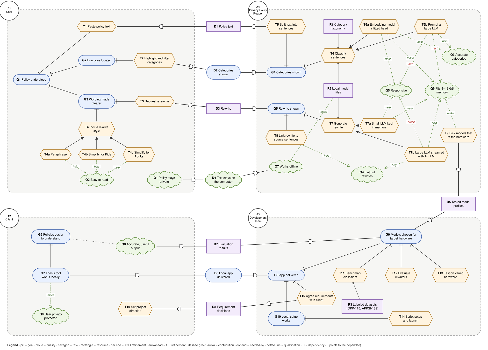
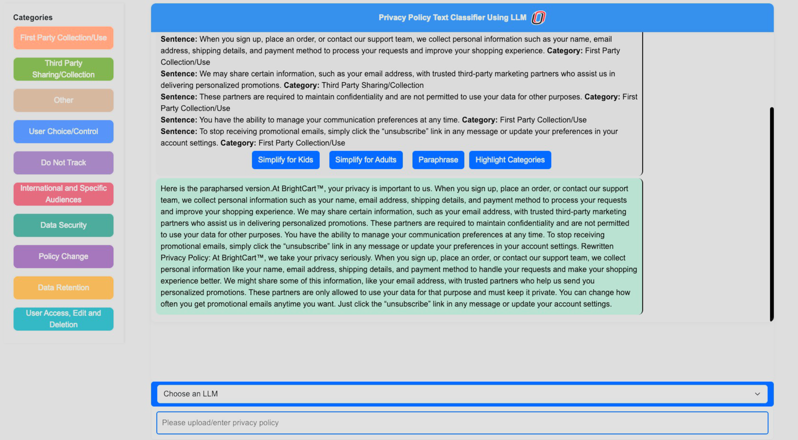
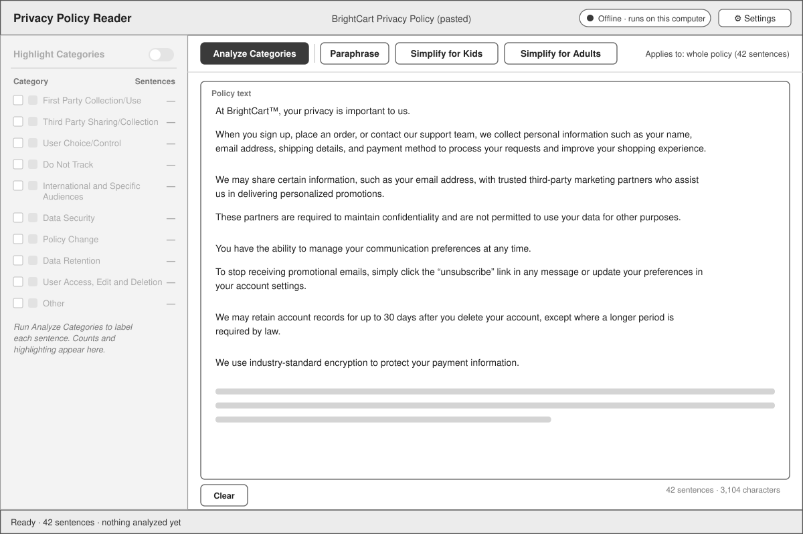
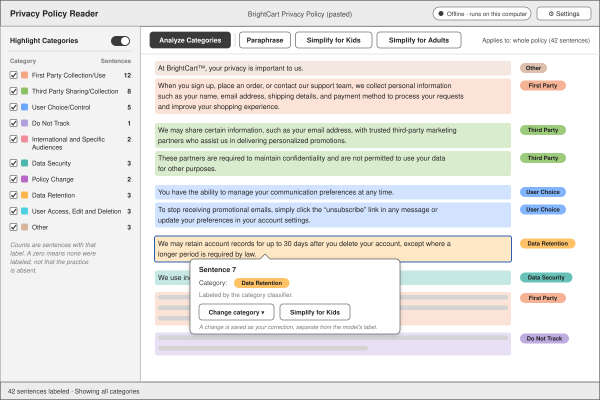
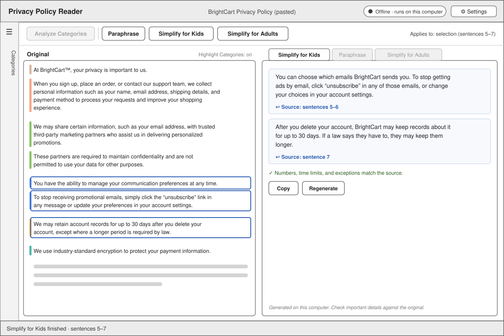
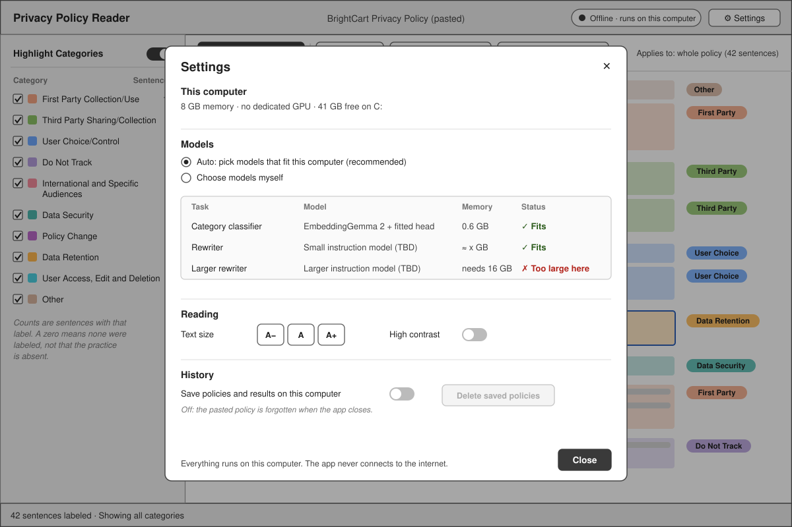
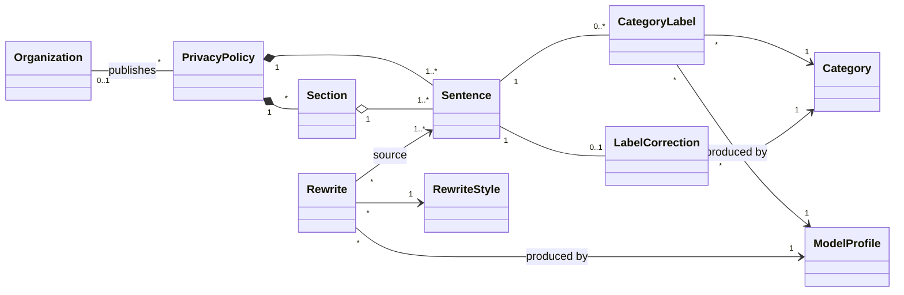

# Requirements

## 1. Goals

### 1.1 Goal model

Figure 1 is the SR model for the four actors: the user, the app, the client, and the development team. Dependencies between actors run through dependums D1–D8.



*Figure 1. SR goal model.*

The tradeoffs that drive the design sit inside the app. A small embedding model with a fitted head (T6a) is fast and small, while a prompted large LLM (T6b) is at most a few points more accurate at many times the time and memory. For rewriting, AirLLM streaming (T7b) fits in little memory but breaks responsiveness (Section 8), so a small model kept in memory (T7a) is the working assumption.

### 1.2 Goal descriptions

IDs: A actor, G goal, Q quality, T task, R resource, D dependum.

**Actors**

| ID | Actor | Description |
| --- | --- | --- |
| A1 | User | Someone trying to understand a privacy policy. No legal or technical background is assumed. |
| A2 | Client | Dr. Alfredo J. Perez. Directs the functional requirements and judges whether the output is accurate and useful. |
| A3 | Development Team | Ethan McGee, Dade Larsen, Tim Pippin, and Nathan Johnson. |
| A4 | Privacy Policy Reader | The desktop app. Runs entirely on the user's computer. |

**A1 User**

| ID | Element | Description |
| --- | --- | --- |
| G1 | Policy understood | The user knows what the policy says about their data: what is collected, who gets it, how long it is kept, and what choices they have. |
| G2 | Practices located | The user can find the sentences about a practice without reading the whole policy. |
| G3 | Wording made clearer | The user gets hard passages in plainer language. |
| T1 | Paste policy text | Paste the policy into the app. |
| T2 | Highlight and filter categories | Turn on category highlighting and narrow it to the categories of interest. |
| T3 | Request a rewrite | Ask the app to rewrite a passage or the whole policy. |
| T4 | Pick a rewrite style | Choose one of the three rewrite actions. |
| T4a | Paraphrase | Same detail, clearer wording. |
| T4b | Simplify for Kids | Short sentences and everyday words for younger readers. |
| T4c | Simplify for Adults | Plain language for adults. The thesis framed this around older readers. |
| Q1 | Policy stays private | Nothing the user pastes leaves their computer. |
| Q2 | Easy to read | Rewrites are easier to read than the source. |

**A4 Privacy Policy Reader**

| ID | Element | Description |
| --- | --- | --- |
| G4 | Categories shown | Every sentence has a category, and the app can highlight them. |
| G5 | Rewrite shown | A rewrite appears next to the passage it came from. |
| T5 | Split text into sentences | Keep the original text unchanged and give each sentence a stable ID and position. |
| T6 | Classify sentences | Give each sentence one of the ten categories (R1). |
| T6a | Embedding model + fitted head | A small sentence-embedding model with a linear head trained on labeled sentences. The current lead: EmbeddingGemma 2, about 0.04 s per sentence and 0.6 GiB. |
| T6b | Prompt a large LLM | Ask a chat model such as Qwen3-14B for the category. Similar accuracy, but 10–30× slower and 10–16 GiB. |
| T7 | Generate rewrite | Produce the requested rewrite with a local generative model. |
| T7a | Small LLM kept in memory | A model small enough to stay loaded between requests. Not chosen yet (AR-02). |
| T7b | Large LLM streamed with AirLLM | Load a larger model layer by layer from disk. Fits in little memory but measured far too slow (Section 8). |
| T8 | Link rewrite to source sentences | Each rewritten block records the sentences it came from, so the reader can check it. |
| T9 | Pick models that fit the hardware | Detect memory and GPU, then choose model profiles tested for that hardware. |
| R1 | Category taxonomy | The ten thesis categories, each with a one-sentence definition (FR-04). |
| R2 | Local model bundle | Model weights, tokenizers, and runtime files shipped with the app. |
| Q3 | Accurate categories | Labels match what a careful reviewer would accept. |
| Q4 | Faithful rewrites | Rewrites keep the source's facts, conditions, numbers, and hedges (*may*, *except*) and add nothing. |
| Q5 | Responsive | Results arrive quickly and the interface never freezes. |
| Q6 | Fits 8–12 GB memory | Runs on an ordinary laptop or desktop alongside other apps. |
| Q7 | Works offline | No internet connection is needed to install, start, or use any feature. |

**A2 Client**

| ID | Element | Description |
| --- | --- | --- |
| G6 | Policies easier to understand | The research goal behind the original thesis. |
| G7 | Thesis tool works locally | The thesis's classify-and-rewrite tool, rebuilt to run on the user's own computer. |
| T10 | Set project direction | Answer scope questions and review results in client meetings. |
| Q8 | Accurate, useful output | Categories and rewrites are correct and actually help readers. |
| Q9 | User privacy protected | Running locally keeps policies, and what they reveal about the user, private. |

**A3 Development Team**

| ID | Element | Description |
| --- | --- | --- |
| G8 | App delivered | The app is built, tested, and handed to the client. |
| G9 | Models chosen for target hardware | Classifier and rewriter chosen on evidence for each hardware tier. |
| G10 | Offline package built | One installer or bundle per platform with everything the app needs. |
| T11 | Benchmark classifiers | Compare candidate classifiers on accuracy, speed, and memory (AR-01). |
| T12 | Evaluate rewriters | Review candidate rewriters for faithfulness and readability (AR-02). |
| T13 | Test on varied hardware | Measure speed and memory on each hardware tier (AR-03). |
| T14 | Bundle app, runtime, and models | Package the UI, Python runtime, and model files for offline installation. |
| T15 | Agree requirements with client | Settle open scope questions with the client. |
| R3 | Labeled datasets | OPP-115 and APPSI-139 sentences with category labels. |

**Dependencies**

| ID | Dependum | Depender → dependee | Description |
| --- | --- | --- | --- |
| D1 | Policy text | App → User | The app needs the text to analyze. |
| D2 | Categories shown | User → App | The user relies on the app to label and highlight sentences. |
| D3 | Rewrite | User → App | The user relies on the app for rewrites. |
| D4 | Text stays on the computer | User → App | The user relies on the app not to send the policy anywhere. |
| D5 | Tested model bundle | App → Team | The app needs models tested for its hardware tier. |
| D6 | Offline app delivered | Client → Team | The client relies on the team to deliver the app. |
| D7 | Evaluation results | Client → Team | The client relies on the team for evidence that the output is accurate and useful. |
| D8 | Requirement decisions | Team → Client | The team needs the client's decisions on open scope questions (FR-07, FR-11, FR-26). |

## 2. Functional requirements

Each requirement is **ID [MoSCoW]** and a user story, with the goal model elements it serves in parentheses. Narratives, BDD scenarios, and tables follow where the story alone isn't enough.

### 2.1 Entering a policy

**FR-01 [Must]** As a user, so that I can understand a privacy policy, I want to paste its text into the app. *(G1, T1, T5)*

The app keeps the pasted text exactly as entered, paragraph breaks included, and splits it into sentences. Every label and rewrite points back to that text. Editing the text clears the results that depended on the changed sentences.

**FR-02 [Could]** As a user, so that I don't have to copy and paste, I want to open a `.txt` file. *(G1, T1)*

**FR-03 [Could]** As a user, so that I can try the app before I have a policy at hand, I want to load a bundled example policy. *(G1)*

### 2.2 Categories

**FR-04 [Must]** As a user, so that I can find what the policy says about each practice, I want each sentence labeled with one of ten categories. *(G2, G4, T6, R1)*

Labeling starts when the user presses **Analyze Categories**. The categories are the thesis's ten:

| Category | Definition |
| --- | --- |
| First Party Collection/Use | Information the service provider collects or uses, including how and why. |
| Third Party Sharing/Collection | Disclosure of user information to third parties, or collection of it by third parties. |
| User Choice/Control | Choices users have about collection, use, or sharing, including consent and opting out. |
| Do Not Track | Whether and how browser Do Not Track signals are honored. |
| International and Specific Audiences | Practices for specific groups, such as children or residents of particular regions. |
| Data Security | Measures that protect user information, or statements about its security. |
| Policy Change | Whether or how the policy may change, and how users are told. |
| Data Retention | How long user information is kept, or what decides the storage period. |
| User Access, Edit and Deletion | Whether and how users can access, correct, update, or delete their information. |
| Other | Introductions, general statements, scope, headings, dates, contact information, and practices outside the nine. |

**FR-05 [Must]** As a user, so that I can see at a glance which parts of the policy cover which practice, I want a **Highlight Categories** toggle that shades each sentence in its category's color, with a legend. *(G2, T2)*

```gherkin
Scenario: Highlighting after analysis
  Given the BrightCart policy has been analyzed
  When I turn on Highlight Categories
  Then each sentence is shaded in its category's color with the category name beside it
  And no model runs again

Scenario: Highlighting before analysis
  Given the policy has not been analyzed
  Then the Highlight Categories toggle is disabled
```

**FR-06 [Should]** As a user, so that I can focus on one practice, I want to filter highlights by category and see how many sentences each category has. *(G2, T2)*

```gherkin
Scenario: Filter to one category
  Given highlighting is on
  When I uncheck every category except Third Party Sharing/Collection
  Then only Third Party Sharing/Collection sentences stay highlighted, including sentences 3 and 4
  And the legend still shows every category's count
```

With several categories checked, a sentence stays highlighted if it matches any of them. A count of zero means no sentence got that label, not that the policy says nothing about it.

**FR-07 [Could]** As a user, so that an ambiguous sentence isn't forced into one category, I want it to show every category that clearly applies. *(G2, Q3, D8)*

The first version shows one category per sentence, but the classifier should be able to return several later. Waiting on the client's decision.

**FR-08 [Could]** As a user, so that I can fix a label I think is wrong, I want to change a sentence's category. *(G2, Q3)*

The change is stored as the user's correction, separate from the model's label, and retrains nothing.

### 2.3 Rewrites

**FR-09 [Must]** As a user, so that a passage is easier to follow, I want to **Paraphrase** it in clearer wording with the same detail. *(G3, T4a)*

**FR-10 [Must]** As a user, so that a younger reader can understand a passage, I want to **Simplify for Kids**. *(G3, T4b, Q2)*

**FR-11 [Must]** As a user, so that I can understand a passage without a legal background, I want to **Simplify for Adults**. *(G3, T4c, Q2, D8)*

| Action | Writes | Must keep |
| --- | --- | --- |
| Paraphrase | Clearer, neutral wording with about the same detail. Not a summary. | Defined terms, who does what, permissions, exceptions, numbers. |
| Simplify for Kids | Short sentences and everyday words, with brief explanations of needed terms. | Who collects what, why, who receives it, and what the reader can do. Important conditions stay even if the rewrite gets longer. |
| Simplify for Adults | Plain language, short paragraphs, and direct explanations of choices. | Deadlines, settings, contact routes, limits, and conditional promises. |

No rewrite may drop a condition or hedge to read more simply. From W4, sentence 7, *"We may retain account records for up to 30 days after you delete your account, except where a longer period is required by law,"* becomes *"After you delete your account, BrightCart may keep records about it for up to 30 days. If a law says they have to, they may keep them longer."* "Your data is deleted within 30 days" would fail: it drops *may*, widens *account records*, and loses the exception.

The thesis doesn't define an age range or reading level for Kids or Adults, and it describes Adults as aimed at older readers. Reading targets will be set with the client and checked in AR-02.

**FR-12 [Must]** As a user, so that I can check a rewrite against what the policy actually says, I want it shown beside the original, with each part linked to the sentences it came from. *(G3, T8, Q4)*

```gherkin
Scenario: Simplify a selection
  Given the BrightCart policy is open
  And I have selected sentences 5–7
  When I press Simplify for Kids
  Then the rewrite appears beside the original text
  And each rewritten block links to its sources, "sentences 5–6" and "sentence 7"
  And the original text is unchanged

Scenario: Follow a source link
  Given a rewrite is shown
  When I click "Source: sentence 7"
  Then the original pane scrolls to sentence 7 and outlines it
```

**FR-13 [Should]** As a user, so that I can rewrite just the part I'm stuck on, I want rewrites to apply to my selection, or to the whole policy when nothing is selected, with the scope shown next to the buttons. *(G3, T3)*

A whole-policy rewrite goes section by section against the source; it never summarizes earlier summaries. If a selection refers to something outside it ("these partners"), the needed context is sent along with it. Rewrites don't wait for classification.

**FR-14 [Should]** As a user, so that I can reuse or retry a rewrite, I want to copy it and regenerate it. *(G3)*

**FR-15 [Could]** As a user, so that I notice when a rewrite may have changed the meaning, I want it flagged when numbers, dates, named parties, or negations differ from the source. *(Q4)*

These checks find rewrites worth a second look. Passing them doesn't prove a rewrite is faithful.

**FR-16 [Could]** As a user, so that I get the gist quickly, I want a short summary of what the policy says under each category, linked to the source sentences. *(G2, G3, Q4)*

### 2.4 Progress and cancelling

**FR-17 [Must]** As a user, so that I know a rewrite is still working, I want to see its progress. *(Q5)*

**FR-18 [Should]** As a user, so that I'm not stuck waiting on a rewrite I no longer need, I want to cancel it. *(Q5)*

Labeling is fast enough not to need either (NFR-04).

| Condition | Response |
| --- | --- |
| Rewrite requested | Show the current stage, such as "Loading rewriter" or "Rewriting section 2 of 5", until it finishes. |
| Cancel pressed | Stop starting new sections, keep finished ones, and say what was cancelled. |
| Model runs out of memory or fails | Keep finished results, say what failed, and suggest a shorter selection or a smaller model. |
| Model files missing or damaged | Name the files. Never fall back to a download (NFR-01). |

### 2.5 Models and settings

**FR-19 [Should]** As a user, so that the app runs well on my computer without my knowing about models, I want it to pick models that fit my hardware. *(T9, Q6, D5)*

At launch the app checks memory, GPU, and free disk without running a test generation, then picks from the bundled model profiles tested for that tier (NFR-03). Settings shows what it found and why a model is unavailable (W5).

**FR-20 [Could]** As a user, so that I can trade speed for quality, I want to choose among the bundled models. *(Q3, Q4, Q5)*

The thesis interface had a **Choose an LLM** menu. Only bundled, tested models are offered (FR-26).

**FR-21 [Could]** As a user, so that the text is comfortable to read, I want to change the text size and turn on high contrast. *(Q2)*

**FR-22 [Could]** As a user, so that I can come back to a policy later, I want to save it with its results on my computer, and delete what I've saved. *(Q1)*

Off by default (NFR-02).

### 2.6 Not in this version

**FR-23 [Won't]** Chat or follow-up questions about a policy. The proposal described a chat window; a reading workspace replaced it.

**FR-24 [Won't]** PDF or DOCX import, or OCR. Extraction can lose headings, columns, and footnotes, which changes meaning.

**FR-25 [Won't]** Policies in languages other than English.

**FR-26 [Won't]** Models the user downloads and adds. Every model needs testing for input and output format, memory, and accuracy first. Waiting on the client's decision (D8).

**FR-27 [Won't]** Accounts, cloud features, update checks, or telemetry (NFR-01).

## 3. Wireframes

Every screen uses the BrightCart policy from the thesis mockup, extended with a retention sentence and a security sentence. Sentences 1–8 are shown; the rest of the 42-sentence policy is greeked. Labels and counts match across screens, and colors follow the thesis legend.

**W1. Thesis interface (starting point).** The parent thesis's UI: a category legend, the sentence and category list, the four actions, a paraphrase result, an LLM menu, and the policy input. The screens below keep the categories and the four actions but show the policy in place instead of as a list of "Sentence: … Category: …" lines.



**W2. Policy entered** *(FR-01, FR-04, FR-13)*. The pasted policy before analysis. Highlighting and counts stay disabled until Analyze Categories runs. The rewrite buttons work right away and apply to the whole policy.



**W3. Categories highlighted** *(FR-05, FR-06, FR-08)*. After analysis. Each sentence is shaded and named, and the legend shows counts and filters. Clicking sentence 7 opens the sentence inspector.



**W4. Rewrite beside the original** *(FR-10, FR-12, FR-14, FR-15)*. Simplify for Kids on sentences 5–7, with the category rail collapsed. Each block links to its source, and the check line is FR-15.



**W5. Settings** *(FR-19 to FR-22)*. Detected hardware, automatic model choice, reading settings, and history, which is off by default. Model names other than the classifier are placeholders.



## 4. Object model



**Required**

- **PrivacyPolicy**: the pasted text, kept unchanged.
- **Sentence**: a span of the policy with a stable ID and position.
- **Category**: one of the ten categories.
- **CategoryLabel**: a category a model gave a sentence. One per sentence for now; several if FR-07 is adopted. Zero until the policy is analyzed.
- **Rewrite**: the output of one rewrite action, tied to its source sentences.
- **RewriteStyle**: Paraphrase, Simplify for Kids, or Simplify for Adults.
- **ModelProfile**: a bundled model and the hardware it was tested on. Records which model produced each label and rewrite.

**Optional**

- **Section**: headings and paragraphs, for section-by-section rewrites of long policies (FR-13).
- **LabelCorrection**: the user's own category for a sentence (FR-08).
- **Organization**: who publishes the policy. Only a name for now.

The practices themselves (data collected, recipients, retention periods, user choices) appear only as categories on sentences. The app doesn't extract them as separate records.

## 5. Nonfunctional requirements

Measurable product qualities use GQM; the rest are narrative.

**NFR-01 [Must] Works with no internet connection.** *(Q7, D4, G7)*

Installation, first launch, and every feature work with no network. The app, Python runtime, model files, and UI assets ship together (NFR-08). There are no accounts, downloads, update checks, or telemetry. Model libraries run in offline mode and load only from local folders, so a missing file is an error, never a download.

Verified on a clean machine with networking blocked before installation and no existing model caches: install, first launch, Analyze Categories, all three rewrites, and a restart.

**NFR-02 [Must] Policy text stays on the computer.** *(Q1, Q9, D4)*

Policies and results are processed on the user's computer. Nothing is saved unless the user turns on history (FR-22). Logs record timings and error codes, never policy text or prompts. If the UI talks to the Python process over local HTTP, the server listens on localhost only.

**NFR-03 [Must] Fits in an ordinary computer's memory.** *(Q6, T9)*

- **Goal:** Analyze the app's memory use to decide which computers it supports, with respect to peak memory, from the user's point of view, on desktops and laptops with 8–12 GB of total memory.
- **Questions:** How much memory does labeling take? How much does rewriting take? How much is left for the OS and other apps? Does the app hold GPU memory while idle?
- **Metrics:** peak RAM, and VRAM where a GPU is used, while labeling the 42-sentence sample and a long policy; the same while rewriting the longest allowed selection; available system memory during each run; GPU memory held while idle.
- **Targets (provisional):**

  | Total memory | Supports |
  | --- | --- |
  | 8–12 GB, no dedicated GPU | Every Must and Should feature. The app's peak stays under half of total memory. |
  | 2–4 GB | Labeling and highlighting (Could). |
  | 16 GB or more | A larger rewriter (Could). |

  Between requests the app releases GPU memory it doesn't need. In testing, holding 16 GiB on the display GPU lagged the Windows desktop; 8 and 12 GiB did not.

**NFR-04 [Should] Responsive.** *(Q5)*

- **Goal:** Analyze the app's response times to judge whether it is usable, with respect to waiting time, from the user's point of view, on 8–12 GB computers.
- **Questions:** How long does labeling a whole policy take? How long does a rewrite take? Does the interface stay usable while a rewrite runs? How quickly does Cancel take effect?
- **Metrics:** time from Analyze Categories to labels shown, with the classifier cold and loaded, for the 42-sentence sample and a long policy; seconds per sentence; time to the first rewrite text and to the finished rewrite, by selection length; input delay during a rewrite; time from Cancel to idle.
- **Targets (provisional, no dedicated GPU):** highlighting and filters update in under 0.1 s with no model call; the 42-sentence sample is labeled within 5 s once the classifier is loaded; Cancel takes effect within 2 s. Rewrite targets are set after AR-02.

**NFR-05 [Must] Accurate categories.** *(Q3, Q8)*

- **Goal:** Analyze the shipped classifier to accept or reject it, with respect to label accuracy, from the client's and user's point of view, on policies it was not tuned on.
- **Questions:** How often does its label match one a reviewer accepts? How does it do on each category, including rare ones? Is it at least as good as the best small baseline?
- **Metrics:** accuracy against accepted labels on the APPSI-139 test half (natural category mix) and the 460-sentence balanced sample; macro accuracy, weighting each category equally; per-category accuracy; share of valid outputs.
- **Target:** not significantly less accurate than skythrone/privacy-model on either sample (exact McNemar test, p < 0.05), with every output valid. The prior-shifted EmbeddingGemma 2 head meets this, tying privacy-model on both; no head yet beats it on both (AR-01).

**NFR-06 [Must] Faithful, readable rewrites.** *(Q4, Q2, Q8)*

- **Goal:** Analyze rewrites to accept a rewriter and its prompts, with respect to faithfulness and readability, from the reader's and client's point of view, on policy passages with numbers, exceptions, negations, and permissions.
- **Questions:** Does the rewrite keep every fact and condition? Does it add anything the source doesn't say? Is it easier to read than the source for its audience?
- **Metrics:** per-rewrite reviewer counts of omitted facts or conditions, changed numbers, dates, or parties, lost negations or hedges, and unsupported additions; readability scores (such as Flesch–Kincaid grade) of the rewrite against the source; reviewer clarity ratings per audience.
- **Target:** no changed numbers, parties, or negations on the review set. The acceptable omission and addition rate, and the reading levels for Kids and Adults, are set with the client after the first review.

**NFR-07 [Should] Usable and accessible.** *(Q2)*

Category colors always appear with the category name, so nothing depends on color alone. Text and highlights meet WCAG 2.2 AA contrast, and every action works from the keyboard. Reading settings (FR-21) apply to every rewrite style; the Kids and Adults labels don't change font size.

**NFR-08 [Must] Installs as one offline package.** *(G10, Q7)*

Users install one installer or portable bundle, with no separate Python, driver, or package installs. Windows 10/11 (x64) is required; macOS (Apple Silicon) and Linux are Could. Large model files may sit in a folder next to the installer on the same media.

**NFR-09 [Should] Models can be swapped.** *(G9, T9)*

Each bundled model has a profile file: model and tokenizer revision, runtime versions, memory needed, and tested tiers. The taxonomy and rewrite prompts are versioned files. Swapping a model changes these files, not the UI. Results are cached by text, model, prompt, and taxonomy version, so switching views never reruns a model.

## 6. Analysis requirements

These are the evaluations the team runs to choose models and settings. Each uses frozen samples and pinned model revisions so results stay comparable.

**AR-01 [Must] Choose the classifier.** *(G9, T11, Q3, Q5, Q6)*

- **Goal:** Analyze candidate sentence classifiers to choose the app's classifier, with respect to accuracy, speed, and memory, from the team's and client's point of view, on policies they were not tuned on.
- **Questions:** Which candidates are most accurate on a balanced sample, and on a natural mix? Do results carry over from OPP-115 to APPSI-139? What does each cost per sentence in time and memory? Which categories does each confuse?
- **Metrics:** accuracy and macro accuracy against accepted labels; macro-F1; exact McNemar tests between pairs; seconds per sentence; peak GPU memory; share of valid outputs; per-category confusion.
- **Status:** In progress. On the balanced APPSI-139 sample, a linear head on EmbeddingGemma 2 ties Qwen3-14B and JEV-9B (0.867 against 0.883–0.891, not significant) at 0.04 s per sentence and about 0.6 GiB. Shifted toward APPSI-139's category mix, it ties privacy-model on the test half (0.858 each) but loses its balanced lead. No head leads on both yet, and nothing has been timed on a computer without a GPU.

**AR-02 [Must] Choose the rewriter.** *(G9, T12, Q4, Q2)*

- **Goal:** Analyze candidate local generative models and prompts to choose the rewriter, with respect to faithfulness, readability, speed, and memory, from the reader's and client's point of view, on 8–12 GB computers.
- **Questions:** Which candidates keep the meaning (NFR-06)? Is the output readable for each audience? Does it run in the 8–12 GB tier at an acceptable speed? Can JEV-9B's base model, with its adapter off, rewrite well enough to serve both tasks?
- **Metrics:** the NFR-06 metrics on a fixed review set of passages; time to first token and total time; peak memory.
- **Status:** Not started.

**AR-03 [Should] Compare runtimes and memory strategies.** *(G9, T13, Q5, Q6)*

- **Goal:** Analyze inference runtimes (Transformers with quantization, llama.cpp, and AirLLM layer streaming) to choose how models run on each tier, with respect to speed and memory, from the team's point of view, on the team's machines and a target-tier laptop.
- **Questions:** How fast does each generate on each tier? How much RAM and VRAM does each need at peak? Does quantization change accuracy?
- **Metrics:** tokens per second; cold load time; peak RAM and VRAM; accuracy change against BF16.
- **Status:** Partly done. Stock AirLLM took about 394 s for 32 tokens with Qwen3-14B on an RTX 4090, against about 1.7 s fully on the GPU in 4-bit. On the pilot, INT8 and NF4 stayed within 1.5 points of BF16 (Qwen3-14B 0.900, 0.890, 0.885; JEV-9B 0.860, 0.860, 0.855), and NF4 roughly halves memory. Every measurement so far comes from one PC with an RTX 4090 and 64 GB of RAM.

**AR-04 [Could] Check that readers understand more.** *(G1, G6)*

- **Goal:** Analyze the app's effect on understanding, with respect to task success and time, from the user's point of view, with readers who aren't privacy experts.
- **Questions:** Do readers find a policy's sharing practices faster with highlighting? Can they explain the retention exception after reading a rewrite? Can they get from a rewrite back to its source?
- **Metrics:** task success rate and time, with and without the app's features; reader ratings.
- **Status:** Not started. A study with outside participants may need IRB approval.

## 7. External system interfaces

The app calls no web services and needs no API keys. Its external interfaces are local Python libraries, model files, and data files.

### 7.1 Model libraries

| Library | Used for | Calls | In → out |
| --- | --- | --- | --- |
| sentence-transformers | Sentence embeddings for the classifier | `SentenceTransformer(path, local_files_only=True)`, `encode` | Sentences, with the fitted head's prefix → embedding vectors |
| Transformers (PyTorch) | Sequence classifiers, chat models, tokenizers | `AutoTokenizer` / `AutoModelFor…` `.from_pretrained(path, local_files_only=True, trust_remote_code=False)`, `generate` | Token IDs → logits or generated tokens |
| bitsandbytes, Accelerate | INT8 and NF4 quantization, device placement | `quantization_config`, `device_map` | — |
| PEFT | JEV-9B's LoRA adapter | `PeftModel.from_pretrained` | — |
| PyTorch, psutil (to add) | Hardware detection (FR-19) | `torch.cuda.mem_get_info()`, `psutil.virtual_memory()` | → free and total VRAM, available RAM |

Setup: set `HF_HUB_OFFLINE=1` and `HF_HUB_DISABLE_TELEMETRY=1` before importing these libraries. Every version is pinned (currently transformers 5.19.0 and torch 2.8.0). A transformers upgrade made JEV-9B 1.6–2.3× faster and shifted its logits, so library versions belong in each model profile.

### 7.2 Model files

Models use the Hugging Face snapshot layout (`config.json`, tokenizer files, `*.safetensors` weights) and are pinned by commit.

| Model | Role | Commit |
| --- | --- | --- |
| google/embeddinggemma-2 | Classifier backbone (current lead) | `914f7f8` |
| Fitted head | Linear head: `weights.safetensors`, plus `fit.json` with the SHA-256 a run checks before loading | — |
| skythrone/privacy-model | Baseline classifier | `7b478b5` |
| Qwen/Qwen3-14B | Prompted classifier (comparison) | `40c0698` |
| autotrust/JEV-9B | Qwen3.5-9B base with a LoRA judge adapter (one-model option) | `4ab5dfb` |
| Rewriter | To be chosen (AR-02) | — |

Each bundled model's license must allow redistribution; EmbeddingGemma 2, for example, is under the Gemma Terms of Use.

### 7.3 Data formats

- **Policy input:** UTF-8 plain text, pasted or from a `.txt` file (FR-02).
- **Category taxonomy:** JSON with the ten categories and their definitions.
- **Classifier output:** one JSON object per sentence, `{"label_id": 0–9}`. A generative model must write exactly this; anything else is rejected and counts as wrong. Classifiers that don't generate text write the same format.
- **Rewrite output:** plain text blocks, each with its source sentence IDs. Copied as plain text.
- **Saved history (FR-22):** a local SQLite file.
- **Development datasets (not shipped):** OPP-115 as a CSV of 10,717 sentences with twelve annotation columns, mapped to the ten categories; APPSI-139 as 13,291 app-policy sentences mapped to the ten categories, with a CSV of accepted labels (the originals plus a relabeling).

### 7.4 AirLLM (tentative)

`airllm.AutoModel.from_pretrained(local_path)` loads a model for layer streaming, and `generate(input_ids, max_new_tokens=…)` returns tokens. The current design doesn't use it (Section 8).

## 8. Requirements not implemented

**AirLLM as the inference runtime** *(T7b)*. The September 17 design ran every model through AirLLM's layer streaming on every supported platform, with an extension that kept some layers in VRAM or RAM to cut reload time. Not implemented: stock AirLLM took about 394 s to generate 32 tokens with Qwen3-14B on an RTX 4090, against about 1.7 s fully on the GPU in 4-bit, and the residency extension was never built. The leading classifier needs about 0.6 GiB, so labeling doesn't need streaming. AirLLM stays a tentative option for running a larger rewriter on low-memory computers if AR-02 finds small models aren't faithful enough.
