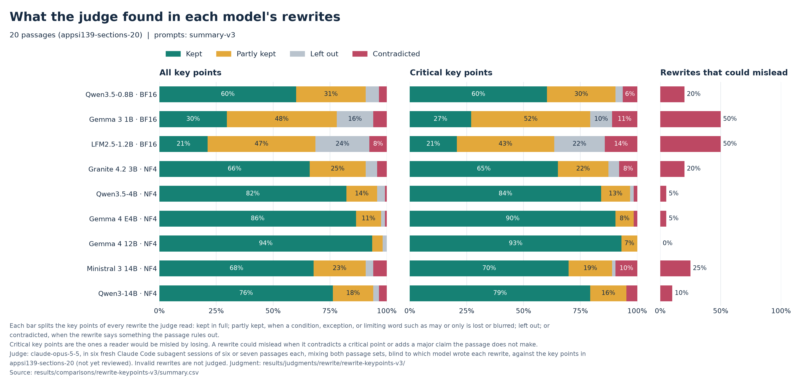
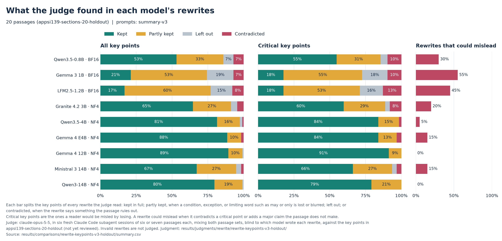
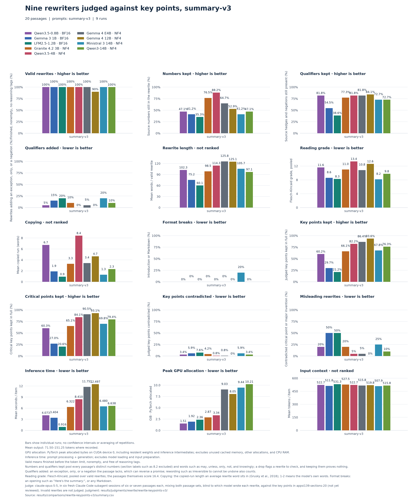
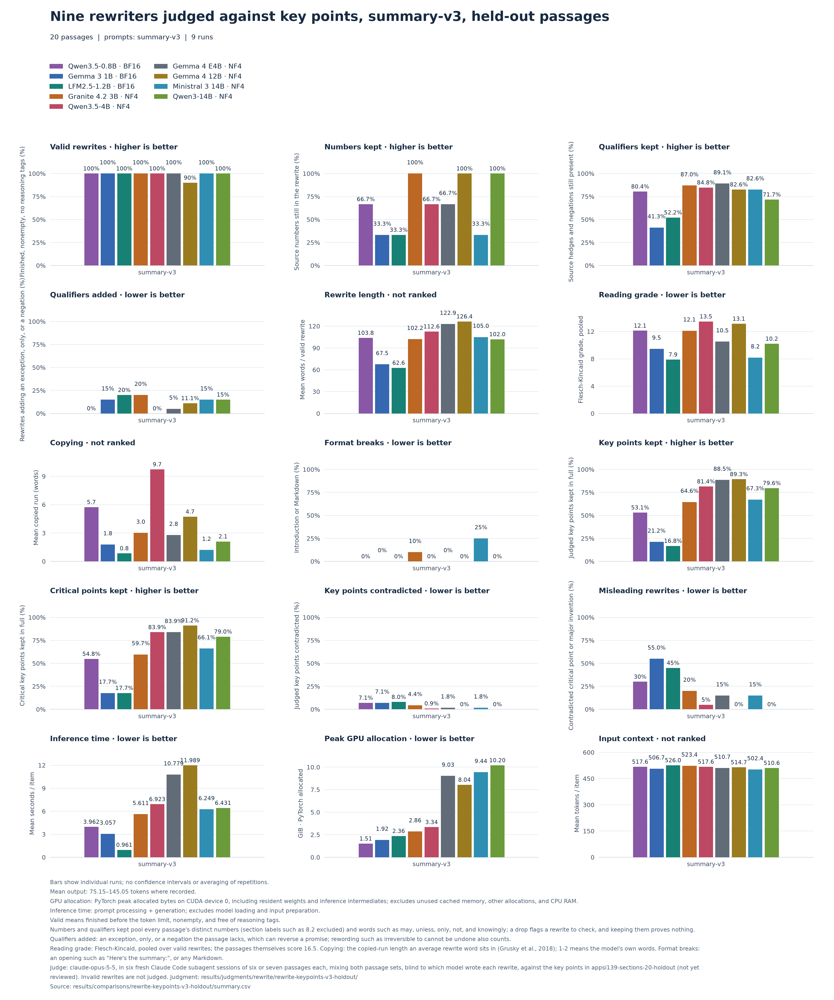
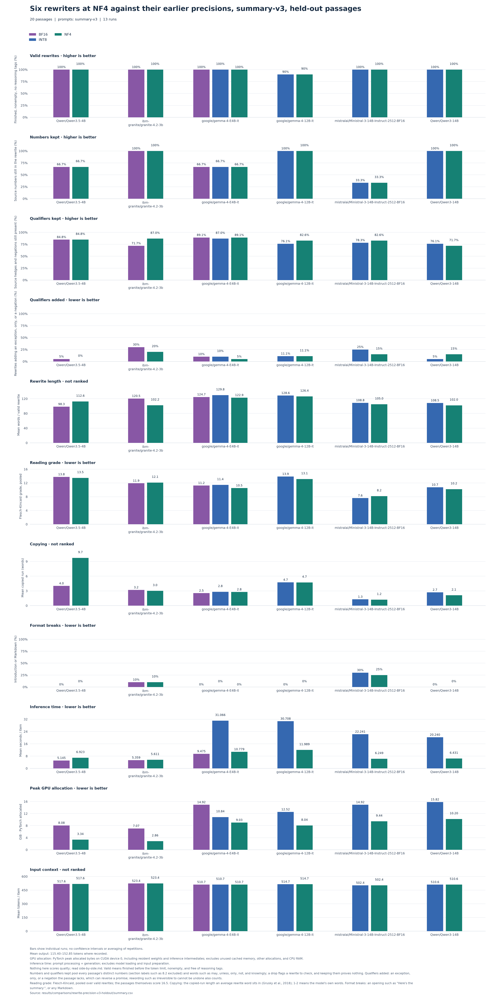

# Choosing a rewriting model: what we found

*October 26, 2026. Results from nine candidate models on 40 real privacy-policy passages.*

The app's Rewrite feature turns a privacy-policy passage into plain language. It must run on the user's own computer, and it must not change what the policy promises. This page reports how well nine small AI models do that job, and which ones fit the computers we are targeting.

## In short

- **Qwen3.5-4B is the best fit for our main target, computers with 8–12 GB of memory.** Compressed to 4-bit (explained below), it needs about 3.6 GB. It kept 82% of the passages' key facts in full, and only 2 of its 40 rewrites could mislead a reader.
- **Larger models do a little better but need more memory than our target computers have.** Gemma 4 12B kept 92% of key facts and never misled, but it needs about 8.6 GB. Qwen3-14B kept 78% and misled twice, at about 11 GB.
- **The smallest models are not reliable.** The three models of about 1 billion parameters could mislead in 25–52% of their rewrites. The requirements only ask for labeling, not rewriting, on 2–4 GB computers, so this rules out rewriting on that tier.
- **Most mistakes are small but matter for privacy.** The most common problem is dropping a limiting word: "we do not *knowingly* collect children's data" becomes "we do not collect children's data", which turns a limited promise into an absolute one.
- **Two things are still unchecked:** a person on the team has not yet reviewed the list of key facts, and no model has been timed on an actual 8–12 GB laptop.

## What we tested

**The task.** Each model got the same instructions (the `summary-v3` prompt): summarize the passage for an ordinary reader in your own words, keep every condition, exception, number, and time limit, keep words such as *may*, *knowingly*, and *reasonable*, make no promise stronger or weaker, and add nothing the passage does not say.

**The passages.** 40 sections from real app privacy policies, each 86–340 words long and each from a different policy. We used the first 20 while improving the instructions. The other 20 come from policies we never looked at while tuning, so they show whether the results hold on new text. The two sets agreed closely: each model's results were similar on both, and the models ranked in the same order on each.

**The models.** Nine freely available models, grouped by the computer memory they need:

| Size | Models | Version tested |
| --- | --- | --- |
| Small (about 1 billion parameters) | Qwen3.5-0.8B, Gemma 3 1B, LFM2.5-1.2B | Full size |
| Medium (3–8 billion) | Granite 4.2 3B, Qwen3.5-4B, Gemma 4 E4B | Compressed to 4-bit |
| Large (12–14 billion) | Gemma 4 12B, Ministral 3 14B, Qwen3-14B | Compressed to 4-bit |

**Why compressed.** A model is a large table of numbers. Storing each number in 4 bits instead of 16 makes the model about a quarter of the size, at a small cost in accuracy. The app must keep its memory use under half of the computer's total memory: under 4 GB on an 8 GB laptop, or 6 GB on a 12 GB one. At full size, no medium or large model fits under that limit. So we tested them in the compressed form the app would actually use. Compression changed our automatic checks only slightly, with one exception: compressed Qwen3.5-4B sometimes copies the passage instead of rewriting it (see [Does compressing a model hurt it?](#does-compressing-a-model-hurt-it)).

## How we scored the rewrites

We scored every rewrite in two ways. Automatic word checks run instantly on any rewrite and need no judge. An AI judge then read every rewrite for meaning, because word checks cannot tell whether a promise survived.

### Automatic word checks

| Check | What it measures | Why it matters |
| --- | --- | --- |
| Valid | The answer finished, is not empty, and has no leftover "thinking" text | An unusable answer cannot be shown to anyone. |
| Numbers kept | How many of the passage's numbers, such as ages, days, or years, are still in the rewrite | A lost "13" or "30 days" changes what a reader can expect. |
| Limiting words kept | How many of the passage's limiting words are still there: *may*, *might*, *could*, *likely*, *if*, *only*, *unless*, *except*, *not*, *never*, *without*, and *knowingly* | These words limit a promise. Dropping *knowingly* or *not* turns a careful promise into a different one. |
| Limiting words added | How many rewrites add *only*, *unless*, *except*, *not*, *never*, or *without* where the passage has none | An added exception or restriction makes a promise stronger or weaker than the policy does. |
| Reading level | The US school grade a reader needs, from sentence and word length (Flesch–Kincaid) | The point of the feature is easier text. The original passages score about grade 16. |
| Copying | The average length of the word-for-word stretches a rewrite takes from the passage; 1–2 means the model used its own words | A rewrite that copies whole sentences keeps the facts but makes nothing easier to read. |
| Format breaks | An opening such as "Here's the summary:", or formatting such as bold text or lists | The app shows the rewrite as it comes, beside the policy. |
| Length | The rewrite's words, against the passage's | Not ranked: it shows how much a model shortens the text. |

**How the checks shaped the instructions.** The `summary-v3` prompt is our third version, and these checks drove each change:

- With a first, generic prompt, Qwen3.5-0.8B mostly copied the passages back, with a copying score of 97 against 1–22 for the other models. Ministral 3 14B opened 12 of 20 rewrites with "Here's your summary:" and used formatting in 18. The second prompt asked for the model's own words, plain text, and no introduction. Qwen3.5-0.8B's copying fell to 6, and Ministral's introductions stopped.
- Under the second prompt, rewrites added *only* and *unless* where the passage had neither, and dropped *knowingly*. We added the "limiting words added" check and put *knowingly* on the list. The third prompt names these words and forbids making any promise stronger or weaker.

**Why the checks are not enough.** They count words, not meaning, and they count over a whole passage, not fact by fact:

- Four models told readers they would get "30 days' notice" that the policy only promises to a library. The "30" survived, so the numbers check passed.
- Ministral 3 14B said the company uses "encryption, secure storage", protections the passage never names. No limiting word changed, so no check noticed.
- Qwen3-14B kept fewer limiting words than Granite 4.2 3B (72% against 82%), yet the judge found it far more faithful: 78% of key facts kept against 65%, and 2 rewrites that could mislead against 8. Word counts alone would rank these two the wrong way round.

The checks still earn their place. They are the only measure of whether a rewrite is easier to read, they catch copying and format problems the judge ignores, and they are cheap enough to run inside the app, for example to warn when *may* or *knowingly* disappears.

### Key facts and an AI judge

**A checklist of key facts.** For each passage we wrote down the facts a reader needs, 231 in all, such as "The company does not knowingly collect personal information from children under 13." 125 of them are marked **critical**: getting one of these wrong would mislead a reader about their data, their rights, or their risks.

**An AI judge.** Claude Opus 5.5 read each passage, its checklist, and all nine models' rewrites of it side by side. The model names were hidden and the order was shuffled for every passage, so the judge could not tell which model wrote which rewrite. For every fact in every rewrite, it chose one of four verdicts:

- **Kept**: the rewrite says it, with its conditions and limiting words.
- **Partly kept**: the rewrite says it but loses or blurs a part that matters, such as a condition, an exception, or a word like *may* or *only*.
- **Left out**: the rewrite does not say it.
- **Contradicted**: the rewrite says something the passage rules out, such as turning "may" into "will" or adding an exception the passage does not make.

The judge also listed anything a rewrite claims that the passage does not support, and rated it **major** if it could mislead a reader. It had to quote the rewrite's exact words for every problem it reported; a checker rejected any quote it could not find.

**"Could mislead".** We count a rewrite as one that could mislead when it contradicts a critical fact or adds a major claim the passage does not make.

## Results

Both passage sets combined, 40 passages per model:

| Model | Memory needed | Facts kept | Partly kept | Left out | Contradicted | Rewrites that could mislead | Reading level |
| --- | --- | --- | --- | --- | --- | --- | --- |
| Qwen3.5-0.8B | 1.6 GB | 57% | 32% | 6% | 5% | 10 of 40 (25%) | grade 12 |
| Gemma 3 1B | 2.1 GB | 26% | 51% | 17% | 6% | 21 of 40 (52%) | grade 9 |
| LFM2.5-1.2B | 2.5 GB | 19% | 54% | 19% | 8% | 19 of 40 (48%) | grade 8 |
| Granite 4.2 3B | 3.1 GB | 65% | 26% | 5% | 4% | 8 of 40 (20%) | grade 12 |
| **Qwen3.5-4B** | **3.6 GB** | **82%** | 15% | 3% | 1% | **2 of 40 (5%)** | grade 13 |
| Gemma 4 E4B | 9.7 GB | 87% | 10% | 1% | 1% | 4 of 40 (10%) | grade 11 |
| Gemma 4 12B | 8.6 GB | 92% | 7% | 1% | 0% | 0 of 36 (0%) | grade 13 |
| Ministral 3 14B | 10.1 GB | 68% | 25% | 3% | 4% | 8 of 40 (20%) | grade 8 |
| Qwen3-14B | 11.0 GB | 78% | 19% | 2% | 2% | 2 of 40 (5%) | grade 10 |

- **Memory needed** is the most the model used while rewriting, measured on a graphics card. The whole app will need somewhat more.
- **Reading level** is the US school grade a reader needs, estimated from sentence and word length. The original passages score about grade 16, which is college level, so every model simplified them.
- **Gemma 4 12B** was judged on 36 rewrites, not 40: four of its answers began with a stray, empty "thinking" marker before the summary. The app could strip that marker, but our checks count those answers as invalid.

The charts show the same results for each passage set separately. Each bar splits all of a model's key facts into kept (green), partly kept (yellow), left out (grey), and contradicted (red). The middle panel shows only the critical facts.

### What the word checks found

Both passage sets combined. The 40 passages hold 20 numbers between them; limiting words are counted over every passage.

| Model | Numbers kept | Limiting words kept | Rewrites adding a limiting word | Copying | Format breaks |
| --- | --- | --- | --- | --- | --- |
| Qwen3.5-0.8B | 10 of 20 | 81% | 1 of 40 | 6.2 | 0 of 40 |
| Gemma 3 1B | 8 of 20 | 48% | 6 of 40 | 1.8 | 0 of 40 |
| LFM2.5-1.2B | 7 of 20 | 46% | 8 of 40 | 0.9 | 0 of 40 |
| Granite 4.2 3B | 16 of 20 | 82% | 6 of 40 | 3.2 | 2 of 40 |
| **Qwen3.5-4B** | **17 of 20** | 83% | **0 of 40** | 9.1 | 0 of 40 |
| Gemma 4 E4B | 13 of 20 | 86% | 2 of 40 | 3.1 | 0 of 40 |
| Gemma 4 12B | 12 of 20 | 83% | 2 of 36 | 4.7 | 0 of 36 |
| Ministral 3 14B | 8 of 20 | 78% | 7 of 40 | 1.3 | 9 of 40 |
| Qwen3-14B | 11 of 20 | 72% | 5 of 40 | 2.2 | 0 of 40 |

- **The checks agree with the judge about the small models.** Gemma 3 1B and LFM2.5 kept under half of the limiting words and added one to 6–8 rewrites. Qwen3.5-0.8B kept more, partly because it copies more.
- **Qwen3.5-4B never added a limiting word and kept the most numbers**, but it also copies the most. Its rewrites are the hardest to read of the medium models (grade 13).
- **Ministral 3 14B still uses formatting** such as bold text or lists in 9 of 40 rewrites, although the instructions ask for plain text. No model opened with an introduction.

### Every measure, one plot per passage set

These plots put every measure we took side by side, one panel per measure and one bar per model, in the legend's colours. The panels fall into three groups:

- **Automatic word checks** (the first eight panels), described in [Automatic word checks](#automatic-word-checks). The plots call limiting words *qualifiers*.
- **The judge's verdicts** (four panels): key facts kept, critical facts kept, facts contradicted, and rewrites that could mislead. These are the numbers in the table above, shown for each passage set.
- **Running costs** (the last three panels): seconds per passage, peak memory, and passage length in tokens. Time and memory were measured on a desktop graphics card. They compare the models with each other, but they do not predict speed on a laptop. Memory here is in GiB (1 GiB is about 1.07 GB).

The held-out passages contain only 3 numbers between them, so on that plot "numbers kept" moves in steps of a third.

## What goes wrong, with examples

**Limiting words disappear.** This was the most common problem, and it shows up as "partly kept" or, on critical facts, "contradicted".

> Passage: "We do not **knowingly** collect or solicit personally identifiable information from children under 13."
> Qwen3-14B: "we don't collect personal information from them"

The passage only promises not to collect such data on purpose; the rewrite promises it never happens. Six of the nine models made this same change on this passage.

> Passage (an e-book service run through public libraries): "If we change the policy in a **material** manner … we will provide at least 30 days' notice **to the Library**."
> Gemma 3 1B: "If we change how we collect or use your information, we'll give you 30 days' notice."

The rewrite promises the reader a notice that the policy only promises to the library, and for every change rather than only major ones. Four models told readers they would get this notice.

**Invented promises.** Some rewrites add reassurances the policy never makes:

> Qwen3.5-0.8B: "We do not sell your personal information to third parties." *(The passage makes no such promise.)*
> Ministral 3 14B: "encryption, secure storage" *(The passage names no specific protections.)*
> Granite 4.2 3B: "The data is kept only as needed for these purposes." *(The passage says nothing about how long data is kept.)*

**Reversed meaning.** The small models sometimes flip a statement:

> Gemma 3 1B: "We may disclose personal information to these parties, **with or without your consent**." *(In the passage, your consent or direction is what allows sharing beyond the groups it lists.)*
> Qwen3.5-0.8B: "We protect your privacy by collecting data only when it is **not** strictly necessary." *(The passage says it asks for your consent before collecting data that is not strictly necessary.)*

## By computer size

| Computer memory | App's limit (half) | Recommendation |
| --- | --- | --- |
| 2–4 GB | 1–2 GB | No rewriting. Only Qwen3.5-0.8B fits, and only on a 4 GB computer; a quarter of its rewrites could mislead. The requirements only ask for labeling on these computers. |
| 8–12 GB (main target) | 4–6 GB | **Qwen3.5-4B, compressed.** It fits easily on a 12 GB computer. On an 8 GB one it is tight, and possibly over the limit, once the rest of the app is counted. Granite 4.2 3B also fits, but a fifth of its rewrites could mislead. |
| 16 GB | 8 GB | Nothing larger fits under the limit. Gemma 4 12B needs about 8.6 GB, just over it. Qwen3.5-4B is the safe choice. |
| 24 GB or more | 12 GB or more | **Gemma 4 12B** scored best overall. Qwen3-14B kept fewer facts in full (78% against 92%) but writes more simply (grade 10 against 13). |

Gemma 4 E4B scored well (87% kept) but does not fit the medium tier. Part of the model, a large word table, cannot be compressed by the tools we use, so it needs 9.7 GB even when compressed.

## Does compressing a model hurt it?

Compressing to 4-bit cut memory sharply and changed the automatic word checks only a little, except that Qwen3.5-4B started copying more. The plot below covers the six medium and large models on the 20 held-out passages. Each group is one model, with a bar for each version we ran: full size (BF16, purple), 8-bit (INT8, blue) and 4-bit (NF4, green). Gemma 4 E4B ran in all three.

- **Memory.** 4-bit needs about 60% less memory than full size for Qwen3.5-4B (8.1 to 3.3 GiB) and Granite (7.1 to 2.9 GiB). For the large models it needs about a third less than 8-bit.
- **Word checks.** Most moved only slightly, in both directions. No model's count of rewrites that added a limiting word changed by more than two out of 20. Qwen3-14B added a limiting word to 3 rewrites at 4-bit, against 1 at 8-bit; Granite, Ministral and Gemma 4 E4B added fewer.
- **Copying.** Qwen3.5-4B's word-for-word stretches grew from 4.0 to 9.7 words on average, because at 4-bit it copied some passages almost whole.
- **Speed.** On our graphics card, 4-bit ran about three times faster than 8-bit. This says little about speed on a laptop.
- **Not judged.** The judge graded only the 4-bit versions of these models, so this plot has no key-fact panels. Whether compression loses facts that the word checks miss is untested.

The labels are the models' full download names, so Ministral's ends in "BF16" even above its 4-bit bar. The first 20 passages show the same pattern ([rewrite-precision-v3](../comparisons/rewrite-precision-v3.toml)). There, "numbers kept" swings more, because those passages hold only 17 numbers between them.

## Limits of this evaluation

- **The checklists have not been reviewed by a person.** Claude drafted them from the passages alone. If the team changes a fact or its critical mark, the affected passages need judging again; the tools refuse to reuse a judgment whose checklist changed.
- **One judge, one reading.** Each passage was judged once, by an AI model. Six separate judging sessions shared the 40 passages, and they handled some borderline wording differently. For example, one counted "should" becoming "must" as kept, while another counted "you must use a strong password" as a contradiction. Within a passage, one judge graded all nine rewrites side by side, so the comparison *between* models is more trustworthy than the exact percentages.
- **The same AI wrote the checklists and judged.** Both came from Claude, so they may share blind spots. None of the nine candidates is a Claude model.
- **Copying is not simplifying.** A rewrite that copies the passage keeps every fact but helps no one. Compressed Qwen3.5-4B copied two passages almost word for word and leaned heavily on the original wording in a few others. Its rewrites read at grade 13, the hardest of the medium models. This helped its score and is worth watching.
- **Short passages only.** The passages are 86–340 words. Users can paste any length.
- **Speed is unknown.** All tests ran on a desktop graphics card, so we have no timings for the laptops the app targets.

## Next steps

1. **Team review of the key facts**, especially which ones are critical. Then re-judge the passages whose facts changed.
2. **Run Qwen3.5-4B on an 8–12 GB laptop without a graphics card** to measure its speed and the whole app's memory.
3. **Try longer passages**, and the Simplify for Kids and Simplify for Adults styles, with the leading models.
4. **Look for a fix for dropped limiting words**, the most common error, such as an automatic check that warns when *may*, *knowingly*, or *only* disappears.

## Where the numbers come from

- Judged results: [comparisons/rewrite-keypoints-v3.toml](../comparisons/rewrite-keypoints-v3.toml) and [comparisons/rewrite-keypoints-v3-holdout.toml](../comparisons/rewrite-keypoints-v3-holdout.toml). The tables combine the two `summary.csv` files that `pbench compare` writes for them under `results/comparisons/`.
- The judge's prompts, replies, and settings: `results/judgments/rewrite/rewrite-keypoints-v3/` and `…-holdout/`.
- Key-fact checklists: `data/rewrite/keypoints/`. Judge instructions: `prompts/rewrite/judge/keypoints.toml`.
- Compression against full size: [comparisons/rewrite-precision-v3.toml](../comparisons/rewrite-precision-v3.toml) and [comparisons/rewrite-precision-v3-holdout.toml](../comparisons/rewrite-precision-v3-holdout.toml).
