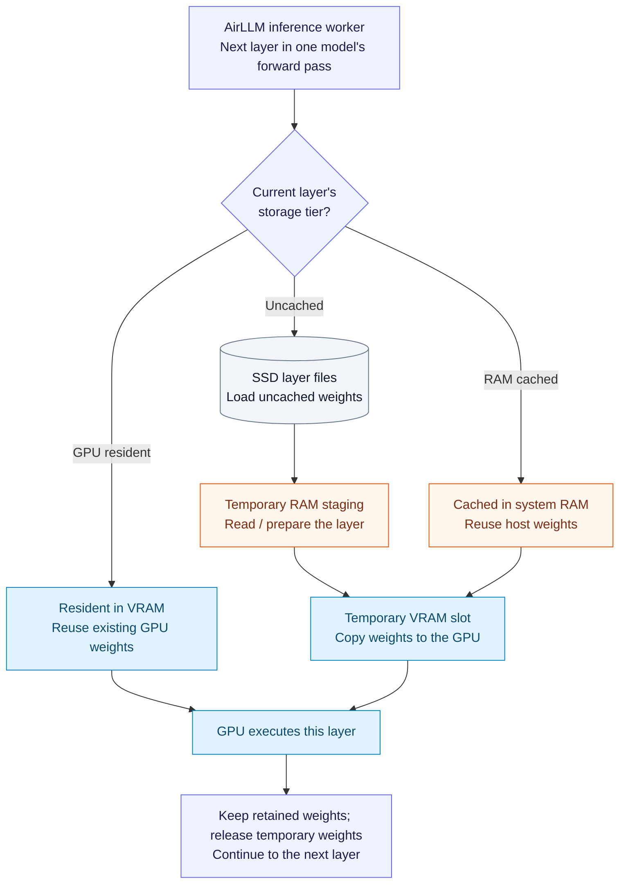
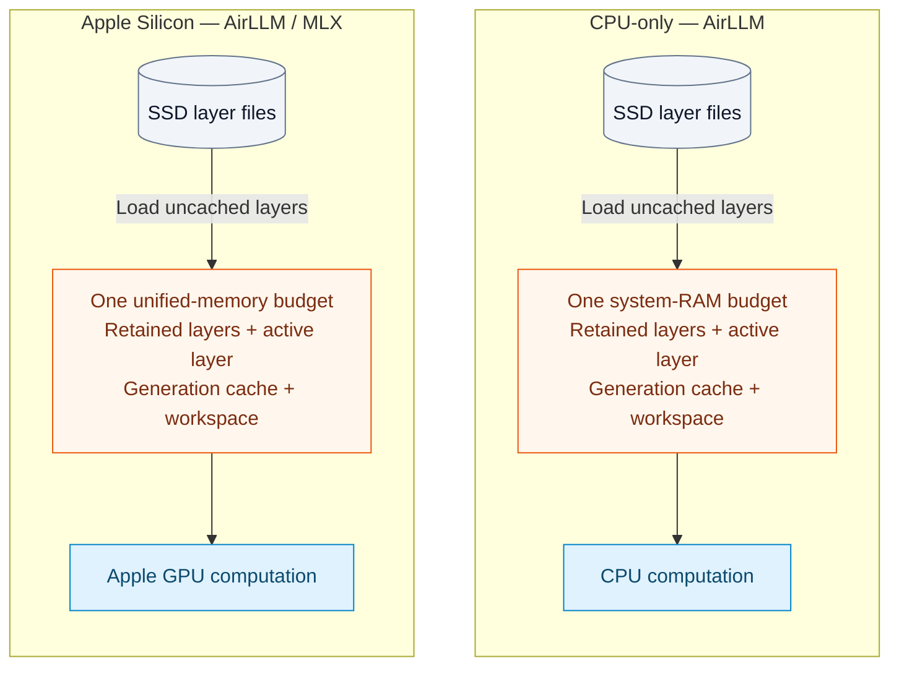

# Adaptive memory and hardware support with AirLLM

[Ideas index](README.md) · [App architecture](local-architecture.md) · [Existing benchmark results](airllm-tests/analysis-report.md)

**Design proposal — September 17, 2026.** This proposal defines an AirLLM-based inference architecture for a fully local desktop application that analyzes and simplifies privacy policies. It aims to reduce repeated model-loading overhead by retaining selected layers in GPU or system memory while streaming the remaining layers from SSD. The adaptive placement policy has not yet been implemented or benchmarked.

The provisional hardware target is desktop and laptop computers with **8–12 GB of total system or unified memory**. The application must leave capacity for the operating system, UI, and other applications. Dedicated GPU VRAM is an additional, separately budgeted resource where present. Minimum supported specifications will be established through testing.

## 1. One model, with weights stored across memory tiers

The model's saved files stay on SSD. During inference, working copies of its weights can occupy several tiers:

| Tier on a computer with a dedicated GPU | Proposed behavior | What it saves |
| --- | --- | --- |
| **Resident VRAM** | Keep selected layers on the GPU across forward passes and requests, while the model is active. | Repeated layer loads and host-to-GPU transfers. |
| **RAM cache** | Keep additional layers in system RAM; copy each to temporary GPU space when needed. | Repeated file loading for those layers. |
| **SSD-backed layers** | Use AirLLM to load uncached layers through RAM into temporary GPU space; release temporary weights after execution. | The need to hold the whole model in RAM or VRAM. |

All tiers contain parts of **the same model**. A single inference worker coordinates layer loading and execution in the model's normal order. In the dedicated-GPU configuration, RAM-cached and SSD-backed layers are transferred to the GPU for computation.

### Layer loading and execution

The three branches below are alternative sources for the **current layer's weights**. Solid arrows show the loading/execution path. Blue nodes use VRAM; orange nodes use system RAM; the gray node is SSD storage. The same layer-selection process repeats as inference advances.



The planner reserves capacity for the temporary VRAM slot, generation cache, and computation workspace **before** assigning resident layers. A configuration is feasible only if its active layer and required workspace fit. OS file caching may satisfy a layer-file load from RAM, so file-loading activity must be distinguished from physical SSD reads when measuring performance.

## 2. Execution backends and memory architectures

AirLLM manages inference on every supported execution path. CUDA, MLX, and CPU execution provide the underlying computation, while VRAM and RAM provide storage. Hardware selection must identify both a usable execution backend and its memory architecture.

| Environment to validate | AirLLM execution path | Memory planning |
| --- | --- | --- |
| Windows/Linux with a compatible NVIDIA GPU | AirLLM with PyTorch/CUDA. | Separate VRAM and host-RAM budgets, used concurrently. |
| Apple Silicon macOS | AirLLM's separate MLX implementation. | One shared physical-memory budget. |
| Supported CPU-only environments | AirLLM CPU execution with a validated model and numerical precision. | System RAM for retained weights, staging, caches, and computation. |
| Other GPUs | Additional AirLLM/backend combinations only after validation. | Based on the actual memory architecture; GPU detection alone is insufficient. |

AirLLM documents CPU inference and Apple Silicon support. Its platform dispatcher selects a separate Llama-style MLX class on macOS. Each packaged environment therefore requires validation of the model, execution precision, compression options, and fallback behavior; results from one backend cannot establish compatibility with another. [AirLLM documentation](https://github.com/lyogavin/airllm), [platform dispatcher](https://github.com/lyogavin/airllm/blob/be982a847bf44d6650d692e78272b5b4131dac9e/air_llm/airllm/auto_model.py).

### Unified-memory and CPU variants

The Apple Silicon and CPU-only configurations each use a single physical-memory budget. AirLLM loads uncached layers from SSD into the memory used by the selected processor.



Apple's CPU and GPU access the same physical memory pool. The planner accounts for their combined memory footprint under one shared limit, while respecting backend allocation constraints. CPU-only execution uses system RAM for both retained weights and computation. [MLX unified-memory documentation](https://ml-explore.github.io/mlx/build/html/usage/unified_memory.html).

## 3. Hardware detection and compatibility validation

Hardware detection is organized by supported environment family. A common probe reads OS/architecture, total and available system RAM, and free space on the model-cache volume. Backend-specific probes establish whether CUDA or the Apple path is usable, identify the device, and obtain relevant memory information. This separates platform-specific checks from the shared placement policy.

System-memory planning uses available memory, which accounts for reclaimable OS caches. PyTorch exposes global free/total CUDA memory. These measurements describe current capacity; other applications can change availability after a probe. [psutil memory documentation](https://psutil.readthedocs.io/stable/#psutil.virtual_memory), [PyTorch GPU memory query](https://docs.pytorch.org/docs/2.8/generated/torch.cuda.memory.mem_get_info.html).

Routine startup must not require a separate model-generation test. AirLLM can incur substantial loading and execution time even for a short prompt, so synthetic inference checks should not delay every launch or repeat work before a useful request.

The proposed startup and request sequence is:

1. Identify the platform and installed, functional backends.
2. Filter the supplied local model profiles for compatible model architecture, backend, precision, and compression.
3. Reuse relevant compatibility records and the selected profile's validated workload limits.
4. Defer model loading until inference is requested; initialize the selected runtime and refresh memory budgets before loading.
5. Execute the user's requested task with memory/error monitoring. Record successful execution for that configuration without adding a separate test prompt.

Validation is divided between development testing and runtime checks:

| When | Validation behavior |
| --- | --- |
| Development and release testing | Test supported model/backend profiles at representative and maximum permitted input/output lengths; establish correctness, memory requirements, and latency. |
| Every launch | Query platform/backend availability and local profile metadata. No synthetic generation or full benchmark. |
| Before each inference request | Refresh available memory and check the request against conservative profile limits. |
| First use or a relevant configuration change | Monitor the first real request and record its outcome. A separate diagnostic run is optional and explicitly initiated. |
| Troubleshooting | Offer a cancellable diagnostic generation with a visible progress state and bounded timeout. |

Compatibility records identify the model/tokenizer, AirLLM and dependency versions, backend/device, driver or OS version where relevant, precision/compression, and placement-policy version. Relevant changes invalidate the record but do not automatically trigger a hidden generation test. A successful short request establishes basic execution only; it does not validate longer inputs or reserve memory for future requests.

An explicit diagnostic can use a short fixed prompt and a two-to-four-token output limit to exercise prompt processing and subsequent token generation. Model preparation is a separate operation, and diagnostic duration depends on the actual configuration. Numerical output need not match an exact phrase; answer quality requires separate evaluation.

Missing drivers, incompatible dependencies, unavailable memory metrics, and failed probes require explicit handling. Unsupported combinations are excluded from automatic selection; a tested CPU configuration can provide a fallback where supported. A missing model file or unsupported model architecture must be reported directly rather than treated as a reason to switch devices.

## 4. Percentage caps plus absolute reserves

Each memory pool has a configurable percentage cap and an absolute reserve. For example, **90% of VRAM and 50% of system RAM** could be evaluated as candidate caps on a dedicated-GPU system. These values are illustrative; default limits require validation. The application allocates only the memory needed by the selected configuration.

For a memory pool, a conceptual initial budget is:

```text
reserve = max(minimum_absolute_reserve, reserve_fraction × total_memory)

additional_budget = max(0, min(
    configured_fraction × total_memory − memory_already_owned_by_app,
    currently_available_memory − reserve
))

retained_weight_budget = max(0,
    additional_budget − estimated_peak_additional_working_memory
)
```

The application controller calculates these budgets; AirLLM does not expose this policy as configuration arguments. The percentage caps the application's total footprint in a pool, including memory it already owns. Available memory is measured after runtime initialization and already excludes those allocations. Existing and additional allocations must be estimated consistently, including allocator reservations and relevant backend overhead. Host and device budgets are evaluated together on a dedicated-GPU system; unified-memory systems use one combined physical-memory budget.

The working-memory estimate includes the active streamed layer, any prefetched layer, host staging, decompression or conversion, the **KV cache** (attention state retained for the input and generated text), temporary activations, and runtime/allocator overhead. Fixed resident components, such as shared embeddings, also count toward the budget where required by the model. Model preparation and initial loading have separate peaks.

### Illustrative dedicated-GPU calculation

Suppose an 8 GiB GPU has 6 GiB free after runtime initialization, with 0.5 GiB already owned by the app. With a 90% capacity cap and a 1 GiB reserve:

```text
Application's additional GPU budget = min(7.2 − 0.5, 6 − 1) = 5 GiB
If additional execution/loading space needs 1.5 GiB:
    retained GPU weights can use at most 3.5 GiB
```

The 1 GiB and 1.5 GiB values are illustrative, not measurements or recommendations. A compatible layer is admitted only if its actual representation fits; layers need not be equal in size. System-RAM caching receives its own calculation after accounting for staging and other host allocations.

The controller rechecks resources between requests. When memory pressure rises, it releases optional cached weights and selects a more conservative validated plan. Further reductions may require a shorter passage or smaller compatible model, with changes visible to the user. Allocation failures trigger bounded retries and a clear failure state if the minimum working set cannot fit. A planning budget does not itself enforce a cross-platform hard memory limit.

## 5. Current capabilities and proposed extensions

The compatibility assessment references AirLLM revision `be982a847bf44d6650d692e78272b5b4131dac9e`. This revision is specified in the Qwen3-14B benchmark setup notes, although the result files do not record the executed checkout commit. Source findings and measured results are therefore reported separately.

| Capability | Status |
| --- | --- |
| Load a model through AirLLM and stream layers from local files | Existing AirLLM behavior; measured in the Windows Qwen3-14B benchmark summarized in Section 7. |
| Keep arbitrary selected decoder layers resident on GPU | Proposed extension to AirLLM's loading/release behavior. |
| Retain a bounded reusable cache of additional layers in host RAM | Proposed extension integrated with layer loading and prefetch. |
| Automatically calculate budgets and choose a placement | Application policy to implement and validate. |
| Apply the same policy to the separate Mac execution path | Separate integration and compatibility work. |

The inspected normal streaming hooks load weights before a layer runs and release them afterward. Architecture-specific resident modules already exist, but they do not provide a general percentage-based placement policy for decoder blocks. The extension would coordinate resident-layer selection, cache lookup, prefetch, and eviction within **one inference worker**. [AirLLM loading/release hooks](https://github.com/lyogavin/airllm/blob/be982a847bf44d6650d692e78272b5b4131dac9e/air_llm/airllm/airllm_base.py#L681).

The initial implementation should use a stable retained set for each admitted workload. Dense models revisit their layers for every generated token, so repeatedly replacing retained layers can waste transfers. Host-cache evaluation must account for OS file caching and duplicate copies. Placement changes preserve the selected model and execution order; model or precision changes require separate quality evaluation.

The Qwen3-14B benchmark evaluates separate inference configurations: `hybrid` and `hybrid4bit` use **Transformers/Accelerate**, while `airllm` uses AirLLM. It does not implement the adaptive AirLLM residency policy described in this proposal. [Benchmark implementation](airllm-tests/qwen3_14b_test.py).

## 6. Model selection and automatic configuration

The interface offers a curated list of **available local model profiles**. A profile records the model/tokenizer revision, compatible AirLLM/backend versions, weight format, execution precision, supported compression settings, and tested context limits. An **Auto** configuration selects tested settings, with advanced controls for memory caps and passage/output limits.

Changes to model, compression, or context allowance trigger placement recalculation and appropriate validation. The interface explains unavailable combinations and distinguishes measured memory/latency estimates from untested configurations. Automatic selection aims to provide validated performance within resource limits; percentage rules alone do not establish an optimal allocation.

AirLLM's built-in layer compression and permanently quantized GPU execution have different memory behavior. The referenced compression utilities expand compressed layers for execution and explicitly use CUDA. Memory estimates must use the execution representation, and compression options must be validated for each backend. [AirLLM compression utilities](https://github.com/lyogavin/airllm/blob/be982a847bf44d6650d692e78272b5b4131dac9e/air_llm/airllm/utils.py#L81).

Installation, first launch, and all application features must work without an internet connection. Each platform-specific bundle includes dependencies, model assets, and any required prepared layers. Model selection and fallback use only locally supplied assets. Prepared layers can reduce first-run work, provided their format matches the packaged execution path.

## 7. Benchmark evidence and validation plan

The Windows Qwen3-14B experiment recorded approximately **1.47 GiB peak allocated VRAM** and **394.44 seconds for 32 generated tokens** on its second AirLLM request. The test used a 23-token prompt on an RTX 4090 PC with 64 GB system RAM. Peak host RAM was not recorded, and disk/transfer behavior was not profiled. These results establish a low-VRAM baseline for that workload. Operation within the 8–12 GB system-memory target and acceptable response times remain unverified. [Full benchmark analysis](airllm-tests/analysis-report.md).

Before loading, the run reported **47.96 GiB available system RAM** and **22.50 GiB free VRAM**. Its small GPU working set therefore reflects the configured streaming strategy despite substantial available capacity. More memory does not automatically enable layer retention; the proposed extension must use that capacity explicitly and demonstrate a measured benefit. [Raw AirLLM results](airllm-tests/results/qwen_airllm.json).

The benchmark also includes full-GPU quantized inference as a performance comparison. This proposal evaluates whether selective residency and host caching can improve AirLLM performance while preserving its ability to stream models that exceed available memory.

| Experiment | What it should establish |
| --- | --- |
| Stock AirLLM on each proposed platform | Correctness and basic compatibility for a chosen model, precision, and compression profile. |
| GPU residency extension first | Whether keeping a fixed subset of layers in VRAM reduces latency, with enough room for the remaining streamed layers. |
| Bounded host cache next | Whether explicit RAM retention improves on ordinary file caching within the same total memory budget. |
| Modest-memory and realistic-context runs | Peak loading/generation RAM and VRAM, system memory pressure, time to first token, and complete-response latency at intended input/output limits. |
| Mac and CPU adaptation | Correct behavior and a useful memory/performance tradeoff for their separate execution paths. |
| Clean offline installation and preparation | First-launch RAM/disk peaks and complete operation with no existing cache or network access. |

Placement comparisons should use identical policy passages, model revisions, prompts, and generation settings. Evaluation should cover paraphrasing, simplification, and category accuracy alongside timing. VRAM-constrained RTX 4090 experiments can test allocation behavior, but smaller GPUs require separate performance measurements. Adding residency and host caching separately to a stock AirLLM baseline allows each extension's costs and benefits to be measured.
