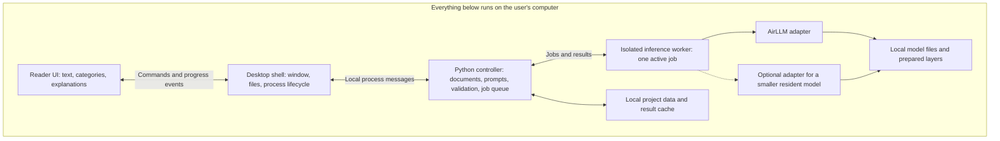

# Local architecture and technology options

[Ideas index](README.md) · [Interface and feature ideas](feature-design.md)

**September 17 update:** the project will retain AirLLM across supported hardware. See [Adaptive memory and hardware support with AirLLM](airllm-memory-and-hardware.md) for the proposed VRAM/RAM/SSD residency policy, diagrams, and memory targets. The alternative-runtime discussion below records earlier exploration; it is not the current implementation direction.

The app could be a desktop privacy-policy reader with a web-based interface and a Python inference worker. **Python owns the language-processing pipeline; the interface stays responsive while it runs.** AirLLM would be a first-class inference option from the initial prototype. Exact models, hardware requirements, and the final desktop framework remain decisions to test.

**Fixed requirement: the entire app must install, launch for the first time, and perform every feature without an internet connection.** Supply the application, model files, dependencies, and UI assets as a complete offline package, which can be transferred on local media. No account, activation, remote inference, online setup, or automatic download is part of this design.

“Installing locally” means placing the app and its files on the user's computer. “Web-based interface” describes the UI technology: HTML, CSS, and JavaScript can all be bundled locally. If a prototype uses `localhost`, its browser and Python service communicate within that same computer; neither internet access nor a connection to another computer is required. The desktop process-message option also avoids the need for a local HTTP listener.

## What to keep from the thesis

Keep sentence-level multi-label classification, the category legend, the original text, and the three rewriting actions. Retain the separation between presentation and inference. Reconsider the deployment and model-selection details for one person's computer.

The thesis uses HTML/CSS/JavaScript, Django, WebSockets, and an inference engine; its diagram separates selected-model classification from baseline-model rewriting. It does not establish that rewriting technically requires classification, or that all variants must fit in GPU memory together. This app can use one instruction model for both tasks initially, with different prompts, and allow separate models later. These are changes proposed here, not a reconstruction of the thesis. [Thesis architecture notes](../docs/thesis-chapters-4-5/chapter-5/system-architecture.md).

Assume English pasted text for the first version, with section-aware processing that can grow to complete policies. Treat a supplied summary as the full extent of the available evidence: the app cannot recover exceptions omitted before the user pasted it.

## Language and application options

| Option | Languages and responsibilities | Why consider it | Main tradeoff |
| --- | --- | --- | --- |
| **Tauri desktop + web UI + Python worker** | TypeScript for the reader; Rust for a small desktop bridge; Python for AirLLM, prompts, and processing. | My preferred direction for an installable reading app. Tauri uses the system webview and supports bundled helper executables. | Three languages/toolchains, and Python/ML dependencies still need platform-specific offline packaging. A small desktop shell does not make bundled model files small. |
| **Local browser + Python service** | TypeScript UI; Python/FastAPI controller; separate inference worker. | Good first working prototype if web/Python development is familiar. The entire app can run on localhost. | Requires managing a background service and local HTTP access; an installer or launcher is still needed for a smooth nondeveloper experience. |
| **Electron desktop + Python worker** | TypeScript/JavaScript UI and Node.js desktop controller; Python inference. | Useful if avoiding Rust reduces project effort or consistent browser rendering matters. | Electron carries a Chromium-based process architecture; shell resource use and packaging deserve comparison on target machines. |
| **PySide6 desktop + Python worker** | Python for both application and inference, with Qt widgets or QML for the interface. | Strong candidate for a Python-focused team and fewer language boundaries. | Rich document annotations and the desired visual design need a Qt-specific implementation; fewer languages does not automatically mean less UI work. |

Framework facts: [Tauri overview](https://v2.tauri.app/start/), [Tauri sidecars](https://v2.tauri.app/develop/sidecar/), [FastAPI features](https://fastapi.tiangolo.com/features/), [Electron process model](https://www.electronjs.org/docs/latest/tutorial/process-model), and [Qt for Python](https://doc.qt.io/qtforpython-6/). The preferences and tradeoffs above are design judgments, not measured comparisons.

For the web UI, React with TypeScript is a reasonable default; Svelte is another choice if preferred by the developer. The important boundary is that UI components consume typed document, annotation, and job data instead of constructing model prompts themselves. Python is the practical inference language because AirLLM exposes a Python API. Rust or Node.js should mostly handle window lifecycle, local files, and communication with Python.

Django remains viable if already familiar, but this single-user workflow does not currently need accounts, a remote database, or its broader web application structure. FastAPI is only needed if choosing HTTP; a desktop process bridge can avoid an HTTP service entirely.

## Proposed component layout

The Python controller handles document segmentation, task preparation, result validation, and persistence. An inference child process handles heavy model work, so the controller can still accept cancellation and report status. This need not become a distributed system: one controller, one worker, and an in-process queue are enough initially.

For Tauri, use a small structured message protocol over the helper process's stdin/stdout, with diagnostics on stderr. Capture library prints as diagnostics too, so they cannot corrupt protocol messages. Tauri documents both sidecar spawning and process I/O. The app must implement message framing, request IDs, errors, and shutdown itself. Bundle the helper for each supported OS/architecture. [Sidecar documentation](https://v2.tauri.app/develop/sidecar/).

For a browser prototype, replace the desktop bridge with local HTTP commands and server-sent progress events, or WebSockets if bidirectional messaging proves useful. Transport choice will not solve model latency. Keep the processing code independent of either transport so the prototype can be packaged later.

## AirLLM's role and practical boundaries

AirLLM is an inference library, not the app's document processor or job server. Its documented approach loads model layers as needed to reduce accelerator-memory requirements, and prepares layer files on disk. The README supports local model paths and describes optional weight compression. This makes it relevant when a desired model exceeds available accelerator memory, but storage and loading costs remain. [AirLLM repository](https://github.com/lyogavin/airllm).

The architecture should expose an `AirLLMAdapter` that loads a tested model profile and returns generated text. The app supplies the tokenizer-aware prompts, classification schema, retry limits, source links, and progress UI. Keep those responsibilities outside AirLLM so the same feature behavior survives a runtime or model change.

**Plan for AirLLM use without promising large-model interactivity.** Start by running a modest instruction model through it. Compare a larger compatible model only if it improves classification or rewrite quality enough to justify the wait. A “70B on 4 GB GPU” claim does not establish a 4 GB total-system requirement, sufficient disk capacity, or an acceptable response time.

As a rough storage calculation, 70 billion weights at two bytes each are about **140 GB in decimal units for weights alone**. That arithmetic excludes working files, tokenizers, runtime memory, and preparation copies; compressed weights change it. Measure peak preparation disk use, RAM, accelerator memory, and warm/cold latency for the actual chosen artifact. Do not derive a device support promise from parameter count alone.

If interactive latency is poor, preserve AirLLM as an explicit larger-model analysis option and benchmark a smaller model that stays resident for everyday actions. Candidate additional runtimes are [llama.cpp](https://github.com/ggml-org/llama.cpp), which documents several hardware backends, and [MLX-LM](https://github.com/ml-explore/mlx-lm) for an Apple Silicon-focused experiment. These would require separate compatible model artifacts/adapters; they are not drop-in consumers of AirLLM's prepared layer cache. This is a proposed contingency, not a reason to implement several engines before testing one.

### Compatibility findings to test early

Source inspection at AirLLM commit `8c16e64b08240e7e3c3596d4e5c98897e0efd646` revealed these boundaries. They are observations about that source revision, not successful inference tests or a recommendation to install an untested development build.

| Target | What this means for the prototype |
| --- | --- |
| NVIDIA/CUDA | The generic implementation delegates generation to Transformers while managing layer movement. Test the specific model, context length, and compression setting together. [Generation and loading implementation](https://github.com/lyogavin/airllm/blob/8c16e64b08240e7e3c3596d4e5c98897e0efd646/air_llm/airllm/airllm_base.py). |
| Apple Silicon/macOS | `AutoModel` selects a separate Llama-style MLX implementation on macOS. Broad repository model-support claims therefore should not be assumed to apply to this path. Normalize its output shape in the adapter and test streaming/cancellation separately. [Platform dispatch](https://github.com/lyogavin/airllm/blob/8c16e64b08240e7e3c3596d4e5c98897e0efd646/air_llm/airllm/auto_model.py), [MLX implementation](https://github.com/lyogavin/airllm/blob/8c16e64b08240e7e3c3596d4e5c98897e0efd646/air_llm/airllm/airllm_llama_mlx.py). |
| CPU-only | Test this as its own configuration, initially without compression: reviewed compression utilities explicitly use CUDA. Do not assume a CPU option also makes GPU-specific compression portable. [Compression utilities](https://github.com/lyogavin/airllm/blob/8c16e64b08240e7e3c3596d4e5c98897e0efd646/air_llm/airllm/utils.py#L89-L111). |

Pin the combination that passes: AirLLM revision, Python, Torch, Transformers, MLX where applicable, model/tokenizer revision, and compression options. The package allows broad dependency ranges; those ranges do not prove every combination works. The installer and device support matrix should follow this experiment. [Package dependencies](https://github.com/lyogavin/airllm/blob/8c16e64b08240e7e3c3596d4e5c98897e0efd646/air_llm/setup.py).

The adapter should report whether token streaming and cooperative cancellation are actually supported. Requesting JSON in a prompt is also not a schema guarantee: validate results in the controller, allow a bounded repair attempt, and surface unresolved outputs instead of manufacturing labels.

## Model lifecycle and a responsive experience

- **One active generation job initially.** Queue whole-document analysis; prioritize a newly requested passage rewrite between classification batches. Do not assume simultaneous classification and rewriting will fit comfortably on a laptop.
- **Load lazily and reuse.** Keep the selected model available across requests when resources allow. Release it before switching to a different model; do not copy the thesis's three-variant menu as a requirement to preload three models.
- **Use model profiles.** Record local artifact/revision, runtime version, tokenizer and chat template, supported tasks, context budget, and tested device configuration. A runtime is how weights execute; a model is what produces the labels or explanation.
- **Keep visible progress honest.** Distinguish preparing/loading, queued, processing a known number of passages, completed, and failed. Show token streaming only if the adapter supports it. Otherwise publish completed chunks and retain a responsive Cancel button.
- **Cancel at supported boundaries.** Stop scheduling new chunks immediately. If a generation call cannot be interrupted cooperatively, terminate and restart the inference child. Preserve completed results and allow model reload time afterward.
- **Cache deterministic task inputs.** Key results by document revision, selected source IDs, surrounding context, model artifact, prompt/taxonomy version, and generation settings. Changing category colors or filters needs no inference.

The controller should check prompt size with the actual tokenizer, reserve output capacity, and split on paragraph/section boundaries. Include neighboring sentences and relevant definitions where possible. Avoid silently truncating a policy. Long-document support needs an explicit strategy for cross-references; a sentence near the end may depend on an exception near the beginning.

## Local data and offline operation

Store the original text and its revision separately from derived annotations and rewrites. A small SQLite database is a reasonable project store for documents, sentence IDs, jobs, cached outputs, and model metadata; model weights live in their own directory. A session-only mode can avoid persisting policy text by default, with an explicit local Save action. Logs can record timing and error codes without recording the policy or full prompts.

Deliver a **complete offline installer or portable bundle** for each supported platform. Include the Python runtime and packages, model weights, configuration, tokenizer, required model code, fonts, scripts, and category data. Any required platform runtime must already be supplied by the supported OS or included in an offline-installable form; an installer that fetches missing dependencies would fail the requirement. Large model files may be a companion folder on the same local media instead of being embedded in one executable.

Model setup means validating and preparing those supplied files locally. AirLLM layer preparation may take time and disk space, but should need no internet access. Model selection lists available local profiles. Missing files produce a clear local repair/import message, with no download fallback. Additional models and app updates can be delivered as offline packages too; the app performs no background update checks or telemetry.

Use complete local model snapshots and offline settings for the model stack. Set `HF_HUB_OFFLINE=1` and `HF_HUB_DISABLE_TELEMETRY=1` before importing Hub-dependent libraries. Offline mode disables Hub HTTP calls and missing cached files produce errors; it does not independently disable networking in every dependency. [Hub environment-variable reference](https://huggingface.co/docs/huggingface_hub/package_reference/environment_variables#hfhuboffline).

Verify this on a clean supported machine with external networking blocked **before installation**, no pre-existing model/package caches, and only the supplied offline bundle. Exercise installation, first launch, model preparation, classification, all four actions, and restart. Missing-file handling must also work offline. A successful run after an online setup would not establish this requirement.

Validate model configuration, tokenizer, weights, and any required model code when building and importing the offline package. AirLLM's loading paths can invoke Hub handling when local files are incomplete, and its configuration dispatch enables `trust_remote_code`. Use a curated, reviewed local model bundle and ensure these paths cannot fetch missing files. These are library behaviors to control, not reasons the application needs an internet connection. [Local loading logic](https://github.com/lyogavin/airllm/blob/8c16e64b08240e7e3c3596d4e5c98897e0efd646/air_llm/airllm/utils.py#L793-L870), [configuration dispatch](https://github.com/lyogavin/airllm/blob/8c16e64b08240e7e3c3596d4e5c98897e0efd646/air_llm/airllm/auto_model.py#L38-L43).

If using a local HTTP service, bind to loopback and restrict requests to the app using a per-launch token and origin/host checks. Ship UI assets locally. Treat imported policy text as data: it cannot issue commands or enable network tools, and generated content should be rendered as text or sanitized markup. These choices make the fully local requirement concrete.

## A useful first model experiment

Use a small fixed set of privacy-policy passages, including multiple labels, cross-sentence references, lists, negation, and retention exceptions. Try one modest instruction model in roughly the 3–8B range as a candidate, not a guaranteed hardware fit. Use separate classification and rewrite prompts; fine-tuning can be a later experiment if prompt-based quality is inadequate.

| Question | What to record |
| --- | --- |
| Can a user install and use every feature entirely offline? | OS, hardware, exact model/runtime revisions, offline bundle size, preparation time, and clean offline installation/first-launch/action results without pre-existing caches. |
| Is it responsive enough? | Cold load, first useful result, total passage rewrite time, sentences classified per second, cancellation delay, peak RAM/VRAM/disk. |
| Are category labels useful? | Per-category precision/recall, micro/macro F1, exact label-set agreement, and malformed/missing outputs. |
| Are rewrites faithful and readable? | Human review of preserved facts, conditions, uncertainty, and clarity for each intended audience. |

For a larger evaluation or fine-tuning exercise, split by original policy so related passages do not leak between training and testing. Document how annotation units map to the app's sentences; do not assume the source dataset already matches the UI segmentation. Use the thesis's category names as a starting vocabulary, then consult the dataset annotation guide before treating label definitions as settled.

The thesis's generation-throughput results and classification scores are useful context, but cannot be transferred to this hardware/runtime or treated as evidence of rewrite faithfulness. Its notes flag both evaluation-counting and dataset-split ambiguities. [Performance limitations](../docs/thesis-chapters-4-5/chapter-5/evaluation-and-future-work.md), [classification limitations](../docs/thesis-chapters-4-5/chapter-4/results-and-limitations.md).

Ship the paste → classify → highlight → rewrite interaction first. PDF/DOCX extraction, OCR, multilingual support, local speech, comparison between policy versions, and document questions are separate extensions. A vector database or retrieval framework is unnecessary for the initial selection-based actions; direct source selection and section context give a simpler starting point.
